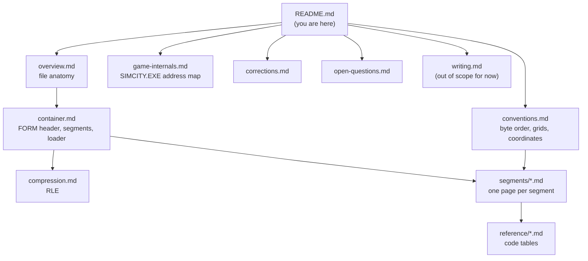

# The SimCity 2000 `.sc2` file format

These pages describe the city files of **SimCity 2000 for Windows 95** (`SIMCITY.EXE`), down to the byte, precisely enough to write a complete reader from them. They cover the city files (`.sc2`) and the scenario files (`.scn`), which use the same format with a few extra segments.

Every rule here comes from the game's own load code (decompiled with Ghidra), from tallies over a corpus of real files, or from both. Each page says which.

> **Scope.** For now these pages cover **reading**. Rules for writing a file the game accepts are collected separately in [writing.md](writing.md) and are not complete yet.

## Where to start

| If you want to… | Read |
|---|---|
| Get the big picture of what is in a file | [overview.md](overview.md) |
| Write a parser | [container.md](container.md), then [compression.md](compression.md), then the segment pages |
| Know how numbers, coordinates and grids work | [conventions.md](conventions.md) |
| Check a claim against the game | [game-internals.md](game-internals.md) |
| See where these pages disagree with older documents | [corrections.md](corrections.md) |
| See what is still not understood | [open-questions.md](open-questions.md) |

## Page map



### Pages

| Page | Contents | Status |
|---|---|---|
| [overview.md](overview.md) | Every segment, its size and purpose, in one table | done |
| [conventions.md](conventions.md) | Byte order, integer types, the 128×128 map, minimap grids, the compass, [orientation](conventions.md#orientation) and how to normalise a city to compass 0 | done |
| [container.md](container.md) | The IFF `FORM` header, segment headers, how the game walks and dispatches segments | done |
| [compression.md](compression.md) | The run-length encoding, exactly as the game decodes it | done |
| **Map layers:** [altm.md](segments/altm.md), [xter.md](segments/xter.md), [xbld.md](segments/xbld.md), [xzon.md](segments/xzon.md), [xund.md](segments/xund.md), [xbit.md](segments/xbit.md) | Altitude and water, terrain shapes, buildings and their footprints, zones and corner bits, pipes and subways, per-tile flags | done |
| **Code tables:** [tile-codes-xbld.md](reference/tile-codes-xbld.md), [terrain-codes-xter.md](reference/terrain-codes-xter.md), [underground-codes-xund.md](reference/underground-codes-xund.md) | Every XBLD, XTER and XUND code | done |
| **Text:** [xtxt.md](segments/xtxt.md), [xlab.md](segments/xlab.md), [cnam.md](segments/cnam.md) | What each tile's text value points to (sign, microsim, moving object, connection), the 256 label texts, the city name | done |
| **Statistics:** [minimaps.md](segments/minimaps.md), [xgrp.md](segments/xgrp.md) | The eight overlays (traffic, pollution, land value, crime, police, fire, density, growth) and the graph history | done |
| **Code tables:** [text-codes-xtxt.md](reference/text-codes-xtxt.md) | Every XTXT value | done |
| Other segment pages | MISC, XMIC, XTHG, scenario segments | planned |
| Other code tables | Thing ids | planned |
| `cross-segment.md`, `implementing-a-reader.md` | How segments relate; a step-by-step parser recipe | planned |
| [game-internals.md](game-internals.md) | Functions and variables in `SIMCITY.EXE` that these pages cite | growing |
| [corrections.md](corrections.md) | Where we differ from the older public documents, and why | growing |
| [open-questions.md](open-questions.md) | Everything not yet settled | growing |
| [writing.md](writing.md) | Notes for writers, collected along the way | stub |

## How sure is each statement?

Every field and rule carries one of these tags:

| Tag | Meaning |
|---|---|
| **Confirmed (code)** | The game's code reads or uses the value this way. The page names the function. |
| **Verified (data)** | Holds in N of the M files in the corpus. The page gives N/M. |
| **Inferred** | Our best reading; consistent with the evidence but not proven. |
| **Unused** | The game loads it but nothing reads it afterwards. |
| **Unknown** | Not understood yet. Listed in [open-questions.md](open-questions.md). |

When a rule is both, it is tagged **Confirmed (code), Verified (data)**.

## The corpus and the tools

"Verified (data)" numbers come from **114 distinct files** (identical files counted once):

- 96 `.sc2` cities: the ones shipped with the Windows 95 edition, plus cities that players saved with it,
- the 18 `.scn` scenarios shipped with the game.

The game files are not part of this repository. To repeat any tally, point the checker at your own SimCity 2000 folder:

```
py -3 -I docs/sc2-format/tools/sc2check.py "C:\Program Files\Maxis\SimCity 2000"
py -3 -I docs/sc2-format/tools/sc2dump.py  SOMECITY.SC2 [--json]
```

[`tools/sc2dump.py`](tools/sc2dump.py) is the reference decoder: it implements every rule on these pages. [`tools/sc2check.py`](tools/sc2check.py) prints the tallies. [`tools/linkcheck.py`](tools/linkcheck.py) checks that every link in these pages resolves. All three use only the Python standard library.

## Sources

- The game: SimCity 2000 for Windows 95, `SIMCITY.EXE` (32-bit PE, image base `0x400000`). Addresses on these pages refer to this file.
- Older public descriptions, which these pages build on and correct where needed:
  - David Moews, *SimCity 2000 file format* (1995), <https://djm.cc/simcity-2000-info.txt> (MS-DOS version).
  - OpenCity2k, *sc2 file spec*, <https://github.com/OpenCity2k/SC2k-docs>.

No decompiled code is reproduced here. Behaviour is described in our own words, with the address of the function it comes from.
