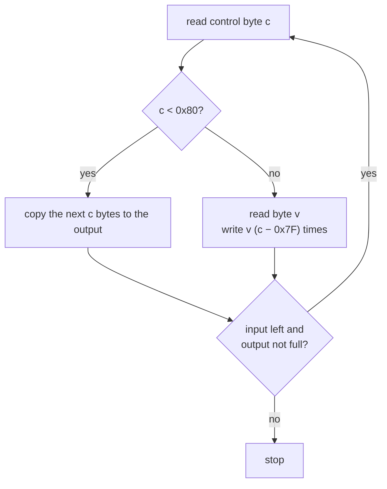

# Compression (run-length encoding)

Nineteen segments are stored run-length encoded (RLE): MISC, XTER, XBLD, XZON, XUND, XTXT, XLAB, XMIC, XTHG, XBIT, XTRF, XPLT, XVAL, XCRM, XPLC, XFIR, XPOP, XROG and XGRP. ALTM, CNAM and the scenario segments are stored raw ([container.md § Segment table](container.md#segment-table)).

The decoder is `0x430dc0` in `SIMCITY.EXE` ([game-internals.md](game-internals.md#city-loading)). The rules below are what it does (**Confirmed (code)**).

## The rule

The compressed body is a sequence of **commands**. Each command starts with a control byte `c`:

| Control byte `c` | Command | Bytes in the command | Output |
|---|---|---|---|
| `0x00` | copy nothing | 1 | nothing |
| `0x01`–`0x7F` | **literal run** | 1 + `c` | the next `c` bytes, unchanged |
| `0x80` | repeat once | 2 | the next byte, once |
| `0x81`–`0xFF` | **repeat run** | 2 | the next byte, `c − 0x7F` times (2 to 128) |

In other words: if the top bit of `c` is clear, copy `c` literal bytes. If it is set, repeat the next byte `(c & 0x7F) + 1` times.



### What the game writes

The game's own files use only part of this range (**Verified (data)**, 114/114 files):

- control bytes `0x00` and `0x80` **never occur**;
- literal runs are at most 127 bytes and repeat runs at most 128.

A decoder must still accept `0x00` and `0x80`, because the game does.

## Worked example

Compressed bytes:

```
03 0A 0B 0C   84 00   01 FF   80 07
```

| Command | Meaning | Output so far |
|---|---|---|
| `03 0A 0B 0C` | literal run of 3 | `0A 0B 0C` |
| `84 00` | repeat `00` 0x84 − 0x7F = 5 times | `0A 0B 0C 00 00 00 00 00` |
| `01 FF` | literal run of 1 | `… 00 FF` |
| `80 07` | repeat `07` once | `… 00 FF 07` |

Result (10 bytes): `0A 0B 0C 00 00 00 00 00 FF 07`.

## Running out of input or space

The decoder is given the stored length and the segment's decoded size ([container.md § Segment table](container.md#segment-table)). It keeps going while **both** input is left **and** the output is not full:

| Situation | What the game does | Confidence |
|---|---|---|
| Input and output end together | Success | **Confirmed (code)**; 114/114 files, every segment |
| Output full, input left over | Shows an error message (**Confirmed (code)**); the load is then abandoned (**Inferred**: Ghidra does not show the decoder's return value clearly) | see left |
| Input ends before the output is full | No error. The rest of the buffer keeps whatever it held before | **Confirmed (code)** |
| A run crosses the end of the output | The run is written in full. The output check only happens between commands, so the game writes past its buffer | **Confirmed (code)** |
| A command crosses the end of the input | The game reads past the segment body | **Confirmed (code)** |

The last three never happen in files the game wrote. A careful reader should treat all of them as errors.

## Reference implementation

Simplified from `decode_rle` in [`tools/sc2dump.py`](tools/sc2dump.py), which also reports the edge cases above:

```python
def decode_rle(body, out_size):
    out = bytearray()
    i = 0
    while i < len(body) and len(out) < out_size:
        c = body[i]
        if c < 0x80:                      # literal run (0 = nothing)
            out += body[i + 1:i + 1 + c]
            i += 1 + c
        else:                             # repeat run (0x80 = once)
            out += bytes([body[i + 1]]) * (c - 0x7F)
            i += 2
    ok = (i == len(body)) and (len(out) == out_size)
    return out, ok
```

## Evidence

| Claim | Code | Data (`sc2check.py --only compression`) |
|---|---|---|
| Command format, including `0x00` and `0x80` | `0x430dc0` | — |
| Exact decoded sizes, no leftover input | `0x430dc0`, sizes from `0x4302e0` | 114/114 |
| `0x00` and `0x80` are never written | — | 114/114 |
| Longest repeat 128, longest literal 127 | — | 114/114 and 105/114 (the other 9 files simply have no 127-byte literal) |
