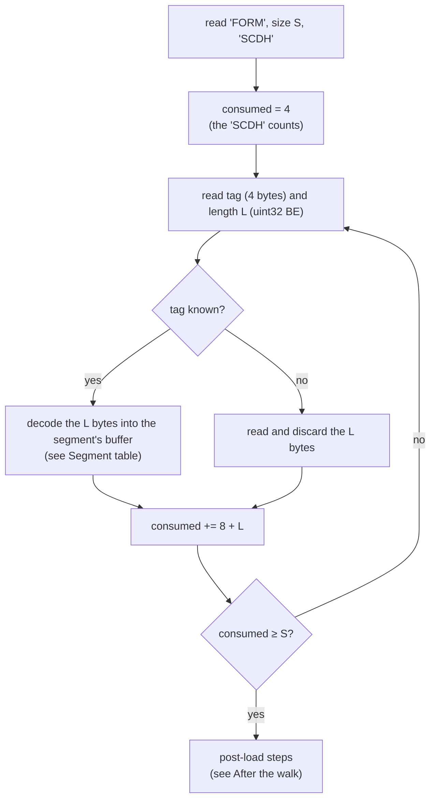

# Container: file header and segments

A `.sc2` or `.scn` file is an IFF-style container: a 12-byte header followed by segments. This page describes the container exactly as the game reads it. The game's city loader is `0x4302e0` ([game-internals.md](game-internals.md#city-loading)).

## At a glance

| | |
|---|---|
| Header | `FORM`, big-endian size, `SCDH` (12 bytes) |
| Segment header | 4-byte tag + big-endian uint32 length (8 bytes) |
| Padding | **none**: odd-length segments are followed directly by the next header |
| Segment order | free; the loader dispatches on the tag |
| Unknown tags | skipped |
| Compression | run-length encoding on most segments ([compression.md](compression.md)) |

## File header

| Offset | Size | Type | Value | Meaning | Confidence |
|---|---|---|---|---|---|
| 0 | 4 | ASCII | `FORM` | IFF container | **Confirmed (code)** `0x431120`, **Verified (data)** 114/114 |
| 4 | 4 | uint32 BE | file size − 8 | Bytes that follow this field; bounds the segment walk | **Confirmed (code)**, **Verified (data)** 114/114 |
| 8 | 4 | ASCII | `SCDH` | IFF type: SimCity 2000 city | **Confirmed (code)**, **Verified (data)** 114/114 |

If the first four bytes are not `FORM`, the game does not treat the file as a SimCity 2000 city. A file of exactly **27 248** bytes is passed to a different import routine (`0x482850`), which is the size of a SimCity Classic city (**Inferred**). Anything else is rejected with an error message. If `FORM` is present but the type is not `SCDH`, the file is rejected.

## Segment header

| Offset | Size | Type | Meaning |
|---|---|---|---|
| 0 | 4 | ASCII | Tag, such as `MISC` or `XBLD` |
| 4 | 4 | uint32 BE | **Stored** length: the number of bytes that follow, i.e. the compressed size for compressed segments |
| 8 | length | bytes | Segment body |

**Confirmed (code)**: the loader reads the tag and the length, then hands exactly `length` bytes to the segment's decoder. **Verified (data)**: walking with these rules covers every file in the corpus exactly, with no bytes left over (114/114).

There is **no padding**. Standard IFF pads odd-length chunks to an even length; SimCity 2000 does not. 114/114 files contain at least one odd-length segment (64 of them an odd-length MISC), and each is followed directly by the next header.

## Walking the segments

The loader counts bytes against the `FORM` size, not against the end of the file:



The same in pseudocode:

```
expect bytes[0..4]  == "FORM"
S = u32be(bytes[4..8])
expect bytes[8..12] == "SCDH"
pos = 12; consumed = 4
while consumed < S:
    tag = bytes[pos..pos+4];  L = u32be(bytes[pos+4..pos+8])
    body = bytes[pos+8 .. pos+8+L]
    handle(tag, body)
    pos += 8 + L;  consumed += 8 + L
```

Bytes after the walk ends (beyond `8 + S`) are never read. The corpus has none (**Verified (data)** 114/114).

## Segment table

What the city loader does with each tag (**Confirmed (code)**, `0x4302e0`). The *decoded size* is the size of the game's buffer. Compressed segments are decoded until either the input or the buffer runs out ([compression.md § Running out of input or space](compression.md#running-out-of-input-or-space)).

| Tag | Storage | Decoded size | Fix-up after decoding | Game buffer |
|---|---|---|---|---|
| `MISC` | RLE | 4800 | 32-bit swap; version check; values copied into variables (`0x431330`) | temporary |
| `ALTM` | raw | `length` bytes (32768 in practice) | 16-bit swap (`0x42a880`) | `0x4cae10` |
| `XTER` | RLE | 16384 | — | `0x4c9f58` |
| `XBLD` | RLE | 16384 | — | `0x4cc4f0` |
| `XZON` | RLE | 16384 | — | `0x4ca1f0` |
| `XUND` | RLE | 16384 | — | `0x4cb1d0` |
| `XTXT` | RLE | 16384 | — | `0x4ca600` |
| `XLAB` | RLE | 6400 | converted after the walk | `0x4ca198` |
| `XMIC` | RLE | 1200 | three 16-bit swaps per 8-byte record (`0x42a820`) | `0x4cb3ec` |
| `XTHG` | RLE | 480 | — | `0x4ca434` |
| `XBIT` | RLE | 16384 | — | `0x4cab10` |
| `XTRF` | RLE | 4096 | — | `0x4ca940` |
| `XPLT` | RLE | 4096 | — | `0x4ca828` |
| `XVAL` | RLE | 4096 | — | `0x4cb0a8` |
| `XCRM` | RLE | 4096 | — | `0x4ca4d8` |
| `XPLC` | RLE | 1024 | — | `0x4c9430` |
| `XFIR` | RLE | 1024 | — | `0x4caa78` |
| `XPOP` | RLE | 1024 | — | `0x4ca448` |
| `XROG` | RLE | 1024 | — | `0x4cb028` |
| `XGRP` | RLE | 3328 | 32-bit swap (`0x42a7e0`) | `0x4cc470` |
| `CNAM` | raw | `length` bytes (32 in practice) | name = C string starting at byte 1 | `0x4ca1a0` |
| anything else | — | — | read and discarded | — |

"Game buffer" is the address of the variable that holds the buffer pointer (for the maps, the table of 128 row pointers). These are listed for cross-checking in [game-internals.md](game-internals.md).

`TEXT`, `SCEN`, `PICT` and `TMPL` fall under "anything else" for the city loader. The scenario code reads the first three separately ([Scenario segments](#scenario-segments)), and nothing reads `TMPL`.

**Verified (data)**: every compressed segment in the corpus decodes to exactly its decoded size with no input left over (114/114 files, all 19 compressed tags). ALTM is always 32768 bytes (114/114) and CNAM always 32 (107/107).

### Version check

MISC word 0 (bytes 0–3) must be **0x122** (290). Otherwise the load fails with *"Unable To Load. Old File Version = "* followed by the number (**Confirmed (code)** `0x431330`; **Verified (data)** 114/114 files hold 0x122).

## Segment order

The loader accepts segments in any order. It loops over them and dispatches on the tag (**Confirmed (code)**). In practice the order is always the one in [overview.md](overview.md#anatomy-of-a-typical-file), except for CNAM:

| CNAM position | Files |
|---|---|
| first, before MISC | 68/114 |
| last, after XGRP | 39/114 |
| absent | 7/114 |

The scenario segments always come after the city segments, in one of three orders: `TEXT TEXT SCEN PICT` (13/18), `TMPL TEXT TEXT SCEN PICT` (4/18) or `TEXT TEXT PICT SCEN TMPL` (1/18).

## Missing, repeated and unknown segments

| Situation | What the game does | Confidence |
|---|---|---|
| Unknown tag | Reads its `length` bytes and discards them | **Confirmed (code)** `0x4310c0` |
| Repeated tag | Each occurrence is decoded into the same buffer; the last one wins | **Confirmed (code)** (follows from the dispatch loop) |
| Missing CNAM, or an empty name | City name = the file name without its directory, upper-cased | **Confirmed (code)** `0x431ee0` |
| Missing XLAB | All 256 labels are cleared | **Confirmed (code)** `0x430d50` |
| Any other segment missing | The loader leaves that buffer as it was. Whether the caller clears it beforehand is **Unknown** | **Confirmed (code)** for the loader |

All 20 city segments other than CNAM are present in 114/114 files (**Verified (data)**). **A reader should require them.** A file without one cannot be loaded reliably.

## Scenario segments

`TEXT`, `SCEN` and `PICT` are not read by the city loader. The scenario code finds them by **tag and id** with `0x42ae10`. It walks the file again from the start, and for each segment:

1. reads the tag; if it is not the wanted tag, skips the segment;
2. reads the length `L` and a 4-byte **id stored little-endian**; if the id is not the wanted one, skips the rest;
3. otherwise reads the body: the `L − 4` bytes after the id, with a per-tag limit.

| Tag | Ids in the corpus | Body the game reads | Confidence |
|---|---|---|---|
| `TEXT` | `0x80`, `0x81` (one segment each) | at most **768** bytes (0x300); a zero byte is added after them | **Confirmed (code)**; ids **Verified (data)** 18/18 |
| `SCEN` | `0x80` | all `L − 4` bytes | **Confirmed (code)**; **Verified (data)** 18/18 |
| `PICT` | `0x80` | at most **4300** bytes (0x10CC) | **Confirmed (code)**; **Verified (data)** 18/18 |
| `TMPL` | — | never read | **Confirmed (code)**: no reference in `SIMCITY.EXE` |

Because of this lookup, scenario segments can be anywhere in the file, and the city segments in a `.scn` are read exactly as in a `.sc2`. The contents of each scenario segment are described on the scenario page (planned).

## After the walk

When every segment has been read, the loader does the following (**Confirmed (code)**, end of `0x4302e0`):

1. **City name.** If there was no CNAM, or it held an empty name, the name is taken from the file name (`0x431ee0`).
2. **Derived values.** Three routines rebuild values from the map layers, overwriting what the file stored:
   - `0x434b70` recounts several statistics from XBLD, XZON and XTXT.
   - `0x434f80` recounts how many tiles carry each XBLD code (a 256-entry table), leaving out tiles in the military zone (XZON zone 7, [xzon.md](segments/xzon.md#zone-7-the-military-base)). That table is loaded from **MISC words 124–379**, so those stored words are replaced on every load.
   - `0x431fd0` computes the maximum of each XGRP graph series, used for scaling the graphs.
3. **Labels.** If XLAB was present, each 25-byte record is converted from a length-prefixed string to a zero-terminated one, with the length capped at 23 (`0x430c00`). If XLAB was missing, all labels are cleared (`0x430d50`).

For a reader, step 2 means the stored copies of these values can be stale or wrong in a hand-edited file. The pages for MISC and XGRP (planned) say how to recompute them. For a writer, it means the game will recompute them anyway ([writing.md](writing.md)).

## Checklist for a reader

1. Check `FORM` and `SCDH`; take the walk bound from the `FORM` size.
2. Walk the segments with no padding; keep unknown tags if you want to preserve them.
3. Decode the compressed tags to their exact decoded size ([compression.md](compression.md)). Treat leftover input as an error, as the game does.
4. Require all city segments except CNAM. Fall back to the file name for the city name.
5. Check MISC word 0 == 0x122.
6. Swap MISC/XGRP as 32-bit, ALTM as 16-bit and XMIC as described in [conventions.md](conventions.md#byte-order).
7. For scenario segments, read the little-endian id after the length and apply the TEXT and PICT limits.

## Evidence

| Claim | Code | Data (`sc2check.py --only container`) |
|---|---|---|
| Header layout | `0x431120`, `0x42ae10` | 114/114 |
| Walk bound and no padding | `0x4302e0` | 114/114, no trailing bytes |
| Tag dispatch table | `0x4302e0`; tag strings at `0x4e736c`–`0x4e740c` | — |
| Decoded sizes | `0x4302e0` | 114/114 exact |
| Version word 0x122 | `0x431330` | 114/114 |
| Scenario lookup by tag and id | `0x42ae10` | ids 18/18 |
| `TMPL` is never read | no reference to the tag in the EXE | present in 5/18 |
