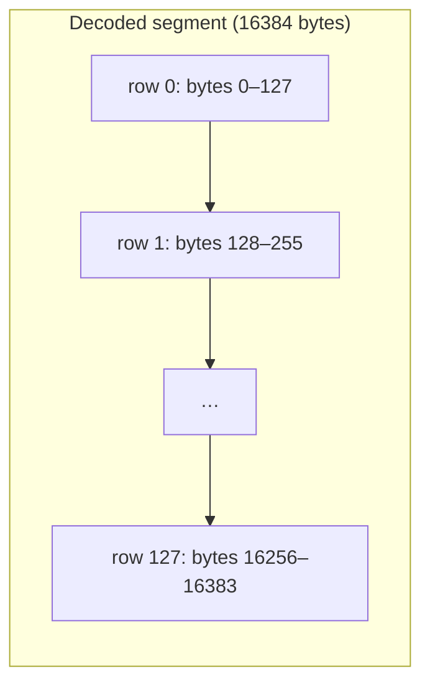
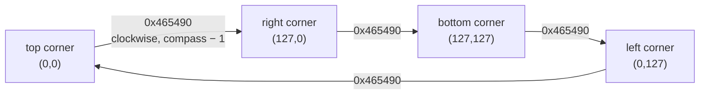

# Conventions

Rules that hold across the whole file. Segment pages refer back here instead of repeating them.

## Byte order

**Everything is big-endian**, except the 4-byte ids at the start of the scenario segments.

| Where | Byte order | Evidence |
|---|---|---|
| `FORM` size, segment lengths | big-endian uint32 | **Confirmed (code)**: the loader swaps them with `0x42a930` before use |
| MISC and XGRP values | big-endian 32-bit | **Confirmed (code)**: the whole decoded buffer goes through `0x42a7e0` (swap every 4 bytes) |
| ALTM values | big-endian 16-bit | **Confirmed (code)**: the whole buffer goes through `0x42a880` (swap every 2 bytes) |
| XMIC records | bytes 0–1 single bytes; bytes 2–3, 4–5, 6–7 big-endian 16-bit | **Confirmed (code)**: `0x42a820` swaps exactly those three words of each 8-byte record |
| `TEXT`, `SCEN`, `PICT` ids | **little-endian** uint32 | **Confirmed (code)**: the scenario reader `0x42ae10` compares the id with no swap. **Verified (data)**: ids are `80 00 00 00` or `81 00 00 00` in 18/18 scenarios |
| All other segments | single bytes, nothing to swap | **Confirmed (code)**: the loader does no fix-up for them |

The game was written for the big-endian Macintosh first. The Windows version swaps on load, which is why the swap calls show exactly which fields are wider than a byte.

## Integer types

- A **byte** is unsigned (0–255) unless a segment page says otherwise.
- MISC holds 1200 **32-bit words**. The loader copies each word into a game variable. Some of those variables are 8- or 16-bit, so the game keeps only the low bits; the MISC pages give the effective type of each field. Values that can go negative, such as funds, are two's-complement **Inferred**, to be confirmed per field.

## The city map: 128 × 128 tiles

Every per-tile segment (ALTM, XTER, XBLD, XZON, XUND, XTXT, XBIT) is a 128 × 128 grid, stored **row by row**:

```
offset(row, col) = row * 128 + col          (1 byte per tile)
offset(row, col) = (row * 128 + col) * 2    (ALTM: 2 bytes per tile)
```

**Confirmed (code)**: the game keeps each map as 128 row pointers into one buffer. The loader decodes the whole segment into that buffer, and every loop over a map (for example `0x434b70`) indexes it as `map[row][col]` with row as the outer index.

These pages call the first index **row** and the second **col**. On screen, row runs toward the bottom-right and col toward the bottom-left ([§ Orientation](#orientation)). The `SimCityReader` code in this repository calls them `x` and `z` ([§ Naming in this repository](#naming-in-this-repository)).



### Overlay grids

Some segments use coarser grids (sizes **Confirmed (code)** by the loader):

| Grid | Segments | Bytes | One cell covers |
|---|---|---|---|
| 64 × 64 | XTRF, XPLT, XVAL, XCRM | 4096 | 2 × 2 tiles: tile `(row, col)` is in cell `(row / 2, col / 2)` (**Confirmed (code)**: the tile renderer `0x43c730` reads XTRF that way) |
| 32 × 32 | XPLC, XFIR, XPOP, XROG | 1024 | 4 × 4 tiles (**Inferred**) |

The overlays are stored row by row like the tile maps, and rotate with them ([§ Orientation](#orientation)). The 32 × 32 mapping will be confirmed on the minimap page (planned).

## The compass: the map is saved as currently viewed

The player can rotate the view in 90° steps. The game does **not** keep a fixed "north-up" copy of the map. Rotating the view **rotates every map array in memory** and counts the turns in a compass variable. A file therefore stores the map in the orientation the player last looked at, together with the compass.

- Compass = MISC word 2 (bytes 8–11), 0–3: the number of counter-clockwise quarter turns since the city was created, modulo 4. **Confirmed (code)**: the MISC loader `0x431330` copies word 2 into the compass variable `0x4c942c`. The view rotation routines `0x465490` and `0x466660` rotate all map arrays and decrement or increment it.
- A reader that wants a fixed orientation must undo `compass` quarter turns, including the tile codes and flags that change with a turn. [§ Orientation](#orientation) gives the exact rules.

Compass values in the corpus: 0 in 45/114 files, 1 in 17, 2 in 18, 3 in 34 (**Verified (data)**). A reader that ignores the compass will get more than half of these cities turned.

## Orientation

### Where row and col point on screen

The game draws tile `(row, col)` at

```
screen x = (row − col) × w          w = tile half-width for the zoom level
screen y = (row + col) × w / 2 − altitude × h
```

**Confirmed (code)**: tile-to-screen conversion `0x444e20`. So **row grows toward the bottom-right of the screen and col toward the bottom-left**, and the four corners of the map are:

```
                    (0, 0)
                   ╱      ╲
          col ↙  ╱          ╲  ↘ row
                ╱            ╲
       (0, 127)                (127, 0)
                ╲            ╱
                 ╲          ╱
                   ╲      ╱
                  (127, 127)
```

This holds for the arrays **as stored, at every compass value**, because a turn rotates the arrays themselves rather than the drawing. The power and water map views draw the same arrays top-down, with row as the horizontal axis and col as the vertical one (`0x4888f0`, `0x488ab0`).

**Compass 0** is the view the city was created in: generating a new map sets it to 0 (`0x410950`). Which edge the game's compass rose calls "north" is not needed for reading and is listed in [open-questions.md](open-questions.md#conventions).

### One quarter turn

The two rotation routines move every tile map and overlay through 4-cycles in place, with `N` = 128 for tile maps, 64 or 32 for overlays (**Confirmed (code)**):

| Routine | Array transform | Compass | Picture on screen |
|---|---|---|---|
| `0x465490` | `new[r][c] = old[c][N−1−r]` | − 1 (0 → 3) | turns **clockwise** |
| `0x466660` | `new[r][c] = old[N−1−c][r]` | + 1 (3 → 0) | turns **counter-clockwise** |

The two are exact inverses, including their remap tables (below). "Clockwise" follows from the screen formula. Under `0x465490` the tile at the top corner, old `(0, 0)`, ends up at new `(127, 0)`, the right corner.



### Normalising a city to compass 0

Undoing the compass means applying `0x465490` `compass` times. For positions this gives, for every per-tile segment (ALTM, XTER, XBLD, XZON, XUND, XTXT, XBIT) and every overlay (`N` = its size):

| Stored compass | Normalised `K[r][c]` from stored `S` |
|---|---|
| 0 | `S[r][c]` |
| 1 | `S[c][N−1−r]` |
| 2 | `S[N−1−r][N−1−c]` |
| 3 | `S[N−1−c][r]` |

Some **values** change with each turn too. A normaliser must repeat the following `compass` times, once per turn, in this order (**Confirmed (code)**, `0x465490`):

1. **Move** every grid one turn: `new[r][c] = old[c][N−1−r]`.
2. **Remap codes** through the clockwise tables: XBLD via `0x4e8fa0`, XTER via `0x4e90a0`, XUND via `0x4e90e8`. In cycle notation, `(a b c d)` means `a` becomes `b`, `b` becomes `c`, and so on. Codes not listed stay the same.

   | Segment | Changes per clockwise turn | Details |
   |---|---|---|
   | XBLD | `(0E 0F) (10 11 12 13) (14 15 16 17) (18 19 1A 1B) (1D 1E) (1F 20 21 22) (23 24 25 26) (27 28 29 2A) (2C 2D) (2E 2F 30 31) (32 33 34 35) (36 37 38 39) (3B 3C 3D 3E) (3F 40 41 42) (43 44) (45 46) (47 48) (49 4A) (4B 4C) (4D 4E) (4F 50) (51 55) (52 54) (61 62 63 64) (65 66 67 68) (6C 6D 6E 6F)` | power lines, roads, rails, highways, bridge pieces, tunnels; buildings (`0x70`+) never change: [xbld.md](segments/xbld.md#footprints-and-anchors) |
   | XTER | `(01 02 03 04) (05 06 07 08) (09 0A 0B 0C) (11 12 13 14) (15 16 17 18) (19 1A 1B 1C) (21 22 23 24) (25 26 27 28) (29 2A 2B 2C) (31 32 33 34) (35 36 37 38) (39 3A 3B 3C) (40 41) (42 43 44 45)`; `0E 0F 1E 1F 2F 3F 46 47` become `00` | every terrain shape that has a direction turns: [xter.md](segments/xter.md#values) |
   | XUND | `(01 02) (03 04 05 06) (07 08 09 0A) (0B 0C 0D 0E) (10 11) (12 13 14 15) (16 17 18 19) (1A 1B 1C 1D) (1F 20)`; `24 25 26 27` become `00` | pipes, subways, tunnels: [xund.md](segments/xund.md) |

3. **Fix bridges and on-ramps** in XBLD and the XBIT 0x02 flag ([xbit.md](segments/xbit.md#bit-layout)), tile by tile:

   ```
   for every tile:
       code = XBLD[tile]; flagged = XBIT[tile] & 0x02
       if 0x5D <= code <= 0x60:                          # highway on-ramps
           k = (code - 0x5D) + (4 if flagged else 0)
           XBLD[tile] = [0x60, 0x5F, 0x5E, 0x5D, 0x5E, 0x5D, 0x60, 0x5F][k]
           set 0x02 if k < 4, else clear it
       elif 0x51 <= code <= 0x5C or code in (0x6A, 0x6B):   # bridges
           if flagged: clear 0x02; XBLD[tile] = XBLD_TABLE[code]   # the table a second time
           else:       set 0x02
   ```

4. Set the compass to 0 (MISC word 2).

The reference decoder implements these steps as `normalise()`; `sc2dump.py CITY.SC2 --normalise` dumps a city turned to compass 0.

Everything else is **moved but not changed**: ALTM values, XZON bytes (including their corner bits: [xzon.md](segments/xzon.md#corner-bits)), XTXT, overlay values, the XBIT bits other than above, and the 0x02 flag of runways, piers and all other buildings. The game also turns the moving objects in XTHG (`0x466410`; page planned). Of MISC, only the compass changes for real. The per-code tile counts in words 124–379 are recomputed on load anyway ([container.md § After the walk](container.md#after-the-walk)).

**Verified (data)**: the corpus contains a city saved at compass 3 (`test-rotated.sc2`) and the same city at compass 0 (`test.sc2`). Normalising the first with the steps above reproduces the second byte for byte in all 15 grid segments, except 58 XBIT bytes that differ only in 0x08, 0x40 and 0x10, the bits the game recomputes ([xbit.md § What to trust](segments/xbit.md#what-to-trust)).

The opposite turn (`0x466660`) uses the inverse tables at `0x4e9110` (XBLD), `0x4e9210` (XTER) and `0x4e9258` (XUND), and the on-ramp list `[0x5E, 0x5D, 0x60, 0x5F, 0x60, 0x5F, 0x5E, 0x5D]`.

### Naming in this repository

`SimCityReader` names the first index `x` and the second `z`: `CityData.getSquare(x, z)`, and the test helper `IffBuilder` writes tile `(x, z)` at offset `x * 128 + z`. So **x = row** (toward the bottom-right of the screen) and **z = col** (toward the bottom-left). `CityData` reads the compass but does not normalise the map; it uses the compass only to decide which way runways and piers run.

## Strings

| Segment | Storage | Evidence |
|---|---|---|
| CNAM | 32 bytes; the name starts at byte 1 and ends at the first zero byte | **Confirmed (code)**: the loader takes the C string at byte 1 |
| XLAB | 256 records of 25 bytes; byte 0 = length (the game caps it at 23), then the characters | **Confirmed (code)**: `0x430c00` |
| TEXT | after the 4-byte id: text up to the end of the segment; the game reads at most 768 bytes | **Confirmed (code)**: `0x42ae10` |

The character set is the Windows ANSI code page of the machine that saved the file (code page 1252 on Western systems) **Inferred**: the game uses the ANSI Windows API (for example `CharUpperA`) and does no conversion. Line breaks in TEXT are a single `\r`. **Verified (data)**: every TEXT segment in the corpus that breaks lines uses a lone `\r`, and none contains `\n`.
