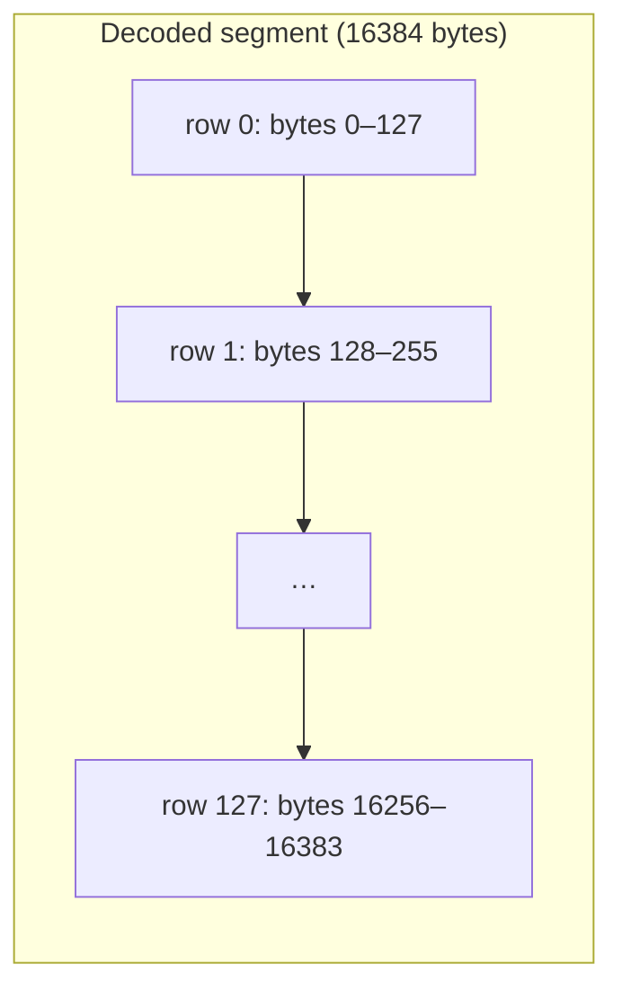

# Conventions

Rules that hold across the whole file. Segment pages refer back here instead of repeating them.

## Byte order

**Everything is big-endian**, except the 4-byte ids at the start of the scenario segments.

| Where | Byte order | Evidence |
|---|---|---|
| `FORM` size, segment lengths | big-endian uint32 | **Confirmed (code)**: the loader swaps them with `0x42a930` before use |
| MISC and XGRP values | big-endian 32-bit | **Confirmed (code)**: the whole decoded buffer goes through `0x42a7e0` (swap every 4 bytes) |
| ALTM values | big-endian 16-bit | **Confirmed (code)**: the whole buffer goes through `0x42a880` (swap every 2 bytes) |
| XMIC records | bytes 0–1 single bytes; bytes 2–3, 4–5, 6–7 big-endian 16-bit | **Confirmed (code)**: `0x42a820` swaps exactly those three words of each 8-byte record |
| `TEXT`, `SCEN`, `PICT` ids | **little-endian** uint32 | **Confirmed (code)**: the scenario reader `0x42ae10` compares the id with no swap. **Verified (data)**: ids are `80 00 00 00` or `81 00 00 00` in 18/18 scenarios |
| All other segments | single bytes, nothing to swap | **Confirmed (code)**: the loader does no fix-up for them |

The game was written for the big-endian Macintosh first. The Windows version swaps on load, which is why the swap calls show exactly which fields are wider than a byte.

## Integer types

- A **byte** is unsigned (0–255) unless a segment page says otherwise.
- MISC holds 1200 **32-bit words**. The loader copies each word into a game variable. Some of those variables are 8- or 16-bit, so the game keeps only the low bits; the MISC pages give the effective type of each field. Values that can go negative, such as funds, are two's-complement **Inferred**, to be confirmed per field.

## The city map: 128 × 128 tiles

Every per-tile segment (ALTM, XTER, XBLD, XZON, XUND, XTXT, XBIT) is a 128 × 128 grid, stored **row by row**:

```
offset(row, col) = row * 128 + col          (1 byte per tile)
offset(row, col) = (row * 128 + col) * 2    (ALTM: 2 bytes per tile)
```

**Confirmed (code)**: the game keeps each map as 128 row pointers into one buffer. The loader decodes the whole segment into that buffer, and every loop over a map (for example `0x434b70`) indexes it as `map[row][col]` with row as the outer index.

These pages call the first index **row** and the second **col**. The `SimCityReader` code in this repository calls them `x` and `z`. Which screen direction each index runs along is covered on the per-tile segment pages (planned).



### Overlay grids

Some segments use coarser grids (sizes **Confirmed (code)** by the loader):

| Grid | Segments | Bytes | One cell covers |
|---|---|---|---|
| 64 × 64 | XTRF, XPLT, XVAL, XCRM | 4096 | 2 × 2 tiles (**Inferred**) |
| 32 × 32 | XPLC, XFIR, XPOP, XROG | 1024 | 4 × 4 tiles (**Inferred**) |

The cell-to-tile mapping will be confirmed on the minimap page (planned).

## The compass: the map is saved as currently viewed

The player can rotate the view in 90° steps. The game does **not** keep a fixed "north-up" copy of the map. Rotating the view **rotates every map array in memory** and counts the turns in a compass variable. A file therefore stores the map in the orientation the player last looked at, together with the compass.

- Compass = MISC word 2 (bytes 8–11), 0–3. **Confirmed (code)**: the MISC loader `0x431330` copies word 2 into the compass variable `0x4c942c`. The view rotation routines `0x465490` and `0x466660` rotate all map arrays and decrement or increment it.
- A reader that wants a fixed orientation must undo `compass` quarter turns. The per-tile pages (planned) will give the exact direction and the tile codes that change with a turn (bridges, on-ramps, the XBIT rotate flag).

## Strings

| Segment | Storage | Evidence |
|---|---|---|
| CNAM | 32 bytes; the name starts at byte 1 and ends at the first zero byte | **Confirmed (code)**: the loader takes the C string at byte 1 |
| XLAB | 256 records of 25 bytes; byte 0 = length (the game caps it at 23), then the characters | **Confirmed (code)**: `0x430c00` |
| TEXT | after the 4-byte id: text up to the end of the segment; the game reads at most 768 bytes | **Confirmed (code)**: `0x42ae10` |

The character set is the Windows ANSI code page of the machine that saved the file (code page 1252 on Western systems) **Inferred**: the game uses the ANSI Windows API (for example `CharUpperA`) and does no conversion. Line breaks in TEXT are a single `\r`. **Verified (data)**: every TEXT segment in the corpus that breaks lines uses a lone `\r`, and none contains `\n`.
