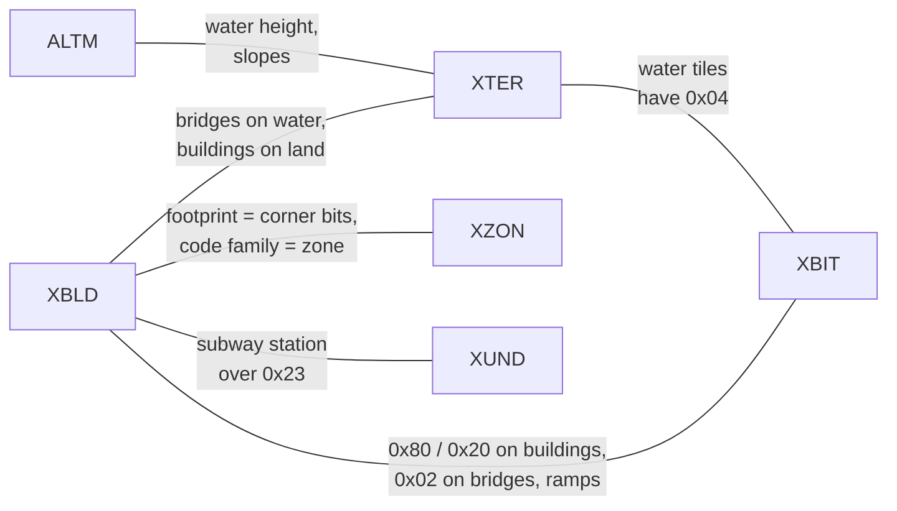
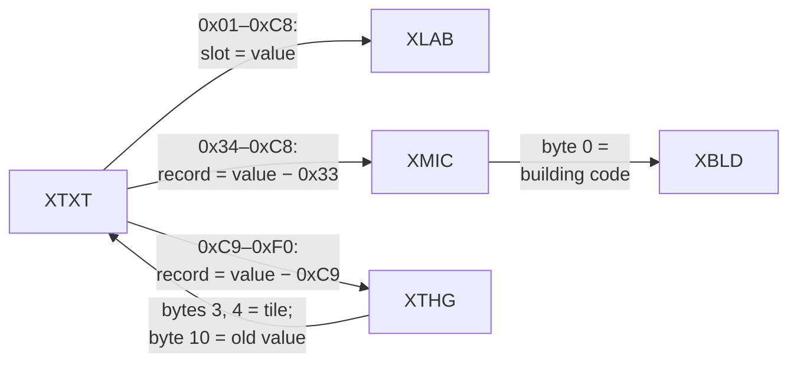
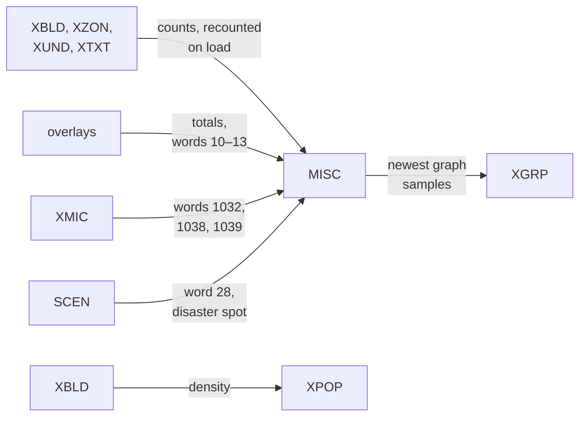

# How the segments relate

The segment pages describe each segment on its own. This page collects every rule that ties two or more segments together: which value points where, which layers must agree, and which values are derived from others. For each rule it says how often it holds in the corpus (114 files), which side the game believes when they disagree, and where the evidence is.

A reader can use these rules in two ways: to **join** the segments (find a building's label, a moving object's tile, a microsim's figures), and to **check** a file (a hand-edited city often breaks one of them). The tallies come from the [`sc2check.py`](tools/sc2check.py) checks named in each table; the `cross_` checks are the ones written for this page.

"Holds" counts the files where the rule holds over the files where it can be tested. "Game uses" says what the game does with the two sides: *trusts* means it uses the stored value as it is, *rebuilds* means it recomputes it on load or at the next simulation step.

## At a glance

The map layers, all 128 × 128, tile for tile:

The references between segments:

The values derived from others:

## References between segments

| Rule | Holds | Game uses | Details |
|---|---|---|---|
| XTXT `0x01`–`0x32` (sign) → XLAB slot = value | The sign's label is non-empty in 66/66 files with signs; 53 sign labels in the corpus have no sign on the map | Draws the label of the slot | [xtxt.md § Signs](segments/xtxt.md#signs-0x010x32), [xlab.md § Slots 1–50](segments/xlab.md#slots-150-signs) |
| XTXT `0x34`–`0x3C` (built-in microsim) → XMIC record value − `0x33` (1–9), XLAB slot = value | Records 1–9 hold the nine systems in 113/114; slots 52–60 used in 114/114; the values sit only on their system's buildings in 98/100 | Trusts | [xtxt.md § Built-in microsims](segments/xtxt.md#built-in-microsims-0x340x3c), [xmic.md § Records 1–9](segments/xmic.md#records-19-city-wide-systems) |
| XTXT `0x3D`–`0xC8` (microsim) → XMIC record value − `0x33` (10–149), whose byte 0 is the tile's XBLD code | 97/104 files with microsims; in the others the value is left on empty land (3) or on another building (4) | Trusts; the January update rewrites the figures | [xtxt.md § Microsims](segments/xtxt.md#microsims-0x3d0xc8), [xmic.md § Records 10–149](segments/xmic.md#records-10149-buildings) |
| The same microsim in all three places: XLAB slot *v* non-empty ⇔ XMIC record *v* − `0x33` in use ⇔ value *v* on the map | 108/114 (`cross_microsim_labels`); 6 files have a few slots that disagree (a record and label with no tiles, a label left behind) | Trusts each separately | [xlab.md § Slots 61–200](segments/xlab.md#slots-61200-microsims) |
| XTXT `0xC9`–`0xF0` → XTHG record value − `0xC9`, whose bytes 3, 4 are this tile | 80/92 files with markers | Clears a marker whose record is elsewhere when it draws it | [xtxt.md § Moving objects](segments/xtxt.md#moving-objects-0xc90xf0), [xthg.md § The XTXT marker](segments/xthg.md#the-xtxt-marker) |
| XTHG record (used, not record 0) → XTXT at (byte 3, byte 4) = `0xC9` + record | Per type, from all records (aircraft, sailboats) to none (fire units); see the XTHG page | Trusts; byte 10 is put back when the object moves | [xthg.md § The XTXT marker](segments/xthg.md#the-xtxt-marker) |
| XTHG byte 10 = the XTXT value the marker replaced | **Confirmed (code)** | Restored to XTXT when the object leaves | [xthg.md § The XTXT marker](segments/xthg.md#the-xtxt-marker) |
| XTXT `0xFA` (neighbour connection) only on roads, rails and highways within one tile of the map edge | 76/76 files with connections | Recounts the road connections from these values on load | [xtxt.md § Neighbour connections](segments/xtxt.md#neighbour-connections-0xfa) |
| XMIC words → MISC 1032 (arcology residents), 1038 (police arrests), 1039 (prisons have room) | 109, 111 and 112 of 114 | Trusts until the next January update | [xmic.md § MISC words](segments/xmic.md#misc-words-set-from-xmic) |
| Stadium XMIC record → its sport bit in MISC 1034, its team label in XLAB slot 251 + sport | 76/79 and 75/79 files with stadiums | Trusts | [xmic.md § MISC words](segments/xmic.md#misc-words-set-from-xmic), [xlab.md § Slots 251–255](segments/xlab.md#slots-251255-sports-teams) |
| MISC 1040 = the XTHG record of the monster or tornado, −1 if none | 114/114 have −1 | Trusts | [general.md § Disasters](segments/misc/general.md#disasters) |

## Buildings across the layers

A building is one XBLD code repeated over its footprint. The other tile layers describe the same tiles, and agree with it in these ways.

| Rule | Holds | Game uses | Details |
|---|---|---|---|
| The XZON corner bits mark the footprint's corners, at corners that depend on the compass | 105/114 (`xzon_corner_rule`); the footprint can be recovered from the corners alone in 107/114 | Draws each building at its corner bit; the anchor is the corner bit for the compass | [xzon.md § Corner bits](segments/xzon.md#corner-bits), [xbld.md § Footprints](segments/xbld.md#footprints-and-anchors) |
| Every anchor starts a complete block of its code | 108/114 (`xbld_footprints`); 37 files have fragment tiles | Draws only from the anchor | [xbld.md § Fragments](segments/xbld.md#fragments) |
| All tiles of one building have the same XZON zone | 105/105 files with multi-tile buildings (`cross_footprint_layers`) | — | [Zones and buildings](#zones-and-buildings) |
| A microsim building has its value on every tile | 106 files have such buildings; in 50 some tiles hold 0 and in 9 a moving object's marker | Clicking any tile with the value opens the microsim | [Microsim values on footprints](#microsim-values-on-footprints) |
| Each code family stands on its own zone | See [below](#zones-and-buildings) | — | [xzon.md § Zone types](segments/xzon.md#zone-types) |
| Bridges and piers stand on water; other buildings on land | See [below](#buildings-and-terrain) | — | [xter.md § Water](segments/xter.md#water) |
| Building tiles carry XBIT `0x80` (conducts power) and `0x20` (carries water), with exceptions | See [below](#power-and-water-bits) | Trusts `0x80` and `0x20`; rebuilds `0x40` and `0x10` | [xbit.md § 0x80](segments/xbit.md#0x80-conducts-power) |
| XBIT `0x02` (mirror) only on bridges, on-ramps, highway bridges, runways and piers, and its meaning depends on the compass | Code list in `xbit_rotate_codes` (plus 3 stray tiles); direction rules hold in 63–69 files, fail for bridges in 2 | Trusts | [xbit.md § 0x02](segments/xbit.md#0x02-mirror-rotate) |
| XUND `0x23` (subway station piece) lies under XBLD `0xE9` (subway station) or `0x6C`–`0x6F` (subway to rail) | 47/49 files with stations | Trusts | [xund.md § Relation to XBLD](segments/xund.md#relation-to-xbld) |
| Otherwise, pipes and subways ignore what is built above | **Verified (data)** | — | [xund.md § Relation to XBLD](segments/xund.md#relation-to-xbld) |
| 2×2 highway pieces sit in even-aligned blocks | 47/49 files with highways | — | [xbld.md § Highways](segments/xbld.md#highways) |

### Zones and buildings

XZON bits 0–3 (the zone) and the XBLD code always come in these pairs (**Verified (data)**, `cross_zones_buildings`). "Holds" counts the files that have the family.

| XBLD codes | Family | XZON zone | Holds |
|---|---|---|---|
| `0x70`–`0x7B` | small homes (1×1) | 1 or 2 | 100/100 |
| `0x8C`–`0x93`, `0xAE`–`0xB1` | apartments and condominiums (2×2, 3×3) | 2 | 98/99 |
| `0x7C`–`0x83` | small shops and offices (1×1) | 3 or 4 | 99/99 |
| `0x94`–`0x9D`, `0xB2`–`0xBB` | dense commercial (2×2, 3×3) | 4 | 98/98 |
| `0x84`–`0x87` | small industry (1×1) | 5 or 6 | 100/100 |
| `0x9E`–`0xA5`, `0xBC`–`0xC1` | dense industry (2×2, 3×3) | 6 | 94/98 |
| `0x88`–`0x8B`, `0xA6`–`0xAD`, `0xC2`–`0xC5` | construction and abandoned buildings | 1–6 | 102/102 |
| `0xDD`, `0xDE`, `0xE1`, `0xE4`–`0xE6`, `0xE8`, `0xEA`, `0xEE`, `0xF6` | airport | 8, or 7 on a military base | 69/69 |
| `0xE0`, `0xE3`, `0xF0`, `0xF2` | seaport | 9, or 7 on a military base | 70/70 |
| `0xE2`, `0xE7`, `0xEF`, `0xF1`, `0xF9` | military only | 7 | 14/14 |
| every other code from `0xC6` (power plants, city services, arcologies, …) | placed buildings | 0 | 106/106 |
| `0x1D`–`0x5C`, `0x61`–`0x6B` | roads, rails, tunnels, crossings, highways, bridges | 0 | 107/107 |

The exceptions are a dense building on a light zone: 49 tiles of 2×2 factories on zone 5 in 4 files, and one 3×3 condominium on zone 1. The game probably keeps a building when the player re-zones its land (**Inferred**). Trees, rubble, power lines, on-ramps (`0x5D`–`0x60`) and subway-to-rail pieces can stand on any zone, and empty land can be zoned. Zone 7 is the military base ([xzon.md § Zone 7](segments/xzon.md#zone-7-the-military-base)).

So a reader that needs the zone of a building can take it from any of its tiles, and a reader that sees a growable code on zone 0 has a damaged file.

### Microsim values on footprints

The game writes a microsim's value on every tile of its building when it places it ([xtxt.md § Microsims](segments/xtxt.md#microsims-0x3d0xc8)). In the corpus, 16 327 buildings have it on every tile, 194 have 0 on some tiles, and 11 have a moving object's marker on some (`cross_footprint_layers`). An object that is removed writes 0 instead of the value it saved ([xthg.md § The XTXT marker](segments/xthg.md#the-xtxt-marker)), which is the likely source of the zeros (**Inferred**). No building has two different microsim values. **To find a building's microsim, take the value from any tile of the footprint that has one.**

### Buildings and terrain

| Rule | Holds (`cross_terrain_buildings`) |
|---|---|
| Bridges, elevated power lines (`0x51`–`0x5C`), highway bridges (`0x6A`, `0x6B`) and piers (`0xDF`) stand on water XTER (`0x10` or higher) | 80/84 files; the others have 10 bridge tiles on land |
| Buildings `0x70`+ other than dams, piers and marinas stand on land XTER (below `0x10`) | 102/105; the others have a few tiles on surface water |
| Hydroelectric dams (`0xC6`, `0xC7`) stand on surface water, almost always on the waterfall `0x3E` (water placed on a slope) | 34/34 on surface water; 33/34 all on `0x3E` |
| Marinas (`0xF8`) stand on land, shore and water alike | — |
| Roads, rails and power lines may cross surface water (`0x30`–`0x45`); on underwater and shore tiles there is only empty land, bridges, elevated power lines, highways (`0x49`, `0x4A`), piers and marinas | **Verified (data)**, apart from 2 stray tiles of rubble and trees |

### Power and water bits

The game sets XBIT `0x80`, `0x40` and `0x20` on every tile of a building it places with its usual routine (`0x436e80`, [xbit.md § 0x80](segments/xbit.md#0x80-conducts-power)). The data shows that some kinds are placed without them (**Verified (data)**, `cross_building_conduct`):

| Tiles | `0x80` | `0x20` | Files |
|---|---|---|---|
| zoned buildings `0x70`–`0xC5` | yes | yes | 102/104 (7 tiles in 2 files lack `0x80`) |
| other buildings from `0xC6`, outside the military zone, except the kinds below | yes | yes | 105/105 |
| parks `0xD5`, statues `0xDB` | no | yes (parks: not in 7 files) | 86/87, 57/57 |
| piers `0xDF` | no | almost never | 65/66 |
| runways `0xDD`, `0xDE` outside the military zone | yes | on some tiles | 69/69 have `0x80` |
| subway stations `0xE9` | yes | no | 48/48 |
| hydroelectric dams `0xC6`, `0xC7` | yes | mostly no | 20/34 none, 13 some |
| buildings in the military zone (zone 7) | no | no | 15/17 |

Which routines place these kinds without the bits is not traced ([open questions](open-questions.md)). A reader should take both bits as stored: power spreads only through `0x80`, water only through `0x20`, and `0x40` and `0x10` are rebuilt from them on load ([xbit.md § What to trust](segments/xbit.md#what-to-trust)).

## Terrain

| Rule | Holds | Game uses | Details |
|---|---|---|---|
| ALTM water height and XTER kind: land has none; shore and underwater tiles have water height = sea level (MISC word 912); surface water has water height = altitude | 114/114 (`altm_water_height`) | Trusts | [altm.md § Water height](segments/altm.md#water-height-bits-59), [xter.md § Water](segments/xter.md#water) |
| Shore tiles are one level below the sea level; underwater tiles lower | 114/114 | Trusts | [altm.md § Sea level](segments/altm.md#sea-level) |
| XTER slope shape matches the altitudes of the neighbours | ≥ 99% of tiles in 94/114, all tiles in 11 | Trusts the stored shape | [xter.md § Slope and altitude](segments/xter.md#slope-and-altitude) |
| XBIT `0x04` (covered by water) only on water XTER, and on every water tile | never on land 114/114; on every shore tile 100/100; gaps on underwater (26 files) and surface water (10 files) | Uses `0x04` as the "has water" flag | [xter.md § Water](segments/xter.md#water), [xbit.md § 0x04](segments/xbit.md#0x04-covered-by-water) |
| ALTM tunnel depth is set under tunnels; tunnel portals (XBLD `0x3F`–`0x42`) have depth 1 | 26/26 files with tunnels | Trusts | [altm.md § Tunnel depth](segments/altm.md#tunnel-depth-bits-1014) |
| XUND slope pieces lie on the XTER slope they belong to | 77/84 files with slope pieces | Trusts | [xund.md](segments/xund.md#piece-shapes) |

## Moving objects

| Rule | Holds | Details |
|---|---|---|
| The tile (bytes 3, 4) is inside the map | every used record 1–39 in the corpus | [xthg.md § Layout](segments/xthg.md#layout) |
| Ships and sailboats (types 3, 9) are on water XTER | 78/79 files with ships (`cross_things_ground`; one sailboat in `LINCOLN.SC2` is on a house) | [thing-ids-xthg.md](reference/thing-ids-xthg.md) |
| Train engines and cars above ground (types 10, 11) are on rail tiles: rails, rail crossings, rail bridges (`0x5A`, `0x5B`), subway-to-rail (`0x6C`–`0x6F`) and rail stations (`0xED`) | 36/47 files with trains; in the other 11 a few trains stand on houses or highway pieces | [thing-ids-xthg.md](reference/thing-ids-xthg.md) |
| Train links: engine → car → car | 47/48 (`xthg_trains`) | [xthg.md](segments/xthg.md#layout) |

Why trains stand on houses is not known; houses may have grown on a rail tile after the train stopped there (**Inferred**).

## Overlays and statistics

| Rule | Holds | Game uses | Details |
|---|---|---|---|
| Overlay cell (r, c) of a 64 × 64 grid covers tiles rows 2r–2r+1, cols 2c–2c+1; of a 32 × 32 grid rows 4r–4r+3, cols 4c–4c+3 | **Confirmed (code)** | — | [minimaps.md § Cell mapping](segments/minimaps.md#cell-mapping) |
| MISC word 10 = sum of XVAL, 11 = sum of XCRM, 13 = sum of XPLT | 114/114 (`minimap_misc_totals`) | Rebuilds both at simulation step 2 | [minimaps.md § What to trust](segments/minimaps.md#what-to-trust) |
| MISC word 12 ≤ sum of XTRF | 114/114 (equal in 69) | Rebuilds | [minimaps.md § XTRF](segments/minimaps.md#xtrf-traffic) |
| XPOP can be recomputed from XBLD | all cells in 27/114, ≥ 90% of cells in 101/114 (`minimap_xpop`) | Trusts until step 2 | [minimaps.md § XPOP](segments/minimaps.md#xpop-building-density) |
| XVAL is non-zero only on cells of the XBIT `0x08` developed-land mask | 63/64 files that have the mask | Rebuilds both | [minimaps.md § XVAL](segments/minimaps.md#xval-land-value), [xbit.md § 0x08](segments/xbit.md#0x08-developed-land-mask-and-scratch-mark) |
| XGRP newest samples = the MISC words they sample (education 19, health 18, unemployment 1001, national population 20, GNP 21, federal rate 22; city size from 1032 and 380) | 101–109 of the 109 files with history, per series; city size 84/109 | Trusts the history | [xgrp.md § Graph series](segments/xgrp.md#graph-series) |

## MISC and the map

| Rule | Holds | Game uses | Details |
|---|---|---|---|
| MISC words 124–379 = number of tiles of each XBLD code outside the military zone | 76/114 exactly (`misc_counts_buildings`); 28 files store negative counts without sign extension | **Rebuilds on load** (`0x434f80`) | [tile-counts.md](segments/misc/tile-counts.md#building-counts-words-124379) |
| MISC words 1002–1017 = military-base tile counts (zone 7) | 105/114 | Trusts (not recounted) | [tile-counts.md § Military counts](segments/misc/tile-counts.md#military-counts-words-10021017) |
| MISC word 1018 = subway tiles in XUND outside the military zone | 114/114 (`misc_general_links`) | Trusts (not recounted) | [general.md](segments/misc/general.md#layout) |
| MISC words 1030, 1031 = mean row and col of the building tiles (rounded down to even) | 91/114 | Rebuilds at step 2 | [general.md § Counters](segments/misc/general.md#counters) |
| MISC words 381–387 = residential, commercial and industrial population units from the zoned buildings | exact in 2 and within 2% in 30 of the 34 files saved at steps 19–24 | Rebuilds at steps 19–24 | [population.md § Zone population](segments/misc/population.md#zone-population) |
| Budget entry counts (police, fire, schools, roads, rails, …) = counts from the tile counts | 99–114 of 114 per entry (`misc_budget_counts`) | Rebuilds monthly | [budget.md § Entries](segments/misc/budget.md#entries) |
| The tax bases (budget words 479, 506, 533) = population units × 10 + a share of MISC 1032 | 23/23 files saved after day 21 | Rebuilds monthly | [budget.md § Entries](segments/misc/budget.md#entries) |
| Neighbour connections: road tiles with XTXT `0xFA` | recounted on load | **Rebuilds on load** (`0x434b70`) | [xtxt.md § The connection sign](segments/xtxt.md#the-connection-sign) |

## Scenarios

| Rule | Holds | Details |
|---|---|---|
| `TEXT 0x80`, `TEXT 0x81`, `SCEN 0x80` and `PICT 0x80` come together | 18/18 scenarios (`container_scenario_ids`) | [container.md § Scenario segments](container.md#scenario-segments) |
| SCEN disaster → MISC word 28 when the scenario starts; the disaster spot is (row, col) in the stored map | **Confirmed (code)**; both meltdown spots are on a nuclear plant (2/2) | [scen.md § The disaster spot](segments/scen.md#the-disaster-spot) |
| SCEN goals are compared with MISC words (city size 1035, tax bases, funds − bonds, land value 10, …) | None is met at load: 18/18 (`scen_goals_at_load`) | [scen.md § Layout](segments/scen.md#layout) |
| SCEN building goals name XBLD codes and are compared with the tile counts (MISC 124 + code) | **Confirmed (code)**; unused in the corpus | [scen.md § Layout](segments/scen.md#layout) |

## The compass

The compass (MISC word 2) says how far the view was turned when the city was saved. It changes the meaning of three things, and a reader that turns the city to compass 0 must change all of them together ([conventions.md § Orientation](conventions.md#orientation)):

| What | How the compass enters |
|---|---|
| XZON corner bits | The bit at each footprint corner, and so the anchor, depend on the compass ([xzon.md § Which bit is at which corner](segments/xzon.md#which-bit-is-at-which-corner)) |
| XBIT `0x02` on bridges, on-ramps, runways and piers | Its direction is read relative to the compass ([xbit.md § 0x02](segments/xbit.md#0x02-mirror-rotate)) |
| XBLD, XTER and XUND codes with a direction | Remapped by one table per turn ([conventions.md § Orientation](conventions.md#orientation)) |

Positions stored as (row, col), such as the XTHG tiles and the SCEN disaster spot, are in the stored map, at the saved compass. They move with the map when a reader turns it.

## What the game rebuilds and what it trusts

When a rule above breaks, the game's choice decides which side a reader should believe:

| Rebuilt on load | Rebuilt at the next simulation step | Trusted as stored |
|---|---|---|
| MISC 124–379 (tile counts), road connections, XBIT `0x40`, `0x10`, `0x08`, the graph maxima | the overlays, MISC 10–13, 380–387, 1030–1031, the budget counts and tax bases, the XMIC figures (in January), MISC 1032, 1038, 1039 | everything else: the map layers, XTXT, XLAB, XTHG, XGRP, the military and subway counts, funds and the budget rates |

Sources: [container.md § After the walk](container.md#after-the-walk), [misc/README.md § Recomputed and trusted](segments/misc/README.md#recomputed-and-trusted), [xbit.md § What to trust](segments/xbit.md#what-to-trust), [minimaps.md § What to trust](segments/minimaps.md#what-to-trust), [xmic.md § When the figures change](segments/xmic.md#when-the-figures-change).

## Checks for a reader

A reader that wants to reject damaged files can test, cheapest first:

1. XTXT values point to existing things: every sign and microsim value has a non-empty XLAB slot, every microsim value an XMIC record in use whose byte 0 is the tile's code, every object marker an XTHG record on that tile.
2. Every multi-tile code is covered by complete footprints (no fragments), and the corner bits sit where the compass says.
3. Every growable building stands on its zone ([table](#zones-and-buildings)).
4. Water: water XTER ⇔ ALTM water height ⇔ XBIT `0x04`.
5. MISC 10, 11, 13 equal the overlay sums.

Expect real files to fail some of them: the corpus has fragments in 37 files, stale microsim values in 7 and misplaced markers in 12. Treat a failure as a warning, not an error, unless it makes a join impossible (a value that points past the end of a table).

## Evidence

| Rules | Checks in `sc2check.py` |
|---|---|
| New on this page | `cross_zones_buildings`, `cross_footprint_layers`, `cross_terrain_buildings`, `cross_things_ground`, `cross_microsim_labels`, `cross_building_conduct` |
| References | `xtxt_builtin_microsims`, `xtxt_microsim_records`, `xtxt_things`, `xtxt_connections`, `xlab_slots`, `xmic_fixed_records`, `xmic_own_records`, `xmic_misc_links`, `xthg_markers`, `xthg_misc_link` |
| Buildings | `xbld_footprints`, `xbld_highways`, `xzon_corner_rule`, `xzon_footprint_walk`, `xbit_rotate_codes`, `xbit_rotate_direction`, `xund_station_under` |
| Terrain | `altm_water_height`, `altm_tunnel_portals`, `xter_water_bit`, `xter_slope_vs_altitude`, `xbit_implications`, `xund_slope_xter` |
| Statistics | `minimap_misc_totals`, `minimap_xpop`, `minimap_xval_mask`, `xgrp_misc_links`, `misc_counts_buildings`, `misc_counts_military`, `misc_general_links`, `misc_population_zones`, `misc_budget_counts`, `misc_budget_tax_base` |
| Scenarios | `container_scenario_ids`, `scen_values`, `scen_goals_at_load` |

## Pitfalls for readers

- **Do not use one layer to find buildings and another to describe them without checking they agree.** Fragments, stale microsim values and misplaced markers all occur in shipped cities.
- **Take a building's zone and microsim value from any tile of its footprint,** not only from the anchor: a tile may hold 0 or an object's marker.
- **A moving object's marker hides the value under it.** The hidden value is in the object's byte 10.
- **Statistics in MISC are a snapshot.** They agree with the maps only as of their last simulation step; the tile counts are the exception, and the game throws them away on load.
- **Turn everything together.** Turning the maps without the corner bits, the `0x02` flags, the XTHG records or the disaster spot breaks the rules on this page.

## Links

- [overview.md](overview.md): every segment in one table
- [conventions.md § Orientation](conventions.md#orientation): turning a city to compass 0
- [implementing-a-reader.md](implementing-a-reader.md): the order to read and join the segments in
- [writing.md](writing.md): what a writer must keep consistent
