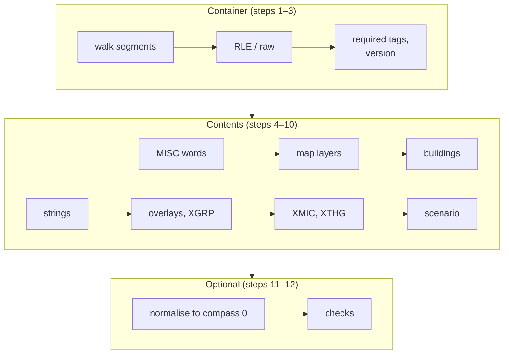

# Implementing a reader

This page is a recipe for writing a complete `.sc2` / `.scn` reader in any language, from these pages alone. It puts the steps in order, gives pseudocode for each, and links to the page that holds the details and the evidence. It adds no new facts: when this page and a segment page disagree, the segment page wins, and the difference is a bug in this page.

The reference decoder [`tools/sc2dump.py`](tools/sc2dump.py) implements every step below. Use it to check your output ([§ Testing your reader](#testing-your-reader)).

## Two paths

| Path | Steps | Gives you |
|---|---|---|
| **Minimum reader**: map and buildings | [1](#step-1-walk-the-container), [2](#step-2-decode-the-segments), [3](#step-3-check-the-container), [4](#step-4-misc-words) (words 0–2 only), [5](#step-5-map-layers) (ALTM, XTER, XBLD, XZON, XBIT), [6](#step-6-buildings), optionally [11](#step-11-normalise-to-compass-0) | Terrain, water, what is built where, each building's footprint, the city's orientation |
| **Full reader** | all steps | Every documented field of every segment |



In the pseudocode, `u16be`, `u32be` and `s32be` read big-endian numbers, `u32le` a little-endian one, and `bytes[a..b]` is the half-open range `a` to `b − 1`. Integer division truncates.

## Step 1: walk the container

Read the whole file into memory. The header is 12 bytes; segments follow with **no padding** ([container.md](container.md)).

```
if length(file) < 12 or file[0..4] != "FORM": fail "not a SimCity 2000 file"
S = u32be(file, 4)                       # bytes after this field
if file[8..12] != "SCDH": fail "not a city file"
pos = 12; consumed = 4                   # 'SCDH' counts towards S
segments = []                            # keep the order and repeats
while consumed < S:
    if pos + 8 > length(file): fail "truncated segment header"
    tag = file[pos..pos+4]; L = u32be(file, pos + 4)
    if pos + 8 + L > length(file): fail "truncated segment body"
    segments.append({tag, offset: pos, length: L, body: file[pos+8 .. pos+8+L]})
    pos += 8 + L; consumed += 8 + L
trailing = length(file) - pos            # never read by the game; 0 in every corpus file
```

- **Stop on the `FORM` size**, not on the end of the file ([container.md § Walking the segments](container.md#walking-the-segments)).
- **Do not round odd lengths up.** Every corpus file has an odd-length segment.
- **Keep unknown tags** (skip them when decoding). The game reads and discards them.
- **Keep repeated tags in order.** For city segments the last one wins ([container.md § Missing, repeated and unknown segments](container.md#missing-repeated-and-unknown-segments)). A scenario has two `TEXT` segments, so a map from tag to segment that rejects duplicates rejects every `.scn`.

## Step 2: decode the segments

Decode each segment by its tag ([container.md § Segment table](container.md#segment-table)):

| Tags | Storage | Decoded size |
|---|---|---|
| `MISC` | RLE | 4800 |
| `XTER` `XBLD` `XZON` `XUND` `XTXT` `XBIT` | RLE | 16384 each |
| `XLAB` | RLE | 6400 |
| `XMIC` | RLE | 1200 |
| `XTHG` | RLE | 480 |
| `XTRF` `XPLT` `XVAL` `XCRM` | RLE | 4096 each |
| `XPLC` `XFIR` `XPOP` `XROG` | RLE | 1024 each |
| `XGRP` | RLE | 3328 |
| `ALTM` | raw | the stored length (32768) |
| `CNAM` | raw | the stored length (32) |
| `TEXT` `SCEN` `PICT` `TMPL` | raw | the stored length; the city loader skips them |
| anything else | — | skip |

The RLE decoder ([compression.md](compression.md)):

```
decode_rle(body, size):
    out = []; i = 0
    while i < length(body) and length(out) < size:
        c = body[i]
        if c < 0x80:                     # literal run; c = 0 copies nothing
            out += body[i+1 .. i+1+c]; i += 1 + c
        else:                            # repeat run; c = 0x80 repeats once
            out += [body[i+1]] * (c - 0x7F); i += 2
    ok = (i == length(body)) and (length(out) == size)
    return out, ok
```

- Accept control bytes `0x00` and `0x80`, although the game never writes them.
- Treat `ok = false` as a damaged file. The game rejects input left over; the other cases (a run past the end of the input or the output) never occur in files the game wrote ([compression.md § Running out of input or space](compression.md#running-out-of-input-or-space)).

## Step 3: check the container

```
for tag in [MISC ALTM XTER XBLD XZON XUND XTXT XLAB XMIC XTHG XBIT
            XTRF XPLT XVAL XCRM XPLC XFIR XPOP XROG XGRP]:
    if tag not in segments: fail "missing " + tag
if s32be(MISC, 0) != 0x122: fail "unsupported version"
```

CNAM is optional ([§ Step 7](#step-7-strings)). All 20 other city segments are in every corpus file, and the game cannot load a city reliably without them ([container.md § Missing, repeated and unknown segments](container.md#missing-repeated-and-unknown-segments)).

## Step 4: MISC words

MISC is 1200 big-endian 32-bit words. Many are copied into 16- or 8-bit variables, and some files store a negative 16-bit value without sign extension (`0x0000FFFD` for −3), so **mask before use** ([misc/README.md § Widths](segments/misc/README.md#widths)):

```
for n in 0..1199:
    v = s32be(MISC, 4 * n)
    if n in WIDTH16: v = v & 0xFFFF; if v >= 0x8000: v -= 0x10000
    elif n in WIDTH8: v = v & 0xFF
    elif n in UNSIGNED32: v = v & 0xFFFFFFFF
    word[n] = v
```

`WIDTH16`, `WIDTH8` and `UNSIGNED32` (the neighbour population and economy words) are listed in [misc/README.md § Widths](segments/misc/README.md#widths). Everything else is a signed 32-bit value ([neighbours.md § Layout](segments/misc/neighbours.md#layout)).

The words a minimum reader needs:

| Word | Meaning | Page |
|---|---|---|
| 0 | Version, `0x122` | [container.md § Version check](container.md#version-check) |
| 2 | **Compass**, 0–3: how the stored map is turned | [conventions.md § The compass](conventions.md#the-compass-the-map-is-saved-as-currently-viewed) |
| 3, 4 | Founding year; days since founding (25-day months, 300-day years) | [general.md § Header and date](segments/misc/general.md#header-and-date) |
| 912 | Sea level | [altm.md § Sea level](segments/altm.md#sea-level) |

For the rest, the [word index](segments/misc/README.md#word-index) links every word to its page. Read the groups as tables: 20 age groups × 3 words from word 31, 11 industries × 3 from word 91, 256 tile counts from word 124, 50 bond rates from word 388 (the first word-6 of them are bonds), 4 neighbours × 4 from word 438, 17 technology years from word 462, 16 budget entries × 27 from word 479, the newspapers from word 916.

Treat the statistics as snapshots: many are a simulation step old, and words 124–379 are recomputed by the game on load ([misc/README.md § Recomputed and trusted](segments/misc/README.md#recomputed-and-trusted)). Ignore words 1044–1199; files from another game version keep data in 1044–1070 ([general.md § Words 1044–1199](segments/misc/general.md#words-10441199)).

## Step 5: map layers

The seven tile maps are 128 × 128, stored row by row: tile `(row, col)` is at `row * 128 + col` (ALTM: twice that, 2 bytes per tile) ([conventions.md § The city map](conventions.md#the-city-map-128--128-tiles)). On screen, row grows toward the bottom-right and col toward the bottom-left ([conventions.md § Orientation](conventions.md#orientation)).

```
w = u16be(ALTM, (row * 128 + col) * 2)
altitude     = w & 0x1F                  # 0-30
water_height = (w >> 5) & 0x1F           # only meaningful on water tiles
tunnel_depth = (w >> 10) & 0x1F          # 0 = no tunnel

ter   = XTER[row * 128 + col]            # slope shape and water kind
code  = XBLD[row * 128 + col]            # what is built
zone  = XZON[row * 128 + col] & 0x0F     # zone type
corners = XZON[row * 128 + col] & 0xF0   # building-corner bits (step 6)
und   = XUND[row * 128 + col]            # pipes, subways
txt   = XTXT[row * 128 + col]            # sign / microsim / moving object / connection
flags = XBIT[row * 128 + col]            # power, water, salt, mirror
is_water = ter >= 0x10
```

| Layer | Read it with | Page |
|---|---|---|
| ALTM | The bit fields above; water height only where XTER ≥ `0x10` | [altm.md § Bit layout](segments/altm.md#bit-layout) |
| XTER | `0x00`–`0x0D` land, `0x10`–`0x1D` underwater, `0x20`–`0x2D` shore, `0x30`–`0x3E` and `0x40`–`0x45` surface water; low bits = slope or banks | [xter.md § Values](segments/xter.md#values), [terrain-codes-xter.md](reference/terrain-codes-xter.md) |
| XBLD | One code per tile; a multi-tile building repeats its code on every tile | [xbld.md](segments/xbld.md), [tile-codes-xbld.md](reference/tile-codes-xbld.md) |
| XZON | Zone 0–9 in the low four bits; corner bits in the high four | [xzon.md](segments/xzon.md) |
| XUND | Codes `0x00`–`0x23` | [xund.md](segments/xund.md), [underground-codes-xund.md](reference/underground-codes-xund.md) |
| XTXT | 0 none, 1–`0x32` sign (XLAB slot = value), `0x34`–`0xC8` microsim (XMIC record = value − `0x33`, XLAB slot = value), `0xC9`–`0xF0` moving object (XTHG record = value − `0xC9`), `0xFA` neighbour connection | [xtxt.md § Values](segments/xtxt.md#values), [text-codes-xtxt.md](reference/text-codes-xtxt.md) |
| XBIT | Masks `0x80` conducts power, `0x40` powered, `0x20` carries water, `0x10` watered, `0x08` scratch, `0x04` covered by water, `0x02` mirror, `0x01` salt | [xbit.md § Bit layout](segments/xbit.md#bit-layout) |

Direction-dependent codes (roads, rails, pipes, slopes, the XBIT mirror flag of runways and piers) are relative to the stored view. Compare or draw them only together with the compass, or normalise first ([§ Step 11](#step-11-normalise-to-compass-0)).

## Step 6: buildings

Codes `0x70`–`0xFF` are buildings of 1×1 to 4×4 tiles. The size comes from the code ([tile-codes-xbld.md](reference/tile-codes-xbld.md)). Find each building from its **anchor**, corner D (smallest row, largest col), whose XZON corner bit depends on the compass ([xbld.md § Footprints and anchors](segments/xbld.md#footprints-and-anchors)):

```
bit(corner, compass) = 0x10 << ((corner + compass) mod 4)   # corners A=0, B=1, C=2, D=3
D = bit(3, compass)
for row in 0..127, col in 0..127:
    code = XBLD[row][col]
    if code < 0x70: continue
    n = size(code)
    z = XZON[row][col] & 0xF0
    if n == 1:
        if z == 0xF0: building(code, rows row..row, cols col..col)
    elif z == D and every tile in rows row..row+n-1, cols col-n+1..col
                   is inside the map and holds code:
        building(code, rows row..row+n-1, cols col-n+1..col)
fragments = tiles with a code >= 0x70 of size >= 2 that no building covers
```

- **Report the anchor** (row, col) with the building. That is what the game uses to identify it.
- **Fragments** are leftovers of partly overwritten buildings (37/114 files). Do not merge them into buildings ([xbld.md § Fragments](segments/xbld.md#fragments)).
- **Highways** below `0x70` also come in 2 × 2 cells aligned to even rows and cols ([xbld.md § Highways](segments/xbld.md#highways)).
- **Zone population** of each zone building counts once, at its anchor ([population.md § Zone population](segments/misc/population.md#zone-population)).

## Step 7: strings

| Where | How to read | Character set | Page |
|---|---|---|---|
| CNAM (32 bytes, optional) | The bytes from byte 1 up to the first zero or the end of the segment. Ignore byte 0. If CNAM is missing or the name is empty, use the file name without its directory, upper-cased, as the game does | Windows code page 1252 | [cnam.md § Layout](segments/cnam.md#layout) |
| XLAB (256 × 25 bytes) | Record *s* at `25 * s`: length = `min(byte 0, 23)`, then that many bytes, cut at the first zero byte. Ignore the bytes after the text | Windows code page 1252 | [xlab.md § Layout](segments/xlab.md#layout) |
| TEXT (scenario) | Bytes 4 … up to 768 bytes and the first zero | Mac Roman | [text.md § Layout](segments/text.md#layout) |

```
cnam_name = bytes 1.. of CNAM, cut at the first 0x00
label[s]  = XLAB[25*s + 1 .. 25*s + 1 + min(XLAB[25*s], 23)], cut at the first 0x00
```

- Decode Windows ANSI with the **1252** table, not Latin-1: `0x80`–`0x9F` are letters and punctuation there ([conventions.md § Strings](conventions.md#strings)).
- XLAB slot 0 is the mayor, slots 52–60 the city-wide microsims, 250 a scratch slot for the connection sign, 251–255 the sports teams ([xlab.md § Label slots](segments/xlab.md#label-slots)). To list the labels a player sees, start from the XTXT values on the map, not from the non-empty slots.

## Step 8: overlays and XGRP

| Segment | Shape | Tile `(row, col)` is in cell | Page |
|---|---|---|---|
| XTRF, XPLT, XVAL, XCRM | 64 × 64 bytes | `(row / 2, col / 2)` | [minimaps.md](segments/minimaps.md#cell-mapping) |
| XPLC, XFIR, XPOP, XROG | 32 × 32 bytes | `(row / 4, col / 4)` | [minimaps.md](segments/minimaps.md#cell-mapping) |
| XGRP | 16 series × 52 big-endian signed 32-bit values | — | [xgrp.md § Layout](segments/xgrp.md#layout) |

```
overlay64(seg, row, col) = seg[(row / 2) * 64 + col / 2]
overlay32(seg, row, col) = seg[(row / 4) * 32 + col / 4]
xgrp(series, slot)       = s32be(XGRP, series * 208 + slot * 4)
    # slots 0-11 monthly, 12-31 half-yearly, 32-51 five-yearly; newest first in each block
```

The overlays are unsigned bytes; XROG's "no change" is 127 or 128, not 0. XPOP is a building density, not people ([minimaps.md § Values](segments/minimaps.md#values)). The 16 XGRP series and their units are in [xgrp.md § Graph series](segments/xgrp.md#graph-series).

## Step 9: microsims and moving objects

**XMIC**: 150 records of 8 bytes ([xmic.md § Layout](segments/xmic.md#layout)).

```
for r in 0..149:
    base = 8 * r
    code = XMIC[base]                   # XBLD code; 0 = free
    f0   = XMIC[base + 1]
    f1   = u16be(XMIC, base + 2); f2 = u16be(XMIC, base + 4); f3 = u16be(XMIC, base + 6)
    # record r <-> XTXT value r + 0x33 <-> XLAB slot r + 0x33
```

Record 0 is unused; records 1–9 are the city-wide systems; 10–149 one building each ([xmic.md § Records](segments/xmic.md#records)). What `f0`–`f3` mean depends on `code` ([microsim-kinds-xmic.md](reference/microsim-kinds-xmic.md)).

**XTHG**: 40 records of 12 single bytes ([xthg.md § Layout](segments/xthg.md#layout)).

```
for n in 1..39:                          # record 0 is the bulldozer cursor: skip it
    rec = XTHG[12*n .. 12*n + 12]
    if rec[0] == 0: continue             # free; the other bytes are leftovers
    type = rec[0]; row = rec[3]; col = rec[4]; under = rec[10]
    if type in 10..13:                   # trains: bytes 6-8 differ
        next_tile = (rec[6], rec[7]); sprite_direction = rec[8] & 7
    else:
        sub_tile = (rec[6], rec[7]); target = (rec[8], rec[9])
```

On the object's tile, XTXT holds `0xC9` + *n*; the value it covers (a sign, a microsim) is in byte 10. Put byte 10 back before listing signs or microsims ([xthg.md § The XTXT marker](segments/xthg.md#the-xtxt-marker)). Types are listed in [thing-ids-xthg.md](reference/thing-ids-xthg.md).

## Step 10: scenario segments

`TEXT`, `SCEN` and `PICT` are found by **tag and a little-endian id** in their first 4 bytes, not by position ([container.md § Scenario segments](container.md#scenario-segments)). Everything after the id in SCEN is big-endian; the PICT size header is little-endian.

```
find(tag, id) = the segment with this tag whose u32le(body, 0) == id

list_text = find(TEXT, 0x80); briefing = find(TEXT, 0x81)
    text = body[4 .. min(length(body), 4 + 768)], cut at the first 0x00, decoded as Mac Roman

scen = find(SCEN, 0x80); f = body[4..]          # 48 or 52 bytes
    disaster = s16be(f, 0); spot = (f[2], f[3]); months = s16be(f, 4)
    goals: s32be at 6, 10, 14, 18, 22, 26
    if length(f) >= 52: life_expectancy = s16be(f, 30); education = s16be(f, 32); rest starts at 34
    else:               rest starts at 30          # the older 48-byte form
    rest: pollution, crime, traffic limits (s32be); item1, item2 (bytes); item1_tiles, item2_tiles (s16be)

pict = find(PICT, 0x80); p = body[4..]
    pixel(r, c) = p[4 + 66 * r + c] for r, c in 0..64  # ignore the stored width and height
```

- Field meanings: [scen.md § Layout](segments/scen.md#layout). Pick the layout by length ([scen.md § Two forms](segments/scen.md#two-forms-48-and-52-bytes)). The disaster spot is (row, col) in the stored map.
- Pixels are colour numbers in `PAL_MAC.BMP` with entries 0 and 255 swapped; the palette is not in the file ([pict.md § Colours](segments/pict.md#colours)).
- `TMPL` is never read by the game; it is a list of Pascal-string field names and 4-character types ([scen.md § TMPL](segments/scen.md#tmpl)).

## Step 11: normalise to compass 0

The map is stored as the player last viewed it (MISC word 2). To get a fixed orientation, apply one clockwise turn `compass` times, in this order each time ([conventions.md § Normalising a city to compass 0](conventions.md#normalising-a-city-to-compass-0)):

```
turn_grid(g, N, item):                   # new[r][c] = old[c][N-1-r]
    new[r][c] = g[c][N-1-r] for all r, c

repeat compass times:
    for ALTM (N=128, 2 bytes), XTER XBLD XZON XUND XTXT XBIT (128),
        XTRF XPLT XVAL XCRM (64), XPLC XFIR XPOP XROG (32): turn_grid
    XBLD[t] = T_XBLD[XBLD[t]]; XTER[t] = T_XTER[XTER[t]]; XUND[t] = T_XUND[XUND[t]]   for every tile t
    for every tile t:
        code = XBLD[t]; flagged = XBIT[t] & 0x02
        if 0x5D <= code <= 0x60:                                   # on-ramps
            k = code - 0x5D + (4 if flagged else 0)
            XBLD[t] = [0x60, 0x5F, 0x5E, 0x5D, 0x5E, 0x5D, 0x60, 0x5F][k]
            if k < 4: set 0x02 in XBIT[t] else clear it
        elif 0x51 <= code <= 0x5C or code in (0x6A, 0x6B):         # bridges
            if flagged: clear 0x02 in XBIT[t]; XBLD[t] = T_XBLD[code]
            else:       set 0x02 in XBIT[t]
    turn every used XTHG record 1-39, type != 0 (xthg.md § Rotation)
    if SCEN disaster != 0: spot (row, col) -> (127 - col, row)
set MISC word 2 to 0
```

Build `T_XBLD`, `T_XTER` and `T_XUND` from the cycle lists in [conventions.md § Normalising a city to compass 0](conventions.md#normalising-a-city-to-compass-0): start from the identity, map each code of a cycle `(a b c d)` to the next one (and the last to the first), and map the listed XTER and XUND codes to `0x00`.

```
table = [0, 1, …, 255]
for cycle in cycles: for i in 0..len(cycle)-1: table[cycle[i]] = cycle[(i + 1) mod len(cycle)]
for code in to_zero: table[code] = 0
```

- XZON bytes, XTXT, ALTM values, overlay values and the other XBIT bits only move ([conventions.md § Orientation](conventions.md#orientation)). The corner-bit formula of step 6 holds at every compass, so building detection works the same before and after.
- The XTHG rules: [xthg.md § Rotation](segments/xthg.md#rotation). The SCEN spot: [scen.md § The disaster spot](segments/scen.md#the-disaster-spot).
- Neighbour *k* is fixed to the land: after normalising, use the compass-0 column of [neighbours.md § Which edge each neighbour is on](segments/misc/neighbours.md#which-edge-each-neighbour-is-on).

## Step 12: checks

Cheap checks that every file the game wrote passes. A file that fails one has been edited or damaged; decide whether to warn or reject.

| Check | Holds in | Page |
|---|---|---|
| Every RLE segment decodes to exactly its size with no input left over | 114/114 | [compression.md § Evidence](compression.md#evidence) |
| No bytes after the walk | 114/114 | [container.md § Walking the segments](container.md#walking-the-segments) |
| MISC word 0 = `0x122` | 114/114 | [container.md § Version check](container.md#version-check) |
| ALTM altitude ≤ 30; bit 15 clear | 114/114 | [altm.md § Bit layout](segments/altm.md#bit-layout) |
| XBIT `0x04` only on tiles with XTER ≥ `0x10` | 114/114 | [xbit.md § 0x04](segments/xbit.md#0x04-covered-by-water) |
| XTXT never `0x33`, `0xF1`–`0xF9` or `0xFB`–`0xFF` | 114/114 | [xtxt.md § Values](segments/xtxt.md#values) |
| XUND codes ≤ `0x23` | 114/114 | [xund.md § Layout](segments/xund.md#layout) |
| 1×1 buildings carry corner bits `0xF0` | 112/114 | [xbld.md § Corner bits mark the outline](segments/xbld.md#corner-bits-mark-the-outline) |

More relations between segments, with their tallies, are collected in [cross-segment.md](cross-segment.md).

## Traps that break naive readers

Gathered from the "Pitfalls for readers" sections of every page. Each links to the page that explains it.

**Container and numbers**

- IFF padding does not exist here; odd segment lengths are followed directly by the next header ([container.md](container.md#segment-header)).
- Scenario ids are little-endian; everything else multi-byte is big-endian ([conventions.md § Byte order](conventions.md#byte-order)).
- A `.scn` has two `TEXT` segments: do not key segments by tag alone ([text.md](segments/text.md#pitfalls-for-readers)).
- Mask the narrow MISC words; a 16-bit −1 can be stored as 65 535 ([misc/README.md](segments/misc/README.md#pitfalls-for-readers)).
- Booleans in MISC can be 255: test for non-zero ([general.md](segments/misc/general.md#pitfalls-for-readers)).

**Orientation**

- The map is stored as viewed: 69/114 corpus files are not at compass 0 ([conventions.md § The compass](conventions.md#the-compass-the-map-is-saved-as-currently-viewed)).
- XZON corner bits depend on the compass; the screen-corner names in older documents hold for one compass only ([xzon.md](segments/xzon.md#pitfalls-for-readers)).
- Runway and pier direction depends on the compass, bridge direction does not ([xbit.md § 0x02](segments/xbit.md#0x02-mirror-rotate)).
- XUND and XBLD shape codes are relative to the stored view ([xund.md](segments/xund.md#pitfalls-for-readers)).
- Neighbour records belong to fixed land edges, not to the stored arrays ([neighbours.md](segments/misc/neighbours.md#pitfalls-for-readers)).

**Map layers**

- ALTM bit 7 is part of the water height, not a water flag; decide water from XTER ([altm.md](segments/altm.md#pitfalls-for-readers)).
- Water height on dry land is leftover data; altitude below sea level does not mean water ([altm.md](segments/altm.md#pitfalls-for-readers)).
- Surface water codes describe banks, not slopes ([xter.md](segments/xter.md#pitfalls-for-readers)).
- Find buildings from their anchor, not by scanning for equal codes; fragments exist ([xbld.md](segments/xbld.md#pitfalls-for-readers)).
- Straight highways `0x49`–`0x50` are 1×1 in XZON but come in 2 × 2 cells ([xbld.md § Highways](segments/xbld.md#highways)).
- XBIT `0x40`, `0x10` and `0x08` are recomputed by the game; do not trust them in an edited file ([xbit.md](segments/xbit.md#pitfalls-for-readers)).

**Text and indexes**

- XTXT is not "the label index": only 1–`0xC8` point into XLAB ([xtxt.md](segments/xtxt.md#pitfalls-for-readers)).
- A moving object hides the sign or microsim under it; the value is in XTHG byte 10 ([xthg.md](segments/xthg.md#pitfalls-for-readers)).
- CNAM byte 0 is not the length; stop at the first zero ([cnam.md](segments/cnam.md#pitfalls-for-readers)).
- XLAB: stop at the length (at most 23), not at a zero byte ([xlab.md](segments/xlab.md#pitfalls-for-readers)).
- Windows strings are code page 1252, scenario TEXT is Mac Roman ([conventions.md § Strings](conventions.md#strings)).

**Records and statistics**

- XMIC figures mean different things per building code; interpret them by byte 0 ([xmic.md](segments/xmic.md#pitfalls-for-readers)).
- XTHG record 0 and free records hold leftovers; test byte 0 and skip record 0 ([xthg.md](segments/xthg.md#pitfalls-for-readers)).
- Two overlay grid sizes; XPOP is density, XROG's zero is 128 ([minimaps.md](segments/minimaps.md#pitfalls-for-readers)).
- XGRP blocks are newest first and overlap in time ([xgrp.md](segments/xgrp.md#pitfalls-for-readers)).
- Budget month pairs are interleaved (count, rate) ([budget.md](segments/misc/budget.md#pitfalls-for-readers)).
- Each age group is people, education, health, in that order ([population.md](segments/misc/population.md#pitfalls-for-readers)).

**Scenarios**

- Pick the SCEN layout by length; its fields are big-endian ([scen.md](segments/scen.md#pitfalls-for-readers)).
- Ignore the PICT size header; read 65 × 65 with stride 66 ([pict.md](segments/pict.md#pitfalls-for-readers)).

## Testing your reader

1. Run [`tools/sc2dump.py`](tools/sc2dump.py) with `--json` on a few files and compare field by field. It prints every segment's offset, stored and decoded length, and the decoded fields; its building list follows step 6.
2. Run it with `--json --normalise` on a city saved at a compass other than 0 and compare with your normalised output.
3. Run [`tools/sc2check.py`](tools/sc2check.py) over your own SimCity 2000 folder: its tallies are the numbers these pages quote, and every check should give the same result through your reader.
4. Include at least: a city saved at each compass value, a city without CNAM, a city with CNAM last, a scenario with TMPL (`CHARLEST.SCN`), `FLINT.SCN` (its `TEXT 0x81` comes first), `MALIBU.SCN` (its PICT has 66 rows), and one of the 52-byte SCEN files (`BARCELON.SCN`, `LASVEGAS.SCN`, `PARIS.SCN`).

## Links

- [container.md](container.md), [compression.md](compression.md), [conventions.md](conventions.md): the format's frame.
- [overview.md](overview.md): all segments in one table.
- [cross-segment.md](cross-segment.md): how the segments relate.
- [writing.md](writing.md): what to watch for when writing files (not complete).
