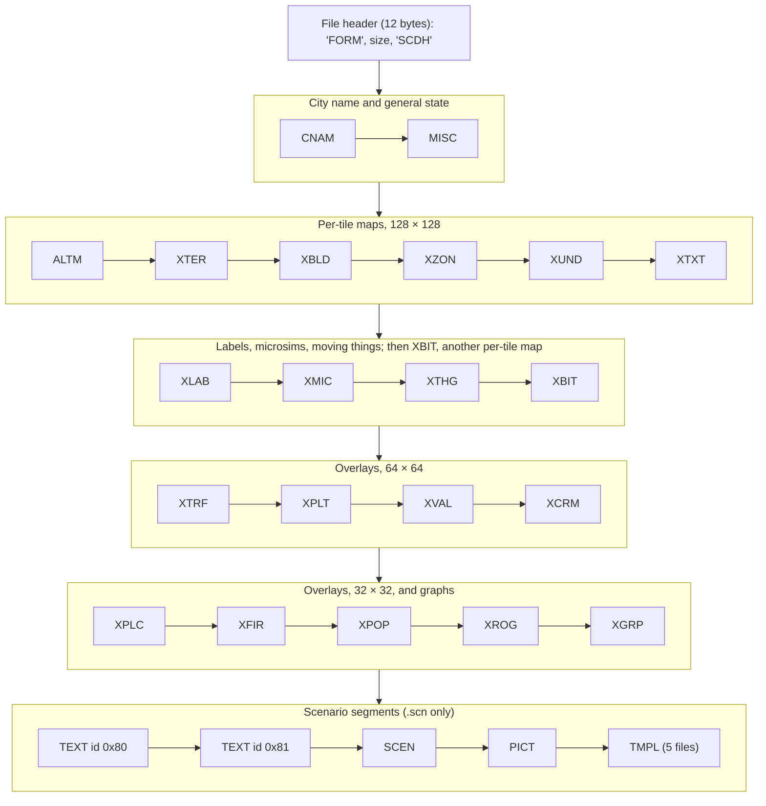
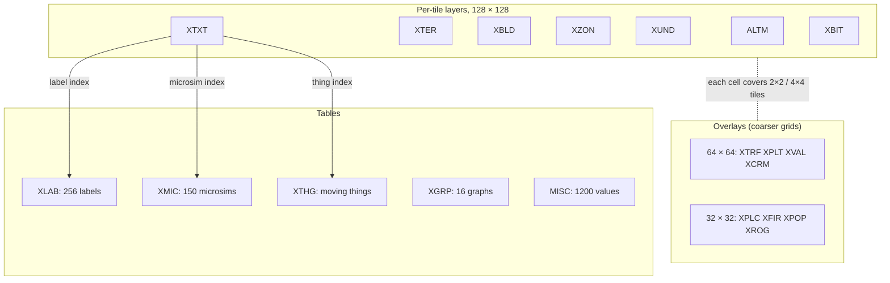

# Overview: what is in a `.sc2` file

A city file is an IFF container (`FORM` … `SCDH`) holding a list of **segments**. Each segment has a four-letter tag. Twenty segments describe the city. Scenario files (`.scn`) add three or four more segments that hold the briefing, the picture and the win conditions.

The container, segment headers and walk order are described in [container.md](container.md). Most segments are run-length encoded ([compression.md](compression.md)). Once decoded, every segment has a fixed size.

## Anatomy of a typical file

The segments in the order the game writes them, top to bottom and left to right. The loader accepts any order.

Where CNAM sits varies. It is first in 68/114 files, last in 39/114 and missing in 7/114 (**Verified (data)**). The game does not care about order ([container.md § Segment order](container.md#segment-order)).

## Segment table

"Decoded size" is the size the game decodes the segment into. It is fixed, and every file in the corpus matches it exactly (**Confirmed (code), Verified (data)** 114/114; see [container.md § Segment table](container.md#segment-table)). "Byte order fix-up" is what the loader does to the decoded bytes before use. Where the Page column says *planned*, the purpose column still summarises the older documents; it gets confirmed when that page is written.

| Tag | Stored | Decoded size | Shape | Byte order fix-up | Purpose | Page |
|---|---|---|---|---|---|---|
| `CNAM` | raw | 32 bytes in every file that has it | string | none | City name | [cnam.md](segments/cnam.md) |
| `MISC` | RLE | 4800 | 1200 × int32 | each 4-byte word big-endian | City state: date, funds, budget and ordinances, population by age, industries, neighbours, inventions, newspapers, weather, options, counters | [misc/README.md](segments/misc/README.md) |
| `ALTM` | raw | 32768 | 128 × 128 × uint16 | each 2-byte word big-endian | Altitude, water surface height and tunnel depth of each tile | [altm.md](segments/altm.md) |
| `XTER` | RLE | 16384 | 128 × 128 × byte | none | Terrain shape (slopes), sea floor, shore and surface water | [xter.md](segments/xter.md) |
| `XBLD` | RLE | 16384 | 128 × 128 × byte | none | What is built on each tile | [xbld.md](segments/xbld.md) |
| `XZON` | RLE | 16384 | 128 × 128 × byte | none | Zone type, and building-corner bits | [xzon.md](segments/xzon.md) |
| `XUND` | RLE | 16384 | 128 × 128 × byte | none | Underground: pipes, subways, subway stations | [xund.md](segments/xund.md) |
| `XTXT` | RLE | 16384 | 128 × 128 × byte | none | Per-tile index: sign or microsim label, moving object, neighbour connection | [xtxt.md](segments/xtxt.md) |
| `XLAB` | RLE | 6400 | 256 × 25-byte string | none (see note) | Label texts: mayor, signs, microsim names, team names | [xlab.md](segments/xlab.md) |
| `XMIC` | RLE | 1200 | 150 × 8-byte record | per record: bytes 0–1 as is, then three big-endian uint16 | Microsim statistics: city-wide systems, power plants, services, stadiums, arcologies | [xmic.md](segments/xmic.md) |
| `XTHG` | RLE | 480 | 40 × 12-byte record | none | Moving objects: vehicles, monster, tornado, dispatched units | [xthg.md](segments/xthg.md) |
| `XBIT` | RLE | 16384 | 128 × 128 × byte | none | Per-tile flags: power, water, salt, sprite mirror | [xbit.md](segments/xbit.md) |
| `XTRF` | RLE | 4096 | 64 × 64 × byte | none | Traffic | [minimaps.md](segments/minimaps.md#xtrf-traffic) |
| `XPLT` | RLE | 4096 | 64 × 64 × byte | none | Pollution | [minimaps.md](segments/minimaps.md#xplt-pollution) |
| `XVAL` | RLE | 4096 | 64 × 64 × byte | none | Land value | [minimaps.md](segments/minimaps.md#xval-land-value) |
| `XCRM` | RLE | 4096 | 64 × 64 × byte | none | Crime | [minimaps.md](segments/minimaps.md#xcrm-crime) |
| `XPLC` | RLE | 1024 | 32 × 32 × byte | none | Police coverage | [minimaps.md](segments/minimaps.md#xplc-police-coverage) |
| `XFIR` | RLE | 1024 | 32 × 32 × byte | none | Fire coverage | [minimaps.md](segments/minimaps.md#xfir-fire-coverage) |
| `XPOP` | RLE | 1024 | 32 × 32 × byte | none | Building density (not people) | [minimaps.md](segments/minimaps.md#xpop-building-density) |
| `XROG` | RLE | 1024 | 32 × 32 × byte | none | Rate of growth (127 and 128 = no change) | [minimaps.md](segments/minimaps.md#xrog-rate-of-growth) |
| `XGRP` | RLE | 3328 | 16 × 52 × int32 | each 4-byte word big-endian | Graph window history: 16 statistics × 52 samples (12 monthly, 20 half-yearly, 20 five-yearly), newest first | [xgrp.md](segments/xgrp.md) |
| `TEXT` | raw | 4-byte id + text | string | id is **little-endian** | Scenario briefing texts (two per file) | planned |
| `SCEN` | raw | 4-byte id + record | record | id is **little-endian** | Scenario goals, disaster, time limit | planned |
| `PICT` | raw | 4-byte id + image | image | id is **little-endian** | Scenario picture | planned |
| `TMPL` | raw | varies | records | — | Field names for `SCEN`; **never read** by the game | planned |

Notes:

- **Shapes** are fixed by the decoded sizes and by how the loader byte-swaps them (**Confirmed (code)**, loader `0x4302e0`). XGRP is 16 series of 52 values: the post-load routine `0x431fd0` walks it that way ([xgrp.md](segments/xgrp.md#layout)). The 25-byte XLAB records are **Confirmed (code)** by the label routine `0x430c00` ([xlab.md](segments/xlab.md#layout)). The XMIC and XTHG records are **Confirmed (code)** by the microsim and animation routines ([xmic.md](segments/xmic.md#layout), [xthg.md](segments/xthg.md#layout)).
- **XLAB** is not byte-swapped. Each 25-byte record starts with a length byte, which the game converts to a C string after loading ([container.md § After the walk](container.md#after-the-walk)).
- **TMPL** appears in 5 of the 18 scenario files and is not referenced anywhere in `SIMCITY.EXE` (**Confirmed (code)**: no code or data refers to the tag).

## How the parts fit together

The XTXT relations are confirmed on [xtxt.md](segments/xtxt.md#values) and the overlay grids on [minimaps.md](segments/minimaps.md#cell-mapping). All relations will be brought together in `cross-segment.md` (planned).
