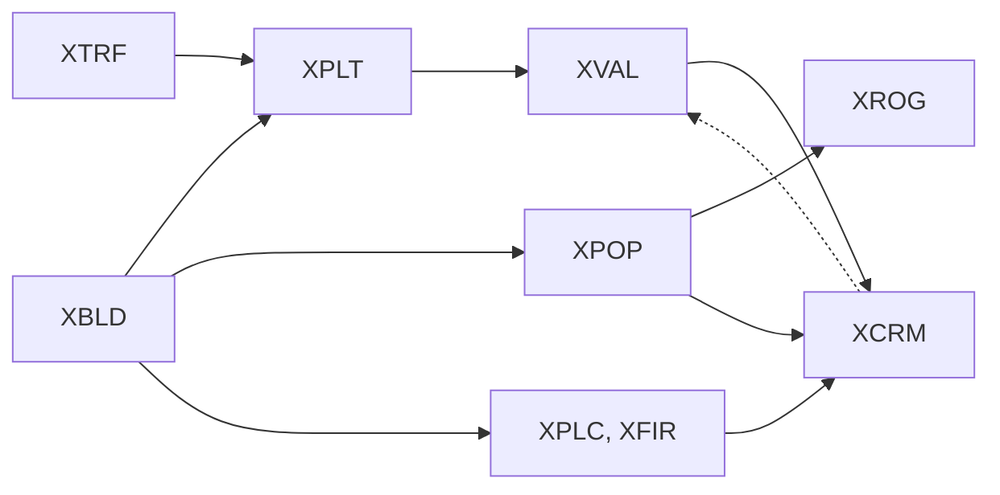

# Overlays: XTRF, XPLT, XVAL, XCRM, XPLC, XFIR, XPOP, XROG

Eight coarse grids that hold the simulation's view of the city: traffic, pollution, land value, crime, police and fire coverage, building density and growth. Each cell covers 2 × 2 or 4 × 4 tiles. The game recomputes all of them while the city runs, but **not when a city is loaded**: the stored values are what the game shows and uses until the next simulation step that touches them.

## At a glance

| Tag | Grid | Cell covers | Meaning | Computed by | Matching MISC total |
|---|---|---|---|---|---|
| `XTRF` | 64 × 64 | 2 × 2 tiles | Traffic | trips add to it (`0x457620`); step 19 decays it (`0x4586f0`) | word 12, after the decay |
| `XPLT` | 64 × 64 | 2 × 2 tiles | Pollution | step 2 (`0x46a840`) | word 13 = sum |
| `XVAL` | 64 × 64 | 2 × 2 tiles | Land value | step 2 | word 10 = sum |
| `XCRM` | 64 × 64 | 2 × 2 tiles | Crime | step 2 | word 11 = sum |
| `XPLC` | 32 × 32 | 4 × 4 tiles | Police coverage | step 2 | — |
| `XFIR` | 32 × 32 | 4 × 4 tiles | Fire coverage | step 2 | — |
| `XPOP` | 32 × 32 | 4 × 4 tiles | Building density | step 2, from XBLD alone | — |
| `XROG` | 32 × 32 | 4 × 4 tiles | Rate of growth (density change, centred on 128) | step 2 | — |

"Step *n*" is a step of the game's 25-step simulation cycle ([How the game uses it](#how-the-game-uses-it)).

## Layout

| | |
|---|---|
| Size | 4096 bytes (64 × 64) or 1024 bytes (32 × 32), RLE-compressed ([compression.md](../compression.md)) |
| Order | row by row, like the tile maps: cell `(r, c)` is at byte `r × 64 + c` or `r × 32 + c` ([conventions.md](../conventions.md#overlay-grids)) |
| Element | one unsigned byte per cell, 0–255 |
| Byte order | nothing to swap (**Confirmed (code)**: the loader `0x4302e0` does no fix-up) |

## Cell mapping

Tile `(row, col)` belongs to:

| Grid | Cell | Cell `(r, c)` covers |
|---|---|---|
| 64 × 64 | `(row / 2, col / 2)` | rows `2r`–`2r+1`, cols `2c`–`2c+1` |
| 32 × 32 | `(row / 4, col / 4)` | rows `4r`–`4r+3`, cols `4c`–`4c+3` |

(integer division)

**Confirmed (code)**, in three independent places:

- the city-view data overlay `0x43bb00` looks up the value under tile `(row, col)` at `(row / 2, col / 2)` for the 64 × 64 grids and `(row / 4, col / 4)` for the 32 × 32 ones;
- the eight map views (`0x4886c0` and the routines listed in [Evidence](#evidence)) colour each tile from the same cells;
- step 2 (`0x46a840`) reads tile `(2r, 2c)` and its 2 × 2 block for 64 × 64 cell `(r, c)`, and adds tile `(row, col)` into 32 × 32 cell `(row / 4, col / 4)`.

The same 64 × 64 cells are used by the XBIT `0x08` "developed land" mask, which the game keeps in tile rows and cols 0–63 of XBIT ([xbit.md](xbit.md#0x08-developed-land-mask-and-scratch-mark)).

## Values

All eight are unsigned bytes. The map views draw a cell with one of 15 shades for `value >> 4` = 1–15 and show the plain map when `value >> 4` is 0; XROG has its own three-band scheme. The city-view overlay `0x43bb00` does not draw values below 16 (**Confirmed (code)**).

### XTRF: traffic

| | |
|---|---|
| Range | 0–255 (capped when trips add to it) |
| Grows | Every trip a zone sends out (simulation steps 3–18, `0x4358b0` → `0x457620`) adds its weight to every 64 × 64 cell along its route, on the route's road, rail and highway pieces (**Confirmed (code)**) |
| Shrinks | Step 19 (`0x4586f0`) takes a quarter off every cell: `v = v − (v >> 2)` (**Confirmed (code)**) |
| Cleared | When the road or rail under a cell is destroyed (`0x45f760`, `0x460e10`, `0x461000`) |
| Total | Step 19 stores the sum of XTRF **right after the decay** in MISC word 12 (`0x4cc6f4`). Trips keep adding to XTRF after that, so the stored total equals the sum of XTRF only if no trip ran between step 19 and the save: 69/114 files are equal, in the other 45 word 12 is smaller (**Verified (data)**) |

A traffic helicopter report is triggered when a vehicle passes a cell above 169 (`0x4540c0`; **Confirmed (code)**).

### XPLT: pollution

Step 2 recomputes every cell from the old value, the traffic and the buildings in it, then spreads it to the four neighbours (**Confirmed (code)**, `0x46a840`):

```
S[r][c] = XTRF[r][c] / 5 + XPLT[r][c] + emissions of the 2 × 2 tiles
XPLT[r][c] = min(255, (2·S[r][c] + sum of S over the 4-neighbours inside the map) / (k + number of those neighbours))
```

- **Emissions** per tile come from a table indexed by the XBLD code (`0x4e95b8`, codes `0x70` and up), plus 200 for radioactive waste (`0x05`):

  | XBLD | Emission | XBLD | Emission |
  |---|---|---|---|
  | `0x84`–`0x87` (small industry) | 6 | `0xD8` prison | 10 |
  | `0x9E`–`0xA1` (2 × 2 industry) | 12 | `0xDC` water pump | 2 |
  | `0xA2`–`0xA5` (2 × 2 industry) | 18 | `0xDD`–`0xDF` runway, pier | 10 |
  | `0xBC`–`0xC1` (3 × 3 industry) | 24 | `0xE0`, `0xE3`–`0xE5` (seaport, airport buildings) | 5 |
  | `0xC9` gas, `0xCA` oil | 10, 25 | `0xE6`, `0xE7`, `0xF2` (tarmac, F-15, cargo yard) | 10 |
  | `0xCB` nuclear, `0xCE` fusion | 2 | `0xE9` subway station, `0xF6` hangar | 5 |
  | `0xCF` coal | 50 | `0xEC` bus station, `0xED` rail station | 3, 4 |
  | `0xD7` stadium | 4 | `0xEE`–`0xF1` (parking, loading bay, top secret) | 2 |
  | `0xF4` water treatment | 10 | `0xFB`–`0xFE` arcologies | 25, 10, 12, 15 |

  All other codes emit 0. Names are from the [XBLD code table](../reference/tile-codes-xbld.md).
- **k** = max(1, 4 + `0x4cb3dc` − `0x4c9428`), plus 1 more when bit `0x80000` of `0x4caa40` is set. `0x4cb3dc` is 1 when the city has enough water treatment plants (it compares the tile count of `0xF4` with a city total), `0x4c9428` grows with the share of heavy industry, and `0x4caa40` looks like the ordinance flags (**Inferred**). All three come from MISC and are described on the MISC pages (planned). A larger *k* makes pollution fade faster.
- **Total**: the sum of the new XPLT is stored in `0x4cc910`, MISC word 13. **Verified (data)**: word 13 equals the sum of XPLT in 114/114 files.

### XVAL: land value

Step 2 recomputes XVAL right after XPLT (**Confirmed (code)**, `0x46a840`). A cell outside the XBIT `0x08` developed-land mask gets 0. Otherwise the value depends on the cell's zone (XZON of tile `(2r, 2c)`, or of `(2r+1, 2c+1)` if the first is unzoned; zone numbers in [xzon.md](xzon.md#zone-types)):

| Zone | Starting score | Bonus for nearness to the city centre | Minus | Plus |
|---|---|---|---|---|
| 3, 4 (commercial) | amenity score A | 64 − distance | XPLT / 4, XCRM / 3 | XPOP / 3 |
| 5, 6 (industrial) | score B; +21 for zone 6 | (64 − distance) / 4 | XPLT / 16, XCRM / 4 | — |
| anything else (residential, unzoned, special) | amenity score A; +21 if XPOP < 64 | (64 − distance) / 2 | XPLT / 5, XCRM / 3 | — |

- The **scores** are averages over the 32 × 32 cell and its four neighbours of a per-tile tally made in the same step: an empty tile adds 4 (12 if it is water, XBIT `0x04`), parks (`0xD5`) 40, trees and small parks (`0x06`–`0x0D`) 20, slopes (XTER `0x01`–`0x0F`) 12 and watered tiles (XBIT `0x10`) 4, while rubble and radioactive waste (`0x01`–`0x05`) take 20 off. Score B, used for industry, only counts the water tiles (12) and watered tiles (4) (**Confirmed (code)**; the tally also starts from leftovers of the pollution calculation, so it cannot be reproduced exactly from the file alone).
- **Distance** is |row − centre row| + |col − centre col| in 64 × 64 cells, where the centre is the average position of all building tiles (XBLD `0x70` and up), recomputed in the same step (`0x4cb458`, `0x4cb45c`).
- An **abandoned building** (`0x8A`, `0x8B`, `0xAA`–`0xAD`, `0xC4`, `0xC5`; class table `0x4e7498`) on tile `(2r, 2c)` halves the result.
- The result is clamped to 0–255. XPOP and XCRM are the values from **before** this step (they are recomputed later in it).
- **Total**: the sum is stored in `0x4ca440`, MISC word 10 (**Verified (data)** 114/114).

**Verified (data)**: in the 64 files where the XBIT `0x08` mask is present, XVAL is 0 outside it in 63. The mask is often absent from a saved file because the power and water steps erase it ([xbit.md](xbit.md#0x08-developed-land-mask-and-scratch-mark)).

### XCRM: crime

Computed last in step 2 (**Confirmed (code)**, `0x46a840`):

```
raw[r][c] = 0                                       if the 64 × 64 cell is outside the XBIT 0x08 mask
raw[r][c] = XPOP[r/2][c/2] − XVAL[r][c] / 4 − XPLC[r/2][c/2] / 2   (+16 if bit 0x4 of 0x4caa40 is set)
XCRM[r][c] = clamp 0..255 of the average of raw over the cell and its 4-neighbours inside the map
```

XPOP, XVAL and XPLC are the values just computed in the same step. Bit `0x4` of `0x4caa40` is presumably an ordinance that raises crime (**Inferred**, MISC pages). **Total**: the sum is stored in `0x4cb454`, MISC word 11 (**Verified (data)** 114/114).

### XPLC: police coverage

Step 2 clears XPLC and rebuilds it (**Confirmed (code)**, `0x46a840`):

- Each police station (XBLD `0xD2`) adds its strength once, at its corner tile with XZON bit `0x80`, spread over a diamond around its 32 × 32 cell: full strength in the cell, then 4/5, then decreasing to the cells up to 3 away (`0x46ba90`, values capped at 255).
- Strength = (`0x4ca1dc` + 5) × the police funding level / 2, halved if the station is not powered (XBIT `0x40`). The funding level is read from the budget data (`0x4cc4cc` + `0x294`); both inputs are MISC values (MISC pages, planned).
- When bit `0x800` of `0x4caa40` is set (presumably an ordinance such as a neighbourhood watch, **Inferred**), every tile with an XBLD code up to `0xC5` adds 2 to its cell.

### XFIR: fire coverage

Built like XPLC in step 2 (**Confirmed (code)**): fire stations (XBLD `0xD3`) spread a strength of (fire funding level, `0x4cc4cc` + `0x304`) × 5 / 2, halved when unpowered; bit `0x10` of `0x4caa40` (presumably the volunteer fire department ordinance, **Inferred**) adds 2 per tile with a code up to `0xC5`. The fire code (`0x45f760`) uses XFIR + 8 as a probability when a fire spreads or is put out (**Inferred** which).

### XPOP: building density

Despite its name in the older documents, XPOP is not a head count. Step 2 sets it **from XBLD alone** (**Confirmed (code)**, `0x46a840`):

```
XPOP[r][c] = min(255, 4 × sum of weight(XBLD) over the tiles of the 4 × 4 cell)
```

Tiles in rows 0 and 127 and cols 0 and 127 are not counted. The weight per tile:

| XBLD | Weight | XBLD | Weight |
|---|---|---|---|
| `0x70`–`0x89` (1 × 1 homes, shops, industry, construction) | 1 | `0xA6`, `0xA7` | 2 |
| `0x8A`, `0x8B`, `0xAA`–`0xAD`, `0xC4`, `0xC5` (abandoned) | 0 | `0xA8`, `0xA9` | 3 |
| `0x8C`–`0x8F` | 2 | `0xAE`–`0xC3` (3 × 3 zone buildings) | 4 |
| `0x90`–`0x93` | 3 | `0xC6`–`0xFF` (power plants, civic, special) | 2 |
| `0x94`–`0x98`, `0x9E`–`0xA1` | 2 | `0xFB`–`0xFE` (arcologies) | 12 |
| `0x99`–`0x9D`, `0xA2`–`0xA5` | 3 | below `0x70` | 0 |

(table `0x4e9648` for codes up to `0xC5`; the rest is coded in `0x46a840`)

**Verified (data)**: XPOP is a multiple of 4 or 255 in 114/114 files. Recomputing it from XBLD with this rule matches every cell in 27/114 files and at least 90% of the cells in 101/114. The rest differ because buildings grew or were demolished after the last step 2.

The Ghidra output suggests that codes below `0x70` also add a weight from the same table, which would make power lines and rails count as dense buildings. The data rules that out: including them matches fewer files (8/114 exact). The decompiler output for this branch is wrong or misleading.

### XROG: rate of growth

Updated in step 2 right after XPOP, from the old and new XPOP (**Confirmed (code)**, `0x46a840`):

```
XROG = clamp 0..255 of (7·XROG + 8·(new XPOP − old XPOP) + 128) / 8      (division truncates toward 0)
```

It is a running average of density change: **128 means no change**, higher means growth, lower means decline. A new map starts every cell at 127 (`0x40e250`), and both 127 and 128 are stable under the formula. The map view draws values below 125 as decline, 131 and above as growth, and leaves 125–130 uncoloured (`0x488db0`).

**Verified (data)**: 127 and 128 are by far the most common values (55 985 and 45 403 cells); 12/114 files hold nothing but 127 and 128.

## How the game uses it

The simulation runs a cycle of 25 steps, picked by MISC word 4 (copied to `0x4cae04`) modulo 25 (**Confirmed (code)**, dispatcher `0x413520`):

| Step | Routine | Overlays |
|---|---|---|
| 1 | `0x467860` power | — |
| 2 | `0x46a840` | recomputes XPLT, XVAL, XPLC, XFIR, XPOP, XROG, XCRM, in that order; updates MISC words 10, 11, 13 |
| 3–18 | `0x4358b0` zone growth, one block of the map per step | reads XVAL, XPLT, XCRM; trips add to XTRF |
| 19 | `0x4586f0` | decays XTRF; updates MISC word 12 |
| 20 | `0x464550` water | — |

What step 2 computes each overlay from (tile maps on the left; a dotted line is a value from the previous step 2):



XVAL also reads the previous XPOP, XZON, XTER and XBIT; XPLC and XFIR read XZON and XBIT `0x40`.

Other uses (**Confirmed (code)** unless marked):

- **Zone growth** (`0x4358b0`) needs land value above 31, 95 or 191 to develop a block to the next level, and rates a microsim location as XVAL / 32 − XCRM / 32 − XPLT / 32 + 12 (halved if unpowered).
- A **new one-tile home** takes its wealth level from XVAL >> 6, capped at 2 (`0x436e80`).
- A **disaster** of type 4 in `0x471bc0` starts at the most polluted cell above 149 (**Inferred**: which disaster).
- The **query tool**, the **map views** and the **city-view data overlays** show the values ([Values](#values)).

### What to trust

Loading a city does **not** recompute any of the eight (**Confirmed (code)**: the post-load routines `0x434b70`, `0x434f80` and `0x431fd0` do not touch them, and step 2 is not called). So:

- The stored values are what the game displays, and what zone growth uses, until step 2 (or step 19 for XTRF) comes round.
- The next step 2 builds on the stored XPLT, XROG and XTRF, and on the stored XPOP and XCRM for land value. Stored values therefore carry into the future of the city.
- XPOP can be recomputed exactly from XBLD (see above). The others depend on the city's history and on MISC values.

## Rotation

The view rotation routines move the overlays with the tile maps (`0x465f00` for a clockwise turn, `0x467100` for the opposite one): the same 4-cycle as the tile maps, with `N` = 64 or 32 ([conventions.md](../conventions.md#orientation)). Values are not changed (**Confirmed (code)**: only swaps). **Verified (data)**: normalising `test-rotated.sc2` (compass 3) reproduces all eight overlays of `test.sc2` byte for byte.

## Evidence

| Claim | Code | Data (`sc2check.py --only minimap`) |
|---|---|---|
| Sizes, no byte swap | loader `0x4302e0` | 114/114 decode exactly |
| Cell mapping | `0x43bb00`; map views `0x4886c0` (XTRF), `0x4891b0` (XPLT), `0x489300` (XVAL), `0x488f10` (XCRM), `0x489060` (XPLC), `0x489450` (XFIR), `0x488c60` (XPOP), `0x488db0` (XROG); `0x46a840` | — |
| XPLT, XVAL, XPLC, XFIR, XPOP, XROG, XCRM formulas | `0x46a840`, spread `0x46ba90` / `0x46ba20` | XPOP: 27/114 exact, 101/114 ≥ 90% of cells |
| Codes below `0x70` add nothing to XPOP | — | 27/114 exact vs 8/114 if they did |
| MISC words 10, 11, 13 = sums of XVAL, XCRM, XPLT | `0x46a840`, MISC loader `0x431330` | 114/114 each |
| MISC word 12 = XTRF sum after the decay | `0x4586f0` | 69/114 equal, 45/114 smaller |
| XROG centred on 128 | `0x46a840`, new map `0x40e250`, map view `0x488db0` | 12/114 files only 127/128 |
| Not recomputed on load | `0x4302e0`, `0x434b70` | — |
| Cities never simulated | — | 11/114 have all-zero XTRF, XPLT, XVAL, XCRM |
| Rotation only moves values | `0x465f00`, `0x467100` | test pair byte for byte |

## Pitfalls for readers

- **Mind the grid size.** Four overlays are 64 × 64 and four are 32 × 32. Reading a 32 × 32 one with the 64 × 64 mapping silently gives wrong values for most tiles.
- **XPOP is not population.** It is a weighted building density, capped at 255; the city's population is in MISC.
- **XROG's zero point is 128,** not 0. 127 also means "no change" (a new map starts there).
- **MISC word 12 is not the sum of XTRF.** Use the sum of XTRF for the current traffic and word 12 only for what the game showed at its last decay step.
- **Stored overlays can be stale.** They describe the city at the last step 2 (or 19), not necessarily the buildings in XBLD now. Recompute XPOP from XBLD if you need it to match the map.
- **The overlays follow the compass.** Like the tile maps they are stored as the player last viewed the city ([conventions.md § Orientation](../conventions.md#orientation)).
