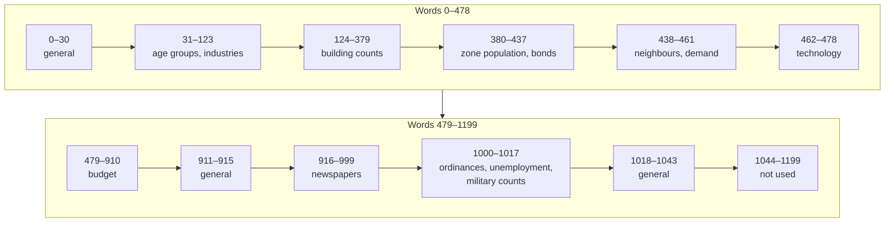

# MISC: city state and statistics

MISC holds everything about a city that is not a map or a label: the date, the money, the budget, taxes and ordinances, the population by age, the industries, the neighbours, the inventions, the newspapers, the weather, the game options and many counters. It is 1200 numbers. This page explains how they are stored and lists every word with a link to the page that describes it.

## At a glance

| | |
|---|---|
| Tag | `MISC` |
| Compressed | yes (RLE, [compression.md](../../compression.md)) |
| Decoded size | 4800 bytes |
| Element | 1200 big-endian 32-bit words, numbered 0–1199 |
| Byte offset of word *n* | 4 × *n* |
| Loader / saver | `0x431330` / `0x433a40` |

## How the words are stored

The loader decodes the segment, swaps every word to the machine's byte order, checks word 0 and then copies the words one by one into the game's variables (**Confirmed (code)**: `0x431330`). The saver does the reverse (`0x433a40`). The two walk the words in the same order, so each word has exactly one meaning.

- **Word 0 is the file version** and must be `0x122` (290); otherwise the game refuses the file ([container.md § Version check](../../container.md#version-check)).
- **Many variables are narrower than 32 bits.** The loader keeps only the low 16 bits of some words and the low 8 bits of others ([Widths](#widths)). The Windows 95 saver writes 16-bit values sign-extended and 8-bit values zero-extended. **Some files from another version do not sign-extend**: a 16-bit −3 can be stored as `0x0000FFFD` (28/114 files have such building counts, [tile-counts.md](tile-counts.md#pitfalls-for-readers)). **Read a 16-bit word as the signed value of its low 16 bits**, and an 8-bit word as its low byte.
- **Words 1044–1199 are not loaded**, and the Windows 95 saver writes them as 0. Files written by another version of the game keep data in words 1044–1070 ([general.md § Words 1044–1199](general.md#words-10441199)).
- **Many words are snapshots.** The simulation updates them at fixed steps of its 25-step cycle, so how they relate to each other and to the maps depends on the day the file was saved (MISC word 4 mod 25). The pages say where this matters.

## Word index

Byte offsets are hexadecimal. "Recomputed" means the game overwrites the stored value soon after loading, so a reader may get it from the maps instead.

| Words | Bytes | Contents | Type | Page |
|---|---|---|---|---|
| 0 | `0x000` | File version, `0x122` | int32 | [general.md § Header and date](general.md#header-and-date) |
| 1 | `0x004` | City mode: 0 terrain editor, 1 city, 2 disaster | int16 | [general.md § Header and date](general.md#header-and-date) |
| 2 | `0x008` | Compass, 0–3 | int16 | [general.md § Header and date](general.md#header-and-date), [conventions.md § Orientation](../../conventions.md#orientation) |
| 3 | `0x00C` | Founding year | int16 | [general.md § Header and date](general.md#header-and-date) |
| 4 | `0x010` | Days since founding (25-day months, 300-day years) | int32 | [general.md § Header and date](general.md#header-and-date) |
| 5 | `0x014` | Funds | int32 | [general.md § Money and difficulty](general.md#money-and-difficulty) |
| 6 | `0x018` | Bonds outstanding, 0–50 | int32 | [general.md § Money and difficulty](general.md#money-and-difficulty) |
| 7 | `0x01C` | Difficulty | int16 | [general.md § Money and difficulty](general.md#money-and-difficulty) |
| 8 | `0x020` | Reward level: population milestones passed, 0–8 (also the number of newspapers) | int16 | [general.md § Rewards](general.md#rewards) |
| 9 | `0x024` | City value, for the bond limit | int32 | [general.md § Money and difficulty](general.md#money-and-difficulty) |
| 10–13 | `0x028`–`0x037` | Sums of XVAL, XCRM, XTRF (after the decay) and XPLT | int32 | [general.md § Statistics](general.md#statistics), [minimaps.md](../minimaps.md#values) |
| 14, 15 | `0x038`–`0x03F` | Never used (**Unused**) | int32 | [general.md § Layout](general.md#layout) |
| 16 | `0x040` | Running sum of the population, never read (**Unused**) | int32 | [general.md § Statistics](general.md#statistics) |
| 17–19 | `0x044`–`0x04F` | Work force %, life expectancy, education quotient | int32 | [general.md § Statistics](general.md#statistics), [population.md](population.md#words-derived-from-the-age-groups) |
| 20–23 | `0x050`–`0x05F` | National population (thousands), GNP, Fed Rate, national trend | int32, int16 | [general.md § Statistics](general.md#statistics) |
| 24–27 | `0x060`–`0x06F` | Weather: heat (°F + 100), wind, humidity, type | int8 | [general.md § Weather](general.md#weather) |
| 28 | `0x070` | Pending disaster | int16 | [general.md § Disasters](general.md#disasters) |
| 29 | `0x074` | Residents last month | int32 | [general.md § Statistics](general.md#statistics) |
| 30 | `0x078` | Rewards available (bit mask) | int16 | [general.md § Rewards](general.md#rewards) |
| 31–90 | `0x07C`–`0x16B` | 20 age groups × (people, education total, health total) | int32 | [population.md § Age groups](population.md#age-groups) |
| 91–123 | `0x16C`–`0x1EF` | 11 industries × (demand, tax rate, size) | int16, int16, int32 | [population.md § Industries](population.md#industries) |
| 124–379 | `0x1F0`–`0x5EF` | Tiles per XBLD code outside the military base. Recomputed | int16 | [tile-counts.md](tile-counts.md#building-counts-words-124379) |
| 380–387 | `0x5F0`–`0x60F` | Population units by zone: total, six zone types, abandoned buildings | int32 | [population.md § Zone population](population.md#zone-population) |
| 388–437 | `0x610`–`0x6D7` | Bond interest rates, in issue order (the first word-6 slots) | int16 | [population.md § Bonds](population.md#bonds) |
| 438–453 | `0x6D8`–`0x717` | 4 neighbours × (name id, population, economy, unused) | int16, int32 | [neighbours.md](neighbours.md#layout) |
| 454–461 | `0x718`–`0x737` | Residential, commercial, industrial demand; 5 unused | int16 | [demand.md](demand.md#layout) |
| 462–478 | `0x738`–`0x77B` | Year each of 17 inventions arrives; 0 = available | int16 | [technology.md](technology.md#layout) |
| 479–910 | `0x77C`–`0xE3B` | Budget: 16 entries × (count, rate, year to date, 12 × (count, rate)) | int32 | [budget.md § Entries](budget.md#entries) |
| 911 | `0xE3C` | Year end pending | int32 | [general.md § Budget year end](general.md#budget-year-end) |
| 912 | `0xE40` | Sea level | int16 | [altm.md § Sea level](../altm.md#sea-level) |
| 913, 914 | `0xE44`–`0xE4B` | Terrain options: coast, river | int32 | [general.md § Terrain options](general.md#terrain-options-and-the-military-base) |
| 915 | `0xE4C` | Military base: offer result and type | int8 | [general.md § Terrain options](general.md#terrain-options-and-the-military-base) |
| 916–945 | `0xE50`–`0xEC7` | 6 newspapers × 5 bytes | int8 | [newspapers.md § Papers](newspapers.md#papers-words-916945) |
| 946–999 | `0xEC8`–`0xF9F` | 9 story slots × (type, priority, parameter, 3 phrase choices) | int16, int8 | [newspapers.md § Stories](newspapers.md#stories-words-946999) |
| 1000 | `0xFA0` | Ordinances in force (bits 0–19) | int32 | [ordinances.md § Bits](ordinances.md#bits) |
| 1001 | `0xFA4` | Unemployment % (newest graph value) | int32 | [xgrp.md § Graph series](../xgrp.md#graph-series) |
| 1002–1017 | `0xFA8`–`0xFE7` | Military-base tiles by building. Not recomputed | int16 | [tile-counts.md](tile-counts.md#military-counts-words-10021017) |
| 1018 | `0xFE8` | Subway tiles. Not recomputed | int16 | [general.md § Counters](general.md#counters) |
| 1019–1027 | `0xFEC`–`0x100F` | Game options: speed, auto budget, auto goto, sound, music, no disasters, newspaper options | int16, int32 | [general.md § Game options](general.md#game-options) |
| 1028, 1029 | `0x1010`–`0x1017` | View centre tile (packed), zoom | int16 | [general.md § View](general.md#view) |
| 1030, 1031 | `0x1018`–`0x101F` | Centre of the buildings (row, col) | int16 | [general.md § Counters](general.md#counters) |
| 1032 | `0x1020` | People in large microsim buildings (**Inferred**) | int32 | [general.md § Layout](general.md#layout) |
| 1033 | `0x1024` | Never used (**Unused**) | int16 | [general.md § Layout](general.md#layout) |
| 1034 | `0x1028` | Sports teams (bit mask) | int16 | [general.md § Counters](general.md#counters) |
| 1035 | `0x102C` | Population: 10 × word 380 | int32 | [general.md § Statistics](general.md#statistics) |
| 1036–1039 | `0x1030`–`0x103F` | Industry bonus, heavy-industry level, arrests, police bonus | int16 | [general.md § Counters](general.md#counters) |
| 1040–1042 | `0x1040`–`0x104B` | Disaster object (−1 = none), current disaster, disaster active | int16, int32 | [general.md § Disasters](general.md#disasters) |
| 1043 | `0x104C` | Water treatment plants cover the water delivered | int16 | [general.md § Counters](general.md#counters) |
| 1044–1199 | `0x1050`–`0x12BF` | Not loaded; 0 from the Windows 95 saver | — | [general.md § Words 1044–1199](general.md#words-10441199) |

## Widths

What the loader keeps of each word. Everything not listed is a full 32-bit signed value.

| Kept | Words |
|---|---|
| low 16 bits, signed | 1–3, 7, 8, 22, 23, 28, 30, the first two words of each industry (91 + 3*k*, 92 + 3*k*), 124–437, the name ids 438, 442, 446, 450, 454–478, 912, the first two words of each story slot (946 + 6*s*, 947 + 6*s*), 1002–1019, 1027–1031, 1033, 1034, 1036–1041, 1043 |
| low 8 bits, unsigned | 24–27, 915–945, the last four words of each story slot (948 + 6*s* … 951 + 6*s*) |

`sc2dump.py` applies this table (`misc_words`) before naming the fields.

## Recomputed and trusted

| Words | After loading |
|---|---|
| 124–379 | Recounted from XBLD and XZON (`0x434f80`) |
| 10–13, 17–19, 380–387, 1001, 1037, 1043 and others | Recomputed at their step of the simulation cycle, so a stored value can be a step old ([population.md](population.md#how-the-game-uses-it), [minimaps.md](../minimaps.md#what-to-trust)) |
| everything else | Used as stored. Among them: funds, the budget, the bond rates, the military counts and the subway count, which nothing recounts |

## Evidence

| Claim | Code | Data |
|---|---|---|
| Word → variable map, widths | loader `0x431330`, saver `0x433a40` | all 114 files decode |
| Version word | `0x431330` | 114/114 = `0x122` |
| Words 1044–1199 not loaded, saved as 0 | `0x431330`, `0x433a40` | 0 in 54/114; data in 1044–1070 in the 60 files of another version |
| Unextended 16-bit values | — | building counts in 28/114 files |

The tallies are produced by the `misc_` checks of [`sc2check.py`](../../tools/sc2check.py).

## Pitfalls for readers

- **Mask the narrow words** ([Widths](#widths)). Reading every word as a signed 32-bit number gives counts of 65 000 where the game sees −1.
- **Do not expect totals to match the maps exactly.** Most statistics are a snapshot from the last time their simulation step ran.
- **Words 1044–1070 are not part of the Windows 95 format.** Ignore them, or treat them as a hint that the file came from another version.
- **OpenCity2k's offsets are byte offsets** (`0x0FA4` = word 1001); djm numbers the words (#3 = word 3).

## Pages

| Page | Words |
|---|---|
| [general.md](general.md) | 0–30, 911–915, 1018–1199 |
| [population.md](population.md) | 31–123, 380–437 |
| [tile-counts.md](tile-counts.md) | 124–379, 1002–1017 |
| [neighbours.md](neighbours.md) | 438–453 |
| [demand.md](demand.md) | 454–461 |
| [technology.md](technology.md) | 462–478 |
| [budget.md](budget.md) | 479–910 |
| [newspapers.md](newspapers.md) | 916–999 |
| [ordinances.md](ordinances.md) | 1000 |
