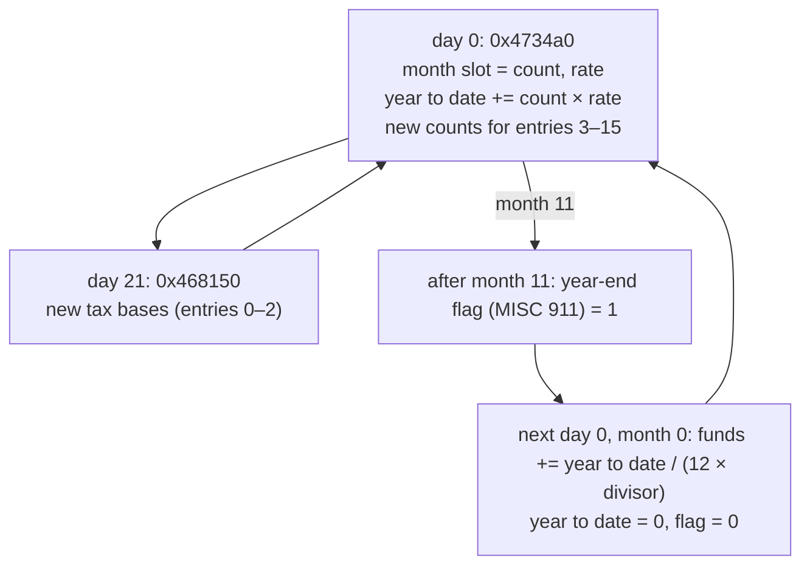

# MISC words 479–910: the budget

432 words of MISC hold the city's **budget**: one 27-word entry for each of the 16 lines the game keeps money for (three property taxes, ordinances, bonds, five city services and six kinds of transport). Each entry stores what the line is charged on and at what rate, the total so far this year, and that pair for every month of the year. The game turns the year's totals into money once a year. A reader can rebuild the Budget window from these words. The ordinances themselves (word 1000) are on [ordinances.md](ordinances.md).

## At a glance

| | |
|---|---|
| Words | 479–910 (bytes `0x77C`–`0xE3B`), part of [MISC](README.md) |
| Shape | 16 entries × 27 words |
| Element | signed 32-bit integer, big-endian |
| Game variable | `0x4cc4cc`, a 1792-byte table: 16 entries of 28 words (`0x70` bytes) (**Confirmed (code)**: allocated by `0x42cef0`, filled by the MISC loader `0x431330`, written back by the saver `0x433a40`) |
| Not stored | the 28th word of each entry, the estimated total for the year |

## Layout

Entry *e* (0–15) starts at word 479 + 27*e*. Its 27 words are (**Confirmed (code)**: `0x431330` and `0x433a40` copy them in this order):

| Word in entry | Name | Game field | Meaning |
|---|---|---|---|
| 0 | count | + `0x60` | What the line is charged on this month: tax base, number of bonds, buildings or tiles (per entry, [below](#entries)) |
| 1 | rate | + `0x64` | Tax rate, funding percentage or bond rate (per entry) |
| 2 | year to date | + `0x68` | Sum of count × rate over the months of this year so far |
| 3 + 2*k* | month *k* count | + 4*k* | The count used in month *k* (0–11) |
| 4 + 2*k* | month *k* rate | + `0x30` + 4*k* | The rate used in month *k* |

So the month pairs are interleaved: words 3 and 4 are month 0, words 5 and 6 month 1, …, words 25 and 26 month 11. Month 0 is the first month of the game year ([general.md](general.md) has the calendar).

The game field + `0x6C` (the estimated total for the year) is not saved. The Budget window recomputes it whenever it opens (`0x4189c0`): (11 − month) × count × rate + year to date, or 12 × count × rate when the year has just ended ([§ The year end](#the-year-end)).

### Entries

| *e* | First word | Bytes | Entry | count (word 0) | rate (word 1) | Divisor |
|---|---|---|---|---|---|---|
| 0 | 479 | `0x77C` | Residential tax | Tax base: (MISC words 381 + 382) × 10 + MISC word 1032 / 6 | Tax rate, % (0–20) | 75 |
| 1 | 506 | `0x7E8` | Commercial tax | (words 383 + 384) × 10 + word 1032 / 12 | Tax rate, % (0–20) | 75 |
| 2 | 533 | `0x854` | Industrial tax | (words 385 + 386) × 10 + word 1032 / 12 | Tax rate, % (0–20) | 75 |
| 3 | 560 | `0x8C0` | Ordinances | Net monthly amount of the enacted ordinances (signed) | always 1 | 75 |
| 4 | 587 | `0x92C` | Bonds | Bonds outstanding (= MISC word 6) | Average bond rate, % × 10 000 | −100 |
| 5 | 614 | `0x998` | Police | Police stations (XBLD `0xD2` tiles / 9) | Funding, % (0–100, steps of 5) | −1 |
| 6 | 641 | `0xA04` | Fire | Fire stations (XBLD `0xD3` tiles / 9) | Funding, % | −1 |
| 7 | 668 | `0xA70` | Health | Hospitals (XBLD `0xD1` tiles / 9) | Funding, % | −2 |
| 8 | 695 | `0xADC` | Schools | Schools (XBLD `0xD6` tiles / 9) | Funding, % | −4 |
| 9 | 722 | `0xB48` | Colleges | Colleges (XBLD `0xD9` tiles / 16) | Funding, % | −1 |
| 10 | 749 | `0xBB4` | Roads | Road tiles, see [below](#transport-counts), + 250 per bus station | Funding, % | −1000 |
| 11 | 776 | `0xC20` | Highways | Highway tiles | Funding, % | −500 |
| 12 | 803 | `0xC8C` | Bridges | Bridge tiles | Funding, % | −400 |
| 13 | 830 | `0xCF8` | Rail | Rail tiles + rail station tiles | Funding, % | −250 |
| 14 | 857 | `0xD64` | Subway | Subway station tiles + subway tiles (MISC word 1018) | Funding, % | −250 |
| 15 | 884 | `0xDD0` | Tunnels | Tunnel entrance tiles | Funding, % | −250 |

The **divisor** is a constant of the game (table `0x4e9eb0`, the same values at `0x4e6ad8`). It turns count × rate into dollars: a positive divisor makes the line income, a negative one an expense ([§ The year end](#the-year-end)). All entries are **Confirmed (code)**; the counts are recomputed every month by `0x4734a0` (entries 3–15) and `0x468150` (entries 0–2).

What the counts and rates mean in dollars per year, at a rate of 100 % (dollars = 12 × count × rate / (12 × divisor)):

| Entry | Cost or income per year |
|---|---|
| Taxes | tax base × rate / 75 |
| Ordinances | monthly amount / 75 (the figure the Ordinances window shows per ordinance) |
| Bonds | 100 × the sum of the bond rates in %: a $10 000 bond at *r* % costs 100 × *r* |
| Police, fire, colleges | $100 per building |
| Health | $50 per hospital |
| Schools | $25 per school |
| Roads | $0.10 per tile; a bus station counts as 250 road tiles, $25 |
| Highways | $0.20 per tile |
| Bridges | $0.25 per tile |
| Rail, subway, tunnels | $0.40 per tile |

These follow from the divisors and the Budget window's arithmetic (**Confirmed (code)**: `0x4189c0` shows each line as year to date / (12 × divisor)). They are not stated anywhere in the file.

### Transport counts

At the start of each month `0x4734a0` sets the six transport counts from the tile count per XBLD code (MISC words 124–379, kept up to date by the game; the [XBLD code table](../../reference/tile-codes-xbld.md) names the codes):

| Entry | XBLD codes counted |
|---|---|
| Roads | `0x1D`–`0x2B` (roads), `0x3F`–`0x46` (tunnel entrances and road crossings), `0x4B`, `0x4C` (highway over road), `0x5D`–`0x60` (on-ramps); plus 250 × (bus station tiles `0xEC` / 4) |
| Highways | `0x49`–`0x50`, `0x61`–`0x6B` |
| Bridges | `0x51`–`0x5C` (including the elevated power line `0x5C`), `0x6A`, `0x6B` |
| Rail | `0x2C`–`0x3E`, `0x45`–`0x48`, `0x4D`, `0x4E`, `0x6C`–`0x6F`; plus the rail station tiles `0xED` (not divided by 4) |
| Subway | subway station tiles `0xE9` + the subway tile count (MISC word 1018) |
| Tunnels | `0x3F`–`0x42` |

Some codes are counted twice: tunnel entrances in Roads and Tunnels, the highway bridges `0x6A` and `0x6B` in Highways and Bridges.

## How the game uses it

### Every month

At the start of each month (day 0 of the 25-day month, simulation step 0 in `0x413520`) the game runs `0x4734a0`, which for every entry:

1. copies the current count and rate into the month's pair (month *k* = the new month),
2. adds count × rate to the year to date,
3. then sets the counts of entries 3–15 for the coming month: bonds from MISC word 6, the five services from the building counts, the transport counts as above, and the ordinance amount from the ordinances in force ([ordinances.md](ordinances.md#amounts)).

The tax bases (entries 0–2) are set later in the month, at step 21, by `0x468150` from the population figures in MISC words 380–386, which the game clears at day 0 and refills during the month.

### The year end

When `0x4734a0` has filled month 11, it sets MISC word 911 (`0x4cad2c`) to 1. At the next day 0 (month 0 of the new year) the game first opens the Budget window (`0x4731e0`, unless auto-budget, MISC word 1020, is on), then for each entry adds year to date / (12 × divisor) to the funds (MISC word 5), with C integer division, and zeroes the year to date. It clears word 911 and carries on with step 1 above (**Confirmed (code)**: `0x413520`, `0x4734a0`). If the funds end up negative while auto-budget is on, the game switches auto-budget off.

Budget money therefore moves only once a year. During the year the funds change only through one-off amounts, such as building costs or the $10 000 from issuing a bond (`0x473a40`).

### Rates

| Rates | Set by | Range |
|---|---|---|
| Residential and commercial tax | Budget window arrows (`0x418330`, all three taxes together) or the property tax dialog (`0x419f60`, `0x419fa0`) | 0–20, steps of 1 |
| Industrial tax | Budget window arrows: through `0x473d80`, which moves all 11 per-industry rates (MISC words 91–123, [population.md](population.md)) and sets this rate to their rounded average, (sum + 6) / 11. The property tax dialog (`0x419ff0`) sets it directly | 0–20 |
| Ordinances | never changed after a new city sets it to 1 | 1 |
| Bonds | issuing a bond (`0x473a40`; Ghidra shows the same code a second time as `0x473a5f`): sum of the bond rates (MISC words 388–437) × 10 000 / number of bonds. No code that lowers the bond count was found | — |
| Funding | Budget window arrows (`0x4184a0` police, `0x418590` fire, `0x418680` health, `0x418770` schools and colleges together, `0x4188b0` all transport) and the transport dialog (`0x41c880` … `0x41ca10`, one per line) | 0–100, steps of 5 |

A new city starts with tax rates 7, ordinances rate 1, bond rate 0 and every funding at 100; all counts and totals 0 (`0x40e250`, table `0x4e6730`).

### What the rates do in the simulation

| Rate | Used by | Effect |
|---|---|---|
| Police funding | step 2 (`0x46a840`) | Strength of each police station in XPLC: (MISC word 1039 + 5) × funding / 2 ([minimaps.md](../minimaps.md#xplc-police-coverage)) |
| Fire funding | step 2 (`0x46a840`) | Strength of each fire station in XFIR: funding × 5 / 2 |
| Health funding | `0x468d30` | Hospital capacity in the health calculation: hospitals × funding × 25 / 100 |
| School and college funding | `0x468d30` | Capacity in the education calculation: schools × funding × 15 / 100, colleges × funding × 50 / 100 |
| Transport funding | zone growth, steps 3–18 (`0x4358b0`) | Below 100 %, each visit to a transport tile turns it into rubble (roads, rail, highways) or destroys it (bridges, tunnels, subway) with a chance of roughly (100 − funding) % |
| Services funding | the microsims (`0x44e390`, `0x44ddc0`) | Scores of the police, fire, hospital and school microsims |

The advisors read the same values (`0x41a490`), for example the financial advisor compares the bond payments with the tax income.

## Evidence

All tallies from `sc2check.py --only misc_budget` over the 114-file corpus (96 cities, 18 scenarios).

| Claim | Code | Data |
|---|---|---|
| 16 entries × 27 words, field order | `0x431330`, `0x433a40` | — |
| Entry meanings and divisors | `0x4734a0`, `0x4189c0`, `0x41a490`; tables `0x4e9eb0`, `0x4e6ad8` | counts below |
| Year to date = Σ count × rate over months 0 … current (all 12 if word 911 is set) | `0x4734a0` | all 16 entries: 95/96 cities, 6/18 scenarios |
| The current month's pair equals count and rate | `0x4734a0` | bonds 114/114; police 110, fire 110, health 111, schools 109, colleges 112 |
| Bond count = MISC word 6 | `0x4734a0`, `0x473a40` | 114/114 |
| Bond rate = Σ bond rates × 10 000 / count | `0x473a40`, `0x42e460` | 12/15 files with bonds (the other 3 hold garbage, [Pitfalls](#pitfalls-for-readers)) |
| Service counts from MISC tile counts | `0x4734a0` | schools 114, colleges 113, health 112, fire 111, police 110 |
| Transport counts from MISC tile counts | `0x4734a0` | highways 112, subway 111, tunnels 110, rail 109, bridges 107, roads 99 |
| Ordinance amount = Σ of the enacted ordinances' amounts | `0x4734a0`, `0x42bca0` | 91/91 files saved before day 21 |
| Tax bases from MISC words 381–386 and 1032 | `0x468150` | 23/23 files saved on day 21 or later |
| Tax rates 0–20, funding 0–100 | `0x418330`, `0x4184a0` … | 114/114; funding a multiple of 5: 113/114 |
| Ordinances rate = 1 | `0x40e250` | 114/114 |
| Industrial rate = rounded average of the 11 industry rates | `0x473d80` | 89/114 (the property tax dialog sets it on its own) |
| Word 911 set only after month 11 | `0x4734a0` | 4 files with 1, all in month 11; 2 scenarios hold 255 |

The counts that do not match were changed after the last monthly update: the tile counts are kept current, the budget counts only at day 0. Files saved before the first monthly update hold 0.

## Pitfalls for readers

- **The month pairs are interleaved**, count then rate, not 12 counts followed by 12 rates.
- **Months are game months**, indexed from the start of the game year, and only months 0 … current hold this year's values. The others still hold last year's.
- **Money is count × rate / (12 × divisor) per month**, not count × rate. The divisors are not in the file; take them from the table above. Use integer division truncating toward zero per entry, as the game does at the year end.
- **The bond rate is an average × 10 000**, not a percentage. The individual bonds are in MISC words 388–437 ([population.md](population.md)).
- **The industrial tax rate need not be the average of the industry rates**: both are stored and both are used.
- **Garbage bonds.** Six files hold −15 532 in bond slots 0–2 (`EM.SC2`, `FLOATING.SC2`, `ISLAND.SC2`, `LINCOLN.SC2`, `SIMCITY.SC2`, `ZUTHERLA.SC2`). All but `EM.SC2` have one bond outstanding, so its rate is −15 532 % and the Bonds entry's rate is far below zero. Treat bonds with a negative rate as invalid ([population.md § Bonds](population.md#bonds)).
- **Scenarios** often have a day counter that does not fit their budget history (12/18): their year to date covers a different number of months. Show the stored values instead of recomputing them.
- **Word 911** is a flag (0 or not 0); two scenarios store 255.

## Links

- [MISC overview](README.md), [ordinances.md](ordinances.md), [general.md](general.md) (funds, date, year-end flag, settings), [population.md](population.md) (tax bases, industry rates, bonds)
- [XBLD code table](../../reference/tile-codes-xbld.md) for the counted codes
- [game-internals.md](../../game-internals.md) for the routines cited here
