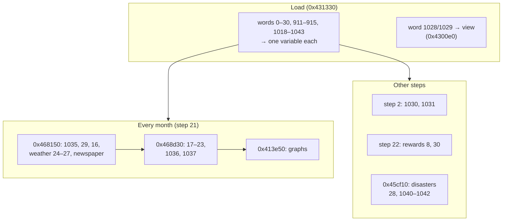

# MISC: general city state (words 0–30, 911–915, 1018–1199)

The scalar words of MISC: the file version, the date, money, the game's difficulty and reward level, the national economy, the weather, disasters, the terrain options, the player's game options, and a block of counters at the end. The arrays and tables of MISC (population, industry, budget, neighbours, technology, newspapers, military counts) are on the other MISC pages; the full word index is in [README.md](README.md).

## At a glance

| | |
|---|---|
| Words | 0–30, 911–915, 1018–1043 (loaded); 1044–1199 (not loaded) |
| Bytes | `0x000`–`0x07B`, `0xE3C`–`0xE4F`, `0xFE8`–`0x12BF` |
| Element | big-endian signed int32 (byte offset = 4 × word) |
| Loader / saver | `0x431330` / `0x433a40`, one variable per word |
| Recomputed on load | none of these words, except that `0x434b70` restarts some counters ([container.md](../../container.md#after-the-walk)) |

The saver writes every value sign-extended from the variable's width, and the loader keeps only that width (16 or 8 bits where the table says so). Read every word as a signed int32.

## Layout

| Word | Bytes | Variable | Width | Name | Meaning | Confidence |
|---|---|---|---|---|---|---|
| 0 | `0x000` | — | 32 | version | Must be `0x122` (290) | **Confirmed (code)**, [container.md](../../container.md#version-check) |
| 1 | `0x004` | `0x4ca42c` | 16 | city mode | 0 terrain editor, 1 city, 2 disaster under way | **Confirmed (code)** |
| 2 | `0x008` | `0x4c942c` | 16 | compass | 0–3, see [conventions.md](../../conventions.md#orientation) | **Confirmed (code)** |
| 3 | `0x00C` | `0x4ca5f4` | 16 | founding year | 1900, 1950, 2000 or 2050 | **Confirmed (code)**, 114/114 |
| 4 | `0x010` | `0x4cae04` | 32 | days | Days since founding | **Confirmed (code)** |
| 5 | `0x014` | `0x4ca444` | 32 | funds | Money, signed (can be negative) | **Confirmed (code)** |
| 6 | `0x018` | `0x4cc4e8` | 32 | bonds | Number of bonds outstanding, 0–50 | **Confirmed (code)**, 114/114 |
| 7 | `0x01C` | `0x4cb404` | 16 | difficulty | 0 none (terrain only), 1 easy, 2 medium, 3 hard | **Confirmed (code)** |
| 8 | `0x020` | `0x4cb010` | 16 | reward level | Population milestones passed, 0–8 | **Confirmed (code)** |
| 9 | `0x024` | `0x4ca4d0` | 32 | city value | Infrastructure value used to limit bonds | **Confirmed (code)** |
| 10 | `0x028` | `0x4ca440` | 32 | land value total | Sum of XVAL | **Confirmed (code)**, [minimaps.md](../minimaps.md#xval-land-value) |
| 11 | `0x02C` | `0x4cb454` | 32 | crime total | Sum of XCRM | **Confirmed (code)**, [minimaps.md](../minimaps.md#xcrm-crime) |
| 12 | `0x030` | `0x4cc6f4` | 32 | traffic total | Sum of XTRF after the traffic decay | **Confirmed (code)**, [minimaps.md](../minimaps.md#xtrf-traffic) |
| 13 | `0x034` | `0x4cc910` | 32 | pollution total | Sum of XPLT | **Confirmed (code)**, [minimaps.md](../minimaps.md#xplt-pollution) |
| 14 | `0x038` | `0x4cad28` | 32 | — | Cleared for a new city, never used | **Unused**; 0 in 114/114 |
| 15 | `0x03C` | `0x4cb018` | 32 | — | Cleared for a new city, never used | **Unused**; 0 in 114/114 |
| 16 | `0x040` | `0x4ca5f0` | 32 | population-months | Running sum of word 1035, added every month; never read | **Unused** (write-only) |
| 17 | `0x044` | `0x4cb460` | 32 | workforce % | Working-age people as a percentage of the population | **Confirmed (code)** |
| 18 | `0x048` | `0x4cb410` | 32 | life expectancy | Health graph value | **Confirmed (code)**, [xgrp.md](../xgrp.md#graph-series) |
| 19 | `0x04C` | `0x4cc4b4` | 32 | education quotient | Education graph value | **Confirmed (code)**, [xgrp.md](../xgrp.md#graph-series) |
| 20 | `0x050` | `0x4ca928` | 32 | national population | SimNation population, in thousands | **Confirmed (code)** |
| 21 | `0x054` | `0x4cb014` | 32 | GNP | Gross national product | **Confirmed (code)** |
| 22 | `0x058` | `0x4ca938` | 16 | Fed Rate | Interest rate, % (at least 1) | **Confirmed (code)** |
| 23 | `0x05C` | `0x4ca1bc` | 16 | national trend | 0–3: how fast the nation grows (0 fastest) | **Confirmed (code)** |
| 24 | `0x060` | `0x4cade0` | 8 | heat | Temperature + 100, in °F | **Confirmed (code)** |
| 25 | `0x064` | `0x4cae0c` | 8 | wind | Wind speed | **Confirmed (code)** |
| 26 | `0x068` | `0x4cb3d4` | 8 | humidity | Humidity / rain | **Confirmed (code)** |
| 27 | `0x06C` | `0x4cb40c` | 8 | weather | Weather type, 0–11 | **Confirmed (code)**; names **Inferred** |
| 28 | `0x070` | `0x4ca420` | 16 | pending disaster | Disaster to start at the next tick, 0 none | **Confirmed (code)**; 0 in 114/114 |
| 29 | `0x074` | `0x4ca194` | 32 | residents last month | Residential population at the previous monthly update | **Confirmed (code)** |
| 30 | `0x078` | `0x4e9a24` | 16 (the loader keeps the low 16 bits) | rewards available | Bit mask of rewards the player may build | **Confirmed (code)** |
| 911 | `0xE3C` | `0x4cad2c` | 32 | year end | 1 between December's budget and the new year | **Confirmed (code)** |
| 912 | `0xE40` | `0x4ca818` | 16 | sea level | See [altm.md](../altm.md#sea-level) | **Confirmed (code)** |
| 913 | `0xE44` | `0x4c94c0` | 32 | coast | Terrain option: the map has a coast | **Confirmed (code)** |
| 914 | `0xE48` | `0x4cb3f8` | 32 | river | Terrain option: the map has a river | **Confirmed (code)** |
| 915 | `0xE4C` | `0x4cc4e4` | 8 | military base | 0 not offered, 1 declined or no site, 2 army, 3 air force, 4 navy, 5 missile silos | **Confirmed (code)**; 4 **Inferred** |
| 1018 | `0xFE8` | `0x4ca41c` | 16 | subway tiles | Count of subway tiles outside the military zone | **Confirmed (code)**, 114/114 |
| 1019 | `0xFEC` | window + `0x308` | 16 | speed | 1 paused, 2–5 slow to fast | **Confirmed (code)**; names **Inferred** |
| 1020 | `0xFF0` | `0x4cc4b0` | 32 | auto budget | Option | **Confirmed (code)** |
| 1021 | `0xFF4` | `0x4ca5d8` | 32 | auto goto | Option | **Confirmed (code)** |
| 1022 | `0xFF8` | window + `0x1e4` | 32 | sound | Option | **Confirmed (code)** |
| 1023 | `0xFFC` | window + `0x1e0` | 32 | music | Option; 0 stops the music on load | **Confirmed (code)** |
| 1024 | `0x1000` | `0x4cc4d4` | 32 | no disasters | Option: 1 = disasters off | **Confirmed (code)** |
| 1025 | `0x1004` | `0x4cb3d0` | 32 | newspaper subscription | Option | **Confirmed (code)** |
| 1026 | `0x1008` | `0x4cc4bc` | 32 | newspaper extras | Option | **Confirmed (code)** |
| 1027 | `0x100C` | `0x4ca808` | 16 | newspaper choice | Which newspaper the player reads | **Confirmed (code)** |
| 1028 | `0x1010` | `0x4c7cb0`, `0x4c7cb4` | 16 | view centre | Tile at the centre of the city window | **Confirmed (code)**; packing **Inferred** |
| 1029 | `0x1014` | `0x4c7cb8` | 16 | zoom | Zoom level of the city window, 0–2 | **Confirmed (code)**; values **Inferred** |
| 1030 | `0x1018` | `0x4cb458` | 16 | building centre row | Mean row of building tiles, rounded down to even | **Confirmed (code)** |
| 1031 | `0x101C` | `0x4cb45c` | 16 | building centre col | Mean col of building tiles, rounded down to even | **Confirmed (code)** |
| 1032 | `0x1020` | `0x4c94c4` | 32 | arcology residents | Sum of the residents (XMIC word 4) of all arcologies | **Confirmed (code)**, [xmic.md](../xmic.md#misc-words-set-from-xmic) |
| 1033 | `0x1024` | `0x4caddc` | 16 | — | Loaded and saved, never used | **Unused** |
| 1034 | `0x1028` | `0x4cc4e0` | 16 | sports teams | Bit mask of the five teams | **Confirmed (code)** |
| 1035 | `0x102C` | `0x4caa74` | 32 | zone population | City population outside microsim buildings, = 10 × word 380 | **Confirmed (code)** |
| 1036 | `0x1030` | `0x4ca1e8` | 16 | industry bonus | From the largest industry's share | **Confirmed (code)** |
| 1037 | `0x1034` | `0x4c9428` | 16 | heavy-industry level | −1, 0, 1, … from the share of heavy industry | **Confirmed (code)** |
| 1038 | `0x1038` | `0x4ca430` | 16 | arrests | Sum of the police stations' arrests (XMIC word 6), at most 65 535 | **Confirmed (code)** |
| 1039 | `0x103C` | `0x4ca1dc` | 16 | prisons have room | 1 if there are prisons and they are on average at most 79 % full | **Confirmed (code)** |
| 1040 | `0x1040` | `0x4ca81c` | 16 | disaster thing | [XTHG](../xthg.md) record of the monster or tornado; −1 none | **Confirmed (code)**; −1 in 114/114 |
| 1041 | `0x1044` | `0x4ca93c` | 16 | current disaster | The disaster most recently started | **Confirmed (code)** |
| 1042 | `0x1048` | `0x4c9ee8` | 32 | disaster active | 1 while a disaster is under way | **Confirmed (code)**; 0 in 114/114 |
| 1043 | `0x104C` | `0x4cb3dc` | 16 | water treatment | 1 if the treatment plants cover the water delivered | **Confirmed (code)** |
| 1044–1199 | `0x1050`–`0x12BF` | — | — | — | Not loaded; written as 0. Other versions store data in 1044–1070 | **Confirmed (code)**; see [§ Words 1044–1199](#words-10441199) |

## Header and date

Word 0 is the version check ([container.md § Version check](../../container.md#version-check)). Word 2 is the compass ([conventions.md § Orientation](../../conventions.md#orientation)).

**City mode (word 1).** 0 while the terrain editor is open, 1 for a running city, 2 while a disaster is under way: the disaster dispatcher `0x45cf10` switches a mode-1 city to 2 and back. A mode-0 city has no newspaper menu (`0x406d70`). In the corpus: 1 in 110 files, 0 in 4 (terrain-only saves, which also have difficulty 0).

**Date (words 3 and 4).** The game's calendar has 25-day months and 300-day years:

```
year         = word 3 + word 4 / 300
month index  = (word 4 / 25) mod 12      (0 = January, Inferred)
day of month = word 4 mod 25
```

Starting a city (`0x42e460`) sets word 3 to 1900, 1950, 2000 or 2050 and word 4 to 0. Word 4 counts up by one every simulation tick; the simulation step is word 4 mod 25 ([game-internals.md](../../game-internals.md#simulation-cycle)).

## Money and difficulty

**Funds (word 5)** is the player's money, signed: the corpus has values from −300 to 2 138 546 374. It is the word the well-known money hex-edit changes (djm).

**Difficulty (word 7)** is chosen when the city starts: 1 easy, 2 medium, 3 hard (`0x42e460` stores the choice + 1). It sets the starting funds (20 000 on easy, 10 000 otherwise, and a first bond on hard) and the starting national trend, and it scales demand through the table at `0x4e9538` (1.2, 1.1, 0.95). 0 means the file was saved from the terrain editor.

**Bonds (word 6)** counts bonds outstanding; the bond rates are in words 388–437 ([README.md](README.md)). The game refuses more than 50 (`0x473a40`).

**City value (word 9)** is a weighted sum of the per-code tile counts minus the subway count (`0x46a270`). It is recomputed only when the player asks for a bond (`0x41b270`), where bonds × 2500 ÷ (value + 1) limits borrowing. It is 0 in 87/114 files: those cities never issued a bond from the Windows 95 game.

## Statistics

Words 10–13 are the overlay totals ([minimaps.md](../minimaps.md#values)). Words 18 and 19 are the newest Health and Education graph values, and words 20–22 the newest Nat'n Pop, GNP and Fed Rate ([xgrp.md § Graph series](../xgrp.md#graph-series)).

**Workforce, health and education (words 17–19)** are recomputed every month by `0x468d30` from the per-age-group arrays in words 31–90 ([README.md](README.md)): word 18 is the life expectancy and word 19 the education quotient, each averaged over the working age groups weighted by their size; word 17 is the size of those groups as a percentage of word 1035.

**Zone population (word 1035)** is set every month by `0x468150` to 10 × word 380 (the population sum). It is the population the reward milestones are measured against. The City Size graph adds word 1032 (people living in arcologies) to it. **Verified (data)**: word 1035 = 10 × word 380 in 92/114 files; the others were saved after word 380 had changed since the last monthly update.

**Residents last month (word 29).** Every month `0x468150` compares the residential population with this word to compute growth, then stores the new value. The saver writes it from the previous month's Residents graph value (XGRP series 1, slot 1). **Verified (data)**: equal in 50/50 Windows 95 files and 40/64 others.

**Population-months (word 16)** gets word 1035 added every month and is never read. It overflows in long-running cities (negative in 4/114).

**National economy (words 20–23)**, updated monthly by `0x468d30`:

| Word | Starts at (`0x42e460`) | Each month |
|---|---|---|
| 20 national population (thousands) | 10 000 / 25 000 / 60 000 / 150 000 for founding years 1900 / 1950 / 2000 / 2050 | Grows by trend × population ÷ 1200; shrinks the same way above 5 000 000 |
| 21 GNP | 3 × national population ÷ 10 | Grows by (6, 3, 0, −3)[trend] × GNP ÷ 1200 (table `0x4e9558`); shrinks above 3 500 000 |
| 22 Fed Rate | 3 | Now and then moves up or down by 1 (never below 1), with a newspaper story |
| 23 national trend | The difficulty (0 easy, 1 medium, 2 hard) | Now and then reset to 0–3 from the national figures, with a newspaper story |

Neighbouring cities' populations follow the same trend ([README.md](README.md), words 438–453).

## Weather

Every month `0x468150` moves the weather to a new type picked at random from a per-type, per-season table (`0x4dbeb8`), then moves heat, wind and humidity halfway towards the new type's values. A new city starts at heat 150, wind 10, humidity 15, weather 4 (`0x40e250`).

| Weather (word 27) | Name (**Inferred**) | Heat target | Wind target | Humidity target |
|---|---|---|---|---|
| 0 | cold | 80 | 15 | 0 |
| 1 | clear | 165 | 30 | 0 |
| 2 | hot | 210 | 0 | 0 |
| 3 | foggy | 100 | 0 | 15 |
| 4 | chilly | 145 | 15 | 15 |
| 5 | overcast | 175 | 5 | 15 |
| 6 | snow | 80 | 10 | 30 |
| 7 | rain | 150 | 30 | 30 |
| 8 | windy | 175 | 60 | 30 |
| 9 | blizzard | 60 | 100 | 60 |
| 10 | hurricane | 140 | 100 | 60 |
| 11 | tornado | 175 | 100 | 60 |

The targets are the tables at `0x4dc038`, `0x4dc048` and `0x4dc058` (**Confirmed (code)**). The names are OpenCity2k's; they fit the targets, and two are confirmed by the disaster code: weather 10 on a coastal map can start a hurricane, weather 11 a tornado (`0x471bc0`).

What the weather does (**Confirmed (code)**):

- The newspaper prints heat − 100 as the temperature (`0x47b400`), so heat is °F + 100.
- Wind adds to the output of wind power plants (`0x4679b0`), and raises the chance that a tile of an underfunded service is destroyed (`0x4358b0`, budget entry 12: which service is **Inferred**, probably bridges).
- Humidity adds to the output of water pumps (`0x4649e0`) and lowers the output of solar plants (`0x4679b0`).
- High heat makes fires more likely (`0x471bc0`).

## Disasters

| Value | Disaster (**Inferred** names, OpenCity2k) | Value | Disaster |
|---|---|---|---|
| 1 | fire | 10 | microwave beam |
| 2 | flood | 11 | volcano |
| 3 | riot | 12 | firestorm |
| 4 | toxic spill | 13 | mass riots |
| 5 | air crash | 14 | major flood |
| 6 | earthquake | 15 | pollution accident |
| 7 | tornado | 16 | hurricane |
| 8 | monster | 17 | helicopter crash |
| 9 | meltdown | 18 | plane crash |

The dispatcher `0x45cf10` handles the cases 1–18; the codes that are confirmed by other code are 7 (tornado: started by tornado weather; moves an XTHG object) and 16 (hurricane: started by hurricane weather on a coast), and 8 (the monster: moves an XTHG object). 5 (air crash) and 17 (helicopter crash) are the numbers a crashing airplane and helicopter give their explosion, and 18 creates a crashing airplane (`0x45e7d0`). The flying rescuer (`0x452fa0`) groups 1, 5, 6, 9–12 as fires, 2 and 14 as floods, 3 and 13 as riots, 4 and 15 as toxic ([thing-ids-xthg.md](../../reference/thing-ids-xthg.md#16-flying-rescuer)).

- **Word 28** is the disaster waiting to start. The dispatcher clears it when it starts the disaster, so a saved file has 0 (114/114).
- **Word 1041** keeps the code of the disaster that was started last; it picks the newspaper story when the disaster ends.
- **Word 1042** is 1 while a disaster is under way and 0 otherwise (0 in 114/114).
- **Word 1040** is the [XTHG](../xthg.md) record of the monster or tornado (its XTXT marker is `0xC9` + this value, [xtxt.md](../xtxt.md#moving-objects-0xc90xf0)). The dispatcher sets it to −1 when the disaster ends, and a new city starts with −1 (−1 in 114/114).
- **Word 1024** is the player's "no disasters" option.

## Rewards

Every tick on step 22, `0x413520` compares word 1035 with the next milestone in the table at `0x4e6984` and, when it is passed, raises the **reward level (word 8)** by one and publishes a newspaper story:

| Level reached | Population passed | What the game does |
|---|---|---|
| 1 | 2 000 | Rewards bit 0: Mayor's House |
| 2 | 10 000 | Rewards bit 1: City Hall |
| 3 | 30 000 | Rewards bit 2: Statue |
| 4 | 60 000 | Offers a military base (`0x4142c0`, word 915) |
| 5 | 90 000 | Rewards bit 3: Braun Llama Dome |
| 6 | 120 000 | Arcologies become possible (bit 4, set by `0x46a080` once the technology exists) |
| 7, 8 | 500 000, 1 000 000 | Newspaper story only |

The level never goes down. **Verified (data)**: word 8 equals the number of milestones word 1035 has passed in 78/114 files and is higher in the other 36 (populations that shrank); never lower.

**Rewards available (word 30)** is a bit mask: bit *k* set means reward *k* may be built now. The game clears the bit when the reward is placed (`0x43f220`) and sets it again when the building is destroyed (`0x458d40`). A change between 0 and non-zero updates the Rewards button (`0x441e50`). **Verified (data)**: every set bit belongs to a level the city has reached (114/114). The usual value is 16 (only arcologies left to build).

The building names come from the game's help text; the bit-to-reward mapping is **Confirmed (code)** for the order of the milestones and **Inferred** for the names.

## Terrain options and the military base

**Words 913 and 914** are the coast and river options of the terrain generator. `0x410950` receives them when a map is made, and the game reads them later: a coastal city gets "Ocean" as its first neighbour (`0x42e460`) and can be hit by hurricanes. In 5 files word 914 is 255 (another version's "true", [§ Pitfalls](#pitfalls-for-readers)).

**Word 915** records the military base offer (`0x4142c0`, at reward level 4): 1 when the player declined or no 8 × 8 site was found, 2 army base, 3 air force base (a site with no slope at all), 5 missile silos. No write of 4 was found; it is the navy base by elimination (3 files) (**Inferred**). Simulation step 3–18 grows base buildings according to it (`0x4358b0`), and `0x46a080` treats 2, 3 and 4 as "has a base". The base's land is XZON zone 7 ([xzon.md](../xzon.md#zone-7-the-military-base)).

## Budget year end

**Word 911** is set to 1 by the monthly budget routine `0x4734a0` in December (month index 11) and cleared, together with the year-to-date budget figures, at the start of the next year. While it is 1 the budget window shows the year-end layout (`0x416d70`, `0x4189c0`, `0x4194b0`), and simulation step 0 opens the year-end budget (`0x4731e0`). 0 in 108/114 files.

## Game options

The player's options are saved with the city and restored on load (**Confirmed (code)**: the loader copies them back into the running game; `0x408290` reads the same options from the `[OPTIONS]` section of the game's settings at start-up).

| Word | Option | Values in the corpus |
|---|---|---|
| 1019 | Speed: 1 paused, 2–5 from slowest to fastest (turtle, llama, cheetah, African swallow: **Inferred** from the menu) | 1–5 |
| 1020 | Auto budget | 0 / 1 |
| 1021 | Auto goto: the disaster routines scroll the view to the disaster when it is set | 1 / 255 |
| 1022 | Sound effects | 0 / 1 |
| 1023 | Music; on load, 0 calls `0x402be4` (**Inferred**: stops the music) | 0 / 1 |
| 1024 | No disasters (1 = off) | 0 / 1 |
| 1025 | Newspaper subscription: the paper comes in months 3 and 7 (April and August if 0 is January) | 0 / 1 |
| 1026 | Newspaper extras: the paper comes with big news (story types 3–5 and `0x24`) | 0 / 1 |
| 1027 | Which newspaper: index into the newspaper list in words 916–945 ([README.md](README.md)); the menu offers one paper per reward level, at most six | 0–5 |

## View

**Word 1028** is the tile at the centre of the city window, packed as `low 7 bits | high byte << 8`. The saver gets it from the screen position (`0x445460` or `0x444bf0`); after loading, `0x4300e0` passes both halves and word 1029 to `0x412570`, which scrolls the window there. −1 (`0xFFFF`) means "unknown", and the loader then uses 64 and 128. Which half is the row and which the col is not settled (**Inferred**: both lie within 10–127 in the corpus).

**Word 1029** is the zoom level of the city window (window + `0x140`, or 1 when no window is open). 0, 1 and 2 occur.

## Counters

| Word | How it is kept | Evidence |
|---|---|---|
| 1018 subway tiles | Kept in step by the XUND writer `0x442370`: subway pieces, crossings, `0x22` and `0x23`, outside zone 7 ([xund.md](../xund.md#how-the-game-uses-it)). Subtracted from the city value | **Verified (data)** 114/114 against XUND and XZON |
| 1030, 1031 building centre | Step 2 (`0x46a840`): over all tiles with XBLD `0x70` and up, (sum of rows) ÷ (2 × (count + 1)) × 2, and the same for cols. New city: 64, 64. Disasters and the traffic helicopter start near it | **Verified (data)** 91/114 (others saved after building) |
| 1034 sports teams | Bit *k* set: team *k* exists; with a stadium the newspaper picks a random team and reports on it if its bit is set (`0x468150`). The team names are XLAB slots 251–255 ([xlab.md](../xlab.md#slots-251255-sports-teams)) | **Confirmed (code)**; values 0–31 and −1 |
| 1036 industry bonus | Monthly (`0x468d30`): the largest of the 11 industries' shares (% of industrial population, words 91–123); below 20 → 0, else (share − 20) ÷ 5. `0x468150` adds word 1036 ÷ 100 to the difficulty factor of its demand formula | **Confirmed (code)**; 0–5 |
| 1037 heavy-industry level | Monthly (`0x468d30`): the share of industries 0, 1, 2 and 5; below 20 % → −1, else (share − 20) ÷ 30. Step 2 adds pollution with it ([minimaps.md](../minimaps.md#xplt-pollution)) | **Confirmed (code)**; −1, 0, 1 |
| 1038 arrests | Set once a year by `0x44e390`: the sum of the police stations' arrests. Next year it feeds the prisons' inmates ([microsim-kinds-xmic.md](../../reference/microsim-kinds-xmic.md#prison-0xd8)) | **Confirmed (code)**; **Verified (data)** 111/114 |
| 1039 prisons have room | Set once a year by `0x44e390`: 1 if there is a prison and the prisons are on average at most 79 % full, else 0. Next year arrests are crimes ÷ (5 − word 1039); step 2 gives a police station the strength (5 + word 1039) × police funding ÷ 2 | **Confirmed (code)**; **Verified (data)** 112/114 |
| 1043 water treatment | Recomputed by the water routine `0x464550` (see [game-internals.md](../../game-internals.md#misc-variables)) and used in step 2 | **Confirmed (code)** |

## Words 1044–1199

The Windows 95 loader stops at word 1043, and its saver writes zeros from word 1044 to the end (**Confirmed (code)**: `0x431330`, `0x433a40`). But 60 of the 114 corpus files have data in words 1044–1070 (words 1071–1199 are 0 in all 114).

Those 60 files are exactly the files written by another version of the game. **Verified (data)**: all 60 have a CNAM in the "name length" form or no CNAM at all ([cnam.md](../cnam.md#which-files-have-which-form)); none of the 50 files in the Windows 95 form has data there; 4 files in the length form have none. All 18 scenarios are among them.

What that version stored there (**Verified (data)**, in the 60 files):

| Word | Matches | Files |
|---|---|---|
| 1048 | Power delivered, % of plant capacity (100 − the newest Power % graph value) | 56/60 |
| 1049 | Water delivered, % of pump capacity (100 − the newest Water % graph value); larger values are the raw figure from the middle of a water flood | 53/60 |
| 1067 | Developed tiles (XBLD above `0x1C`, or zoned): `0x4c93b4` | 53/60 exactly, 4 within 1 % |
| 1044 | Number of XTXT `0xFA` neighbour-connection tiles | 27/60 (**Inferred**) |
| 1045–1047, 1050–1052, 1056, 1065, 1066, 1069, 1070 | Not identified. 1050–1052 and 1056 occur only in 4 scenarios and `NEWMONRO.SC2` (1052 = 20 000 to 100 000) | **Unknown** |

The Windows 95 game recomputes all of the identified ones after loading, so a reader can ignore words 1044–1199.

## How the game uses it



## Evidence

| Claim | Code | Data (114 files) |
|---|---|---|
| Word → variable map, widths, words 1044+ written as 0 | `0x431330`, `0x433a40` | — |
| New-city defaults | `0x40e250`, `0x4348e0`, `0x42e460` | — |
| Founding year 1900/1950/2000/2050 | `0x42e460` | 114/114 |
| Weather tables and effects | `0x468150`, `0x47b400`, `0x4679b0`, `0x4649e0` | weather 0–10 in the corpus |
| Reward milestones and mask | `0x413520`, `0x441e50`, `0x43f220`, `0x458d40` | level never below milestones 114/114; mask bits reached 114/114 |
| Military base | `0x4142c0`, `0x4358b0`, `0x46a080` | 0–5 |
| Year end | `0x4734a0`, `0x413520` | 0/1/255 |
| Options | `0x408290`, `0x406d70`, `0x413520`, `0x47b5c0` | — |
| Word 29 = previous Residents graph value | `0x468150`, `0x433a40` | 50/50 Windows 95 files |
| Word 1035 = 10 × word 380 | `0x468150` | 92/114 |
| Words 1030/1031 | `0x46a840` | 91/114 |
| Word 1018 | `0x442370` | 114/114 |
| Words 1033 unused | no reference outside load and save | — |
| Words 1044–1070 from another version | — | 60/60 non-Windows-95 CNAM form |

Run `sc2check.py … --only misc_general` to repeat the tallies.

## Pitfalls for readers

- **Booleans can be 255.** The other version wrote "true" as 255 in some option words (1020–1023, 1026, 911, 914): 36/114 files, 11 of them re-saved by the Windows 95 game, which keeps the value. Treat any non-zero value as true.
- **Read words as signed.** Funds can be negative, word 1040 is −1, word 1028 can be −1, and word 16 overflows.
- **Words 1044–1070 are not from this game.** Do not give them meanings from the Windows 95 code; they come from another version and are ignored by this one.
- **Words 10–13, 17–23, 29, 1030–1039 are snapshots.** They were true at the last monthly or step-2 update, not necessarily at the moment of saving.
- **Word 1035 is not the whole population.** The City Size graph adds word 1032 (and an arcology bonus); see [xgrp.md](../xgrp.md#graph-series).
