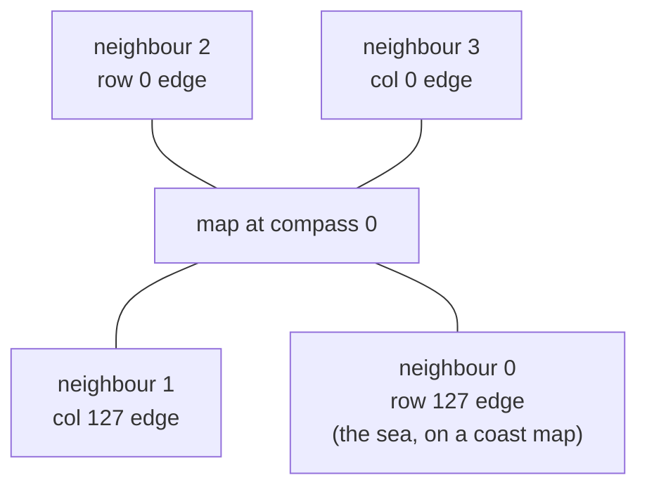

# MISC: neighbour cities (words 438–453)

The four neighbouring cities shown in the game's **Neighbors window**: a name and a population for each map edge. Four words per neighbour. The names are not stored as text, only as a number into the game's list of 36 town names.

## At a glance

| | |
|---|---|
| Words | 438–453 (bytes `0x6D8`–`0x717`) |
| Records | 4 × 4 words, neighbour *k* at word 438 + 4*k* |
| Loaded by | `0x431330`; saved by `0x433a40` |
| Set up by | `0x40e250` (new city), `0x42e460` (after terrain is made) |
| Updated by | `0x468d30`, every month |

## Layout

| Word | Bytes | Type | Name | Meaning | Confidence |
|---|---|---|---|---|---|
| 438 + 4*k* | `0x6D8` + 16*k* | int16 | name id | 0 = "Ocean"; 1–36 = string 547 + id (see [§ Names](#names)) | **Confirmed (code)** |
| 439 + 4*k* | `0x6DC` + 16*k* | uint32 | population | The neighbour's population, as shown in the Neighbors window | **Confirmed (code)** |
| 440 + 4*k* | `0x6E0` + 16*k* | uint32 | economy | A second figure that drifts each month; nothing else reads it | **Unused** (only updated) |
| 441 + 4*k* | `0x6E4` + 16*k* | uint32 | — | Set to 0 for a new city; never read or changed | **Unused** |

The loader turns the name id into text right away (into `0x4cad58`, 32 bytes per neighbour), so the names a player sees always come from the id.

## Which edge each neighbour is on

Neighbour *k* sits on one edge of the map, fixed to the land, not to the screen. When the city is normalised to compass 0 ([conventions.md § Orientation](../../conventions.md#orientation)):

| Neighbour | Edge (compass 0) | On screen at compass 0 |
|---|---|---|
| 0 | row 127 | bottom right |
| 1 | col 127 | bottom left |
| 2 | row 0 | top left |
| 3 | col 0 | top right |

In a file saved at compass *c*, neighbour *k* is on the stored edge that the table gives for neighbour (*k* − *c*) mod 4. The Neighbors window draws neighbour *c* at the bottom right, *c* + 1 at the bottom left, *c* + 2 at the top left and *c* + 3 at the top right (all mod 4) (**Confirmed (code)**: `0x46c562`). The neighbour records themselves are not touched when the view turns.

**Verified (data)**: on coast maps (name id 0 for neighbour 0), the map edge with the most salt water (XBIT `0x01` and `0x04`) is the edge of neighbour 0 in 35/38 files. The three exceptions have only a few sea tiles on any edge.

## Names

| Name id | Name |
|---|---|
| 0 | Ocean (only for neighbour 0 of a coast map) |
| 1–36 | String 547 + id: Oak Creek, Denmont, Fort Verdegris, Schwinton, Mill Valley, Petaluma, PortVille, Ashland, Eubancs, Aurac, Tent Pegs, Cherryton, Blake, Pioneers, Fortune, Phippsville, Jeromi, Harpersville, Washers Grove, Stars County, Villa, Serviland, Newton, Avon, Dexter, Sinistrel, Jenna, Yestonia, New Boots, Hoek Creek, Stimpleton, Little Rouge, Krighton, Cats Corner, Rimmer, Lister |

(**Confirmed (code)**: the loader passes the id to `0x42b520` with category 1000, which loads string 547 + id; id 0 copies the text "Ocean" instead. The names are from the string table of the US English `SIMCITY.EXE`.)

## How the game uses it

- **New city** (`0x40e250`): each neighbour gets a random name id from 1 to 36, different from the others. Its population is the smallest of three random numbers from 100 to 7 499. Its economy figure is the population divided by 1, 2 or 3, and the fourth word is 0.
- **Coast** (`0x42e460`): when the terrain has a coast (MISC word 913, [general.md](general.md)), neighbour 0 becomes "Ocean" with name id 0, population 0 and economy 0.
- **Every month** (`0x468d30`, step 21 of the simulation cycle): each neighbour with a population grows by a random amount, or shrinks when it is above 5 000 000. The economy figure changes by a percentage that depends on the national economy (MISC word 23), the Fed Rate (MISC word 22) and a random term, and falls back when it is above 3 500 000. About once in 64 months one neighbour's two figures are scaled up or down by a random event. The details are **Inferred** (floating-point code).
- **Neighbors window** (`0x46c562`): shows each neighbour's name and population at its corner, and the city's own population in the middle.

Nothing else reads the neighbour records (**Confirmed (code)**: the only code that refers to the population, economy or fourth-word arrays is the allocation, new-city, load, save, monthly-update and window code above). The neighbours do not feed demand or any other simulation value. The road, rail and highway connections to them are counted separately ([xtxt.md § Neighbour connections](../xtxt.md#neighbour-connections-0xfa)).

## Evidence

| Claim | Code | Corpus (114 files) |
|---|---|---|
| Name id range | `0x40e250`, `0x431330` | 0–36 in 114/114 |
| Ids differ from each other | `0x40e250` | 107/114 (the duplicates are in `DEFAULT.SC2`, cities based on it, and three others) |
| Id 0 means "Ocean", coast only | `0x42e460`, `0x431330` | id 0 only for neighbour 0 (38 files); its population and economy are 0 in 38/38; MISC word 913 is set in all 38 (and in 4 more files whose neighbour 0 has a name) |
| Fourth word unused | `0x40e250`; no reader | 0 in 114/114 |
| Edge of each neighbour | `0x46c562` | 35/38 coast maps |

## Pitfalls for readers

- **Use the compass to find the edge.** The record order is tied to the land at compass 0, not to the stored arrays.
- **The economy word can hold anything.** The game treats it as unsigned and lets it overflow: in 4/114 files some values are above 2³¹ (negative when read as signed); in most files it has fallen to 0. Nothing in the game reads it.
- **Population is unsigned 32-bit**; in the corpus it stays below 5 100 000.
- **The names are language-dependent.** A non-English `SIMCITY.EXE` may have other names for ids 1–36.

## Links

- [MISC word index](README.md)
- [conventions.md § Orientation](../../conventions.md#orientation)
- [xtxt.md § Neighbour connections](../xtxt.md#neighbour-connections-0xfa)
