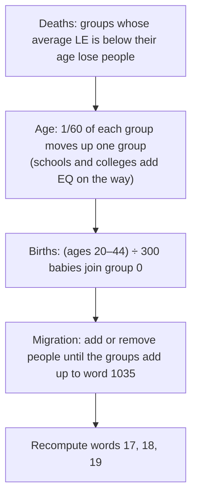

# MISC: population, industry and bonds

Four blocks of [MISC](README.md) words:

- the city's people by age, with their health and education;
- the eleven industries of the Industry window;
- the population counted per zone type;
- the interest rates of the outstanding bonds.

The first three are the state of the game's monthly population and industry model. The game keeps simulating from the stored values, so they are what a reader shows as the Population and Industry windows. The bonds are a list the budget works from.

## At a glance

| Words | Bytes | Content | Element |
|---|---|---|---|
| 31–90 | `0x07C`–`0x16B` | 20 age groups × (people, education total, health total) | int32 each |
| 91–123 | `0x16C`–`0x1EF` | 11 industries × (demand, tax rate, size) | int32 each (demand and tax rate are 16-bit in the game) |
| 380–387 | `0x5F0`–`0x60F` | population units: total, six zone types, abandoned | int32 each |
| 388–437 | `0x610`–`0x6D7` | 50 bond interest rates, in issue order | int32 each (16-bit in the game) |

Every word is big-endian and signed, like all of MISC ([README.md](README.md)). The loader `0x431330` copies the blocks word by word into the arrays below, and the saver `0x433a40` writes them back the same way (**Confirmed (code)**).

| Words | Game array | Allocated by `0x42cef0` | New city (`0x40e250`) |
|---|---|---|---|
| 31 + 3*i* | `0x4c94b4[i]`: people | 20 × 4 bytes | 0 |
| 32 + 3*i* | `0x4c94bc[i]`: education total | 20 × 4 bytes | 0 |
| 33 + 3*i* | `0x4caa70[i]`: health total | 20 × 4 bytes | 0 |
| 91 + 3*k* | `0x4ca3f4[k]`: demand | 11 × 2 bytes | 0 |
| 92 + 3*k* | `0x4cb3e0[k]`: tax rate | 11 × 2 bytes | 7 |
| 93 + 3*k* | `0x4cb3f0[k]`: size | 11 × 4 bytes | 0 |
| 380–387 | `0x4ca428[0..7]` | 8 × 4 bytes | 0 |
| 388–437 | `0x4c9ef0[0..49]` | static, 50 × 2 bytes | 0 |

## Age groups

Group *i* (0–19) holds the people aged 5*i* to 5*i* + 4 years: group 0 is ages 0–4 and group 19 is ages 95–99 (**Confirmed (code)**: people move one group up at 1/60 per month, i.e. after 5 years; the death rule compares the group's life expectancy with 5*i* years).

| Word | Name | Meaning |
|---|---|---|
| 31 + 3*i* | people | Number of people in the group |
| 32 + 3*i* | education total | Sum of the group's education quotients (EQ). **Average EQ = education total ÷ people** |
| 33 + 3*i* | health total | Sum of the group's life expectancies, in years. **Average life expectancy = health total ÷ people** |

The order within each triple is people, education, health (**Confirmed (code)**: `0x468d30` computes MISC word 18, life expectancy, from the third array and word 19, EQ, from the second; **Verified (data)**: both match in 100/100 files with people).

The game's **Population window** (`0x46db92`) draws one bar per group in three modes:

- **population**: people × 600 ÷ word 1035;
- **health**: average life expectancy;
- **education**: average EQ × 15 ÷ 25.

Its headline numbers are words 17, 18 and 19.

### Words derived from the age groups

`0x468d30` ends its monthly run by recomputing three words of the [general block](README.md) from groups 4–10 (ages 20–54, the work force):

| Word | Name | Formula (integer division) | Evidence |
|---|---|---|---|
| 17 | Work force % | people in groups 4–10 × 100 ÷ (word 1035 + 1) | **Confirmed (code)**, **Verified (data)** 100/100 |
| 18 | Life expectancy (LE) | health total of groups 4–10 ÷ people in groups 4–10 | **Confirmed (code)**, **Verified (data)** 100/100 |
| 19 | Education quotient (EQ) | education total of groups 4–10 ÷ people in groups 4–10 | **Confirmed (code)**, **Verified (data)** 100/100 |

Word 1035 is the city's population, and the age groups always add up to it (**Verified (data)**: 100/100 files with people). 14 files have all age groups at 0; they are new or empty cities, and `0x468d30` clears the groups whenever word 1035 is 0.

### How the age groups change

Once a month, in step 21 of the [simulation cycle](../../game-internals.md#simulation-cycle), `0x468d30` runs these steps in order (**Confirmed (code)**). "Random rounding" means that the fractional part becomes 1 with that probability.

1. **Deaths.** In each group *i* from 1 to 19, let *r* = average life expectancy × 100 ÷ (5*i*). If *r* is below 100, people × (100 − *r*) ÷ 2400 die (random rounding). Their share of the totals goes with them.
2. **Ageing.** For each group from 19 down to 1, a 60th of the group below moves up (random rounding). They take a proportional share of the education and health totals. On the way:
   - The pollution penalty *P* comes off the moved health once per group and month. *P* = word 13 (total pollution) ÷ (word 1035 + 10 × word 387 + 1), at most 3.
   - Moving into groups 1 and 2 (ages 5–14), up to the **school capacity** gain 35 EQ each. School capacity = schools × school funding % × 15 ÷ 100, where schools = tile count of XBLD `0xD6` ÷ 9.
   - Moving into group 3 (ages 15–19), up to the **college capacity** gain half their EQ again. College capacity = colleges × college funding % × 50 ÷ 100, where colleges = tile count of `0xD9` ÷ 16.
   - Everyone who moves loses 1 EQ, unless the Pro-Reading Campaign ordinance (bit `0x100` of word 1000) is in force.
3. **Births.** Babies = people in groups 4–8 (ages 20–44) ÷ 300 (random rounding). Group 0 gains them, with these totals:
   - **health**: 35 years each, plus (*H* − 35) for as many as the **hospital capacity** allows. Hospital capacity = hospitals (tile count of `0xD1` ÷ 9) × health funding % × 25 ÷ 100, plus the residential tax base (budget entry 0) ÷ 400 with Free Clinics (bit `0x40`). *H* is 85, or 90 with the Anti-Drug Campaign (`0x200`), plus 5 each for CPR Training (`0x400`) and the Public Smoking Ban (`0x20`).
   - **education**: word 19 ÷ 5 each.
4. **Migration.** Earlier in step 21, `0x468150` sets word 1035 to 10 × word 380 and notes how much it changed. Deaths count towards people to add and births towards people to remove. The difference is then applied:
   - Arrivals go in equal chunks into groups 4–7 (ages 20–39) and then groups 0–11, until all have arrived. Each arrival in group *g* gets a life expectancy of 65 − *g* and an EQ of 90 − *g*. Children in groups 0, 1 and 2 get an EQ of 17, 52 and 87.
   - Departures leave every group in proportion to its size, taking their share of the totals.

   The result is that the groups always add up to word 1035.
5. Words 17, 18 and 19 are recomputed as above.

The funding percentages are the rates of budget entries 7 (health), 8 (schools) and 9 (colleges) ([budget.md § Entries](budget.md#entries)). The ordinance bits of word 1000 are listed in [ordinances.md](ordinances.md#bits).

## Industries

The 11 industries of the **Industry window**, in this order. The names are the game's strings, stored together in `SIMCITY.EXE`, Tourism separately (**Confirmed (code)**: the order of the loops in `0x468d30`; **Inferred**: that the window lists them in the same order).

| *k* | Industry | Heavy |
|---|---|---|
| 0 | Steel/Mining | yes |
| 1 | Textiles | yes |
| 2 | Petrochemical | yes |
| 3 | Food | |
| 4 | Construction | |
| 5 | Automotive | yes |
| 6 | Aerospace | |
| 7 | Finance | |
| 8 | Media | |
| 9 | Electronics | |
| 10 | Tourism | |

| Word | Name | Meaning | Range in corpus |
|---|---|---|---|
| 91 + 3*k* | demand | Smoothed national demand for the industry (the window's "Demand") | 0–127 (113/114; one file holds garbage) |
| 92 + 3*k* | tax rate | Industry's tax rate in percent (the window's "Tax Rates"); a new city starts at 7 | 0–20 (114/114) |
| 93 + 3*k* | size | The industry's share of the city's industrial population units (the window's "Ratios" is size ÷ total) | ≥ 0 |

**Confirmed (code)** for the meanings, by `0x468d30` and `0x473d80`. `0x473d80` changes all 11 tax rates by the same amount, clamps them to 0–20, and stores their rounded average as the industrial tax rate in budget entry 2. The window labels are from OpenCity2k and the Industry window (**Inferred**).

### How the industries change

Once a month, `0x468d30` does the following (**Confirmed (code)** except where marked):

1. **National ratios.** It takes a ratio for each industry from a table of eras. The era is (word 3, founding year, − 1900) ÷ 50 + (years since founding) ÷ 50. Within eras 0–3 it interpolates linearly to the next era, using (years since founding) mod 50. From era 4 on, the 2100 row is used as it is.

   | Era (from) | Steel | Text. | Petro. | Food | Constr. | Auto. | Aero. | Fin. | Media | Electr. | Tour. |
   |---|---|---|---|---|---|---|---|---|---|---|---|
   | 1900 | 20 | 20 | 10 | 10 | 15 | 5 | 0 | 15 | 8 | 0 | 10 |
   | 1950 | 30 | 20 | 40 | 10 | 20 | 40 | 20 | 20 | 16 | 10 | 20 |
   | 2000 | 35 | 20 | 30 | 10 | 25 | 40 | 30 | 25 | 24 | 80 | 30 |
   | 2050 | 20 | 50 | 20 | 10 | 20 | 30 | 40 | 30 | 40 | 80 | 40 |
   | 2100 | 10 | 20 | 10 | 10 | 20 | 20 | 50 | 30 | 20 | 80 | 50 |

   (Tables at `0x4e9458`, 11 int32 per row, and `0x4e9508` for era 4 and later.)
2. **Demand.** It sums four random numbers of 0–127, multiplies by the ratio and divides by 256. The result is averaged into the stored demand as (3 × old + new) ÷ 4, so the stored demand hovers around the ratio.
3. **Attractiveness.** Demand minus the tax rate, at least 0. Before the subtraction the code adjusts the demands. The adjustments depend on the Pollution Controls ordinance (bit `0x80000` of word 1000), on whether the population grew this month, and on the work force's EQ (word 19: 131 and up, 101–130, below 60). The decompile does not show which industries each adjustment touches (**Inferred**).
4. **Sizes.** The target total is the city's industrial population units: light plus dense industrial, words 385 + 386 as summed in step 21 (`0x4ca930[2]`).
   - If the sizes add up to more, each shrinks by its share of the excess.
   - Otherwise the shortfall is shared out in proportion to attractiveness.
   - Both use random rounding.
5. **Industry levels** for the [general block](README.md):
   - Word 1037 (heavy-industry level, `0x4c9428`) = −1 if the heavy industries (Steel/Mining, Textiles, Petrochemical and Automotive) hold less than 20% of the total, otherwise (share − 20) ÷ 30. It is used by the pollution overlay ([minimaps.md § XPLT](../minimaps.md#xplt-pollution)).
   - Word 1036 (`0x4ca1e8`) = 0 if no industry holds 20%, otherwise (largest share − 20) ÷ 5. `0x468150` adds word 1036 ÷ 100 to a difficulty factor in one of its demand terms (**Inferred**: an industry bonus; OpenCity2k calls this word "Industry Bonus").

**Verified (data)**: word 1037 equals the level computed from the stored sizes (with their sum as the total) in 99/114 files. The others were saved between a size change and the next month.

## Zone population

| Word | Name | Counts |
|---|---|---|
| 380 | total | Sum of words 381–386, set in step 21 |
| 381 | light residential | Units of buildings in XZON zone 1 |
| 382 | dense residential | Zone 2 |
| 383 | light commercial | Zone 3 |
| 384 | dense commercial | Zone 4 |
| 385 | light industrial | Zone 5 |
| 386 | dense industrial | Zone 6 |
| 387 | abandoned | Units of **abandoned** buildings in zones 1–6 |

How they are counted (**Confirmed (code)**: `0x413520` and the zone growth routine `0x4358b0`):

- **Step 0** of each 25-day cycle (word 4 mod 25 = 0) sets all eight words to 0.
- **Steps 3–18** each visit a sixteenth of the map: step 3 + 4*r* + *c* visits the tiles whose row mod 4 = *r* and col mod 4 = *c*. Every zone building (XBLD `0x70`–`0xC5`) on the visited tiles adds its **population units** to the word of its zone, once per building, at its footprint's corner D ([xbld.md § The anchor](../xbld.md#the-anchor)). Abandoned buildings add to word 387 instead. Construction sites add nothing.
- **Step 21**: `0x468150` sets word 380 to the sum of 381–386. It also sets word 1035 (population) to 10 × word 380, and the residential, commercial and industrial totals to the pairs 381 + 382, 383 + 384 and 385 + 386.

Population units per building (tables `0x4e7458`, level per code, and `0x4e75b0`, units per level; **Confirmed (code)**):

| XBLD codes | Buildings | Units |
|---|---|---|
| `0x70`–`0x87`, `0x8A`–`0x8B` | 1 × 1 homes, shops, factories, abandoned | 1 |
| `0x8C`–`0x8F`, `0x94`–`0x98`, `0x9E`–`0xA1`, `0xAA`–`0xAB` | lower 2 × 2 buildings | 8 |
| `0x90`–`0x93`, `0x99`–`0x9D`, `0xA2`–`0xA5`, `0xAC`–`0xAD` | upper 2 × 2 buildings | 12 |
| `0xAE`–`0xC1`, `0xC4`–`0xC5` | 3 × 3 buildings | 36 |
| `0x88`–`0x89`, `0xA6`–`0xA9`, `0xC2`–`0xC3` | construction | 0 |

Abandoned codes: `0x8A`, `0x8B`, `0xAA`–`0xAD`, `0xC4`, `0xC5`. One unit is ten people: the population (word 1035) and the City Size graph use 10 × word 380 ([xgrp.md § Graph series](../xgrp.md#graph-series)). The Unemployment graph is 100 × word 387 ÷ (word 380 + word 387 + 1). What the game calls unemployment is therefore the abandoned share of the zone buildings (**Confirmed (code)**).

**Verified (data)**:

- 15/16 Windows 95 saves made in steps 0–2 have words 380–387 all 0. "Windows 95 save" here means MISC words 1044 and up are 0; see [README.md](README.md).
- 15/16 saves from the other version are not 0 at steps 0–2, so that version clears or counts in other steps.
- Word 380 equals the sum of 381–386 in 23/23 files saved in steps 21–24, but in only 6/59 saved in steps 3–20.
- In files saved in steps 19–24, words 381–387 match a recount from XBLD and XZON exactly in 2 files and in total to within 2% in 30. Buildings that grew or were abandoned after their tile was visited explain the difference. The 2 exceptions: one file has all words at 0, the other was probably edited.

## Bonds

| Word | Name | Meaning |
|---|---|---|
| 388 + *n* | bond rate *n* | Interest rate in percent of bond *n*; bonds are numbered in the order they were issued |

The number of outstanding bonds is MISC word 6 (`0x4cc4e8`), at most 50 (**Verified (data)**: 0–50 in 114/114). Only slots 0 to word 6 − 1 are bonds; the slots after them are not cleared and can hold the rates of repaid bonds.

**Confirmed (code)**:

- Issuing a bond (`0x473a40`) refuses a 51st bond. Otherwise it asks the player, adds $10 000 to the funds (word 5), stores the rate in slot word 6 and increments word 6. It also updates budget entry 4 (bonds) with the count and the average rate × 10 000 ([budget.md § Entries](budget.md#entries)).
- The budget window's bond button (`0x41b270`) offers the Fed Rate (word 22) + 1%. It refuses while word 6 × 2500 ÷ (word 9 + 1) is 6 or more.
- A city started at difficulty 3 (word 7) begins with one bond at the Fed Rate (`0x42e460`).
- A cheat code issues a bond at 25% (`0x40ca30`).
- After loading, `0x434b70` sums the rates of the outstanding bonds into `0x4ca400`.

**Verified (data)**:

- Rates of outstanding bonds are 3–7 in the corpus, except in 5 files.
- 21/114 files have non-zero rates after the last outstanding bond: repaid bonds whose slots were not cleared (**Inferred**).
- 6 very rich cities hold `−15532` in slots 0–2, the value `0xC354` read as a 16-bit number, so a reader must not trust slot values blindly (**Unknown** cause; see [open-questions.md](../../open-questions.md)).

## How the game uses it

| Use | Words | Where |
|---|---|---|
| Monthly population and industry model | 31–123, 17–19, 1036, 1037 | `0x468d30` (step 21) |
| Population window bars and headline | 31–90, 17–19 | `0x46db92` |
| Education advisor: schools crowded if ages 5–14 exceed school capacity, colleges if ages 15–19 exceed college capacity | 34, 37, 40 (people of groups 1–3) | `0x41a490` |
| School and college microsims: students per building | 34, 37, 40 | `0x44e390` |
| Graphs: City Size, Residents, Commerce, Industry, Unemployment | 380–387 | `0x413e50` ([xgrp.md](../xgrp.md#graph-series)) |
| Population (word 1035) and the budget's taxed populations | 380–386 | `0x468150` |
| Bonds: interest and the bond count in the budget | 388–437, 6 | `0x473a40`, `0x434b70`, budget |

## Evidence

| Claim | Code | Data (114 files) |
|---|---|---|
| Word layout of all four blocks | loader `0x431330`, saver `0x433a40` | — |
| Order people, education, health | `0x468d30` (words 18, 19), `0x46db92` (window modes) | words 17, 18, 19 recomputed exactly: 100/100 |
| Age groups add up to word 1035 | `0x468d30` migration | 100/100 |
| Industry order and heavy industries | `0x468d30`; strings in `SIMCITY.EXE` | word 1037 recomputed: 99/114 |
| Tax rates 0–20, default 7 | `0x473d80`, `0x40e250` | 0–20: 114/114; all 7: 42/114 |
| Zone population counting | `0x4358b0`, `0x413520`, `0x468150`; tables `0x4e7458`, `0x4e75b0`, `0x4e7498` | recount within 2%: 32/34 saves after step 18 |
| Word 387 = abandoned buildings | `0x4358b0` (class 2 of `0x4e7498`) | recount (above) |
| Bond rates | `0x473a40`, `0x41b270`, `0x42e460`, `0x434b70` | count 0–50: 114/114 |

The tallies come from `misc_population_*` in [sc2check.py](../../tools/sc2check.py).

## Pitfalls for readers

- **Each age group is a triple of people, education and health.** OpenCity2k names the order "Population/Health/Education", but the game's order is people, education, health ([corrections.md](../../corrections.md)).
- **Education and health are totals.** Divide by the group's people for the averages, and check for 0 people.
- **Word 387 is not a count of jobless people.** It counts the population units of abandoned buildings, and the game's unemployment percentage is derived from it.
- **Words 380–387 depend on the simulation step.** Only in files saved in steps 21–24 is word 380 the sum of 381–386. In steps 3–20 the words are partly counted, and in steps 0–2 a Windows 95 save holds zeros. To show zone populations, use word 1035 (population) and the graph history, or recount from XBLD and XZON (`zone_population_from_map` in [sc2dump.py](../../tools/sc2dump.py)).
- **Units are tens of people.** Word 380 is in units of 10 people; word 1035 and the age groups count people.
- **Only the first word-6 bond slots are bonds.** The rest can hold stale rates.
- **The game keeps 16-bit copies** of the demand, tax rate and bond rate words. A value outside −32 768…32 767 loads truncated.

## Links

- [README.md](README.md): the whole MISC word index.
- [budget.md](budget.md) and [ordinances.md](ordinances.md): the budget entries and ordinances used above.
- [xgrp.md](../xgrp.md): the graph series built from words 380–387 and 17–19.
- [xzon.md § Zone types](../xzon.md#zone-types), [tile-codes-xbld.md](../../reference/tile-codes-xbld.md): zones and building codes.
