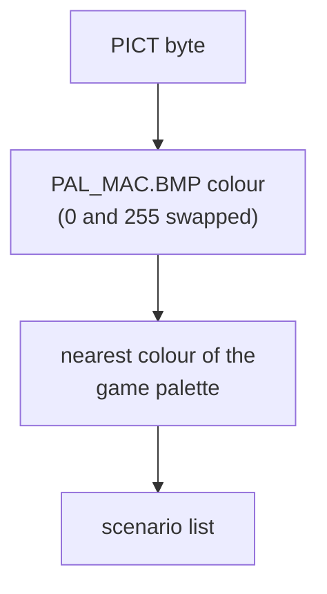

# PICT: scenario picture

The small picture shown next to each scenario in the game's scenario list: 65 × 65 pixels, one byte per pixel, each byte a colour number. Only scenario files (`.scn`) have it. The colours come from a palette file of the game, not from the segment.

## At a glance

| | |
|---|---|
| Segments | one per scenario, id `0x80` (18/18 scenarios) |
| Storage | raw, not compressed ([container.md](../container.md#segment-table)) |
| Body | 4-byte id (**little-endian**), a 4-byte size header, then 65 rows of 66 bytes |
| Length the game reads | at most 4300 bytes after the id (`0x42ae10`); 4294 in 17/18 files |
| Picture | 65 × 65 pixels, row 0 at the top; the size header is ignored |
| Pixel | 1 byte: an index into the colours of `PAL_MAC.BMP`, with entries 0 and 255 swapped ([Colours](#colours)) |
| Found by | tag and id, wherever the segment is ([container.md § Scenario segments](../container.md#scenario-segments)) |

## Layout

Offsets from the start of the segment body:

| Bytes | Field | Confidence |
|---|---|---|
| 0–3 | Id, little-endian: `0x80` | **Confirmed (code)**: `0x426180` asks for `PICT` `0x80`. **Verified (data)** 18/18 |
| 4–5 | Width, little-endian 16-bit: 65 | **Unused**: the game never reads it. **Verified (data)** 18/18 |
| 6–7 | Height, little-endian 16-bit: 65 (66 in `MALIBU.SCN`) | **Unused**. **Verified (data)** |
| 8 + 66 *r* + *c* | Pixel at row *r*, col *c* (both 0–64) | **Confirmed (code)**: `0x475790` copies 65 rows of 65 bytes, 66 bytes apart, starting 4 bytes after the id |
| 8 + 66 *r* + 65 | End of row *r*: `0x00` (15 files) or `0xFF` (3 files) | **Unused**: skipped by the copy. **Verified (data)** |

The stored rows match the header: 4 + height × (width + 1) bytes after the id in 18/18 files. `MALIBU.SCN` has a 66th row (4360 bytes), which the game cuts off: it reads 4300 bytes and draws 65 rows (**Confirmed (code)**, `0x42ae10`, `0x475790`).

The picture is drawn as stored, row 0 at the top: the game puts it into a top-down bitmap (**Confirmed (code)**: `0x474bc0` creates it with a negative height), and all 18 pictures decoded this way show their scene upright (**Verified (data)**).

### The frame

The outer pixels are part of the picture. In 14 files the top, bottom and left edges are one colour, a frame: index 0 (black) in 7, 1 (black) in 4, 254 (grey) in 3; in the other 4 the scene runs to the edge in places (**Verified (data)**; the right edge was not tallied). The game draws all 65 × 65 pixels, frame included (**Confirmed (code)**).

## Colours

A pixel is a colour number 0–255. The game does not store the colours in the segment. It takes them from `PAL_MAC.BMP` in its graphics folder (`[PATHS] GRAPHICS` in the settings; `BITMAPS` in a normal install) (**Confirmed (code)**: `0x425854`). The name suggests the palette of the Macintosh version, where the scenarios were made (**Inferred**).

`PAL_MAC.BMP` is an 8-bit bitmap whose 256-entry colour table holds:

| Index | Colour in `PAL_MAC.BMP` | Drawn as |
|---|---|---|
| 0 | white | **black** (swapped with 255) |
| 1 | black | black |
| 2–154 | the game's colours: entry *i* = entry *i* + 16 of the game's main palette `PAL_MSTR.BMP` | the same |
| 155–254 | grey (127, 127, 127) | grey |
| 255 | black | **white** (swapped with 0) |

Before drawing, the game swaps entries 0 and 255 when the scenario file is dated after 30 December 1993, and leaves them alone for older files (**Confirmed (code)**: `0x426260` compares the file's creation date, `0x475e60` swaps). On any installed copy the files are newer than that, so **0 is drawn black** (**Inferred** for a typical install; a copy that keeps the original 1993 dates would draw 0 white). The corpus pictures need the swap: with index 0 white, the dark parts of most pictures (Atlanta's UFO, the Hollywood clapperboard, the police car, …) turn into white blotches (**Verified (data)**, by rendering all 18 both ways).

The game then maps every colour to the nearest colour of its own palette and draws with that (`0x475e60`, nearest colour by `0x476d60`). For indices 2–154 the nearest colour is the same colour, so a reader can use the table directly. On a display with fewer than 32 colours the game skips the remapping (`0x4ea04c`).

Corpus pixels use only indices 0–154 and 254 (**Verified (data)** 18/18).

## How the game uses it

| Use | Function | What it does |
|---|---|---|
| Set-up | `0x425854` | Lists the `*.scn` files of the `[PATHS] SCENARIOS` folder, loads the `PAL_MAC.BMP` palette, creates a 65 × 65 8-bit bitmap (`0x474bc0`) |
| Draw a list entry | `0x425e40` | Reads `PICT` `0x80` and `TEXT` `0x80` (`0x426180`), copies the pixels (`0x475790`), gives the bitmap the `PAL_MAC` colours (`0x4759b0`), remaps them (`0x475e60` or `0x475c90`, chosen by the file date `0x426260`), and draws the picture 3 pixels inside the entry, with the [text](text.md) to its right |
| Find | `0x42ae10` | Reads at most 4300 bytes after the id |

The picture is not used anywhere else: it is not shown while the scenario runs, and the save routine `0x432350` writes no PICT segment (**Confirmed (code)**: no other code refers to the tag).

## Evidence

| Claim | Code | Data (`sc2check.py --only pict_`) |
|---|---|---|
| One PICT, id `0x80` | `0x426180` | 18/18 scenarios |
| 65 rows of 65 pixels, 66 bytes apart, after a 4-byte header | `0x475790` | body = 4 + height × (width + 1) in 18/18 |
| Header ignored | `0x475790` uses the fixed sizes 65 and 66 | 65 × 65 in 17/18, 65 × 66 in 1 |
| Row end byte ignored | `0x475790` | `0x00` in 15, `0xFF` in 3 |
| Colours from `PAL_MAC.BMP`, 0 and 255 swapped | `0x425854`, `0x475e60`, `0x426260` | all 18 render as their scenes; pixels 0–154 and 254 only |
| Row 0 at the top | `0x474bc0` | all 18 upright |

## Pitfalls for readers

- **Ignore the size header.** Read 65 rows of 65 pixels with a row stride of 66, as the game does; `MALIBU.SCN`'s header says 66 rows.
- **Index 0 is black**, not the white of `PAL_MAC.BMP`'s entry 0.
- **Use `PAL_MAC.BMP`, not `PAL_MSTR.BMP`.** The two differ by 16 places: PICT index *i* is `PAL_MSTR` entry *i* + 16 for *i* = 2–154.
- **The frame is ordinary pixels.** It is black in some files and grey in others; do not crop it unless you want to.
- **The palette is not in the city file.** `sc2dump.py` returns colour indices; `pict_palette()` builds the colours from a `PAL_MAC.BMP` you supply.

## Links

- [text.md](text.md): the description drawn next to the picture
- [container.md § Scenario segments](../container.md#scenario-segments): how the game finds scenario segments
