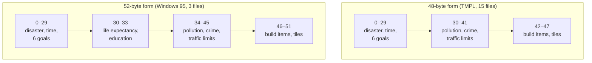
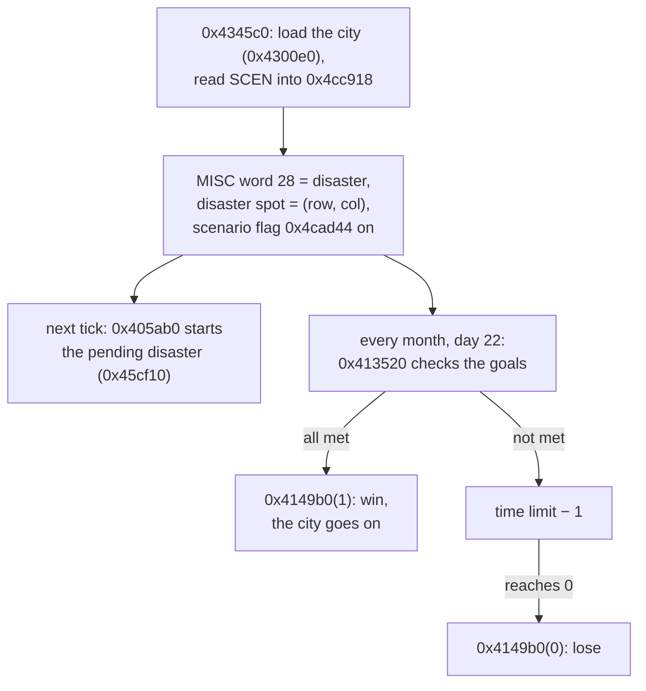

# SCEN and TMPL: scenario goals

SCEN holds what makes a city a **scenario**: the disaster that strikes when it starts, where it strikes, how many months the player has, and the goals the city must reach. Only scenario files (`.scn`) have it. TMPL, found in a few scenario files, is a description of SCEN's fields that the game never reads.

## At a glance

| | SCEN | TMPL |
|---|---|---|
| Files | the 18 scenarios (18/114) | 5 of the 18 scenarios |
| Storage | raw, not compressed ([container.md](../container.md#segment-table)) | raw |
| Id | 4 bytes, little-endian, `0x80` (18/18) | 4 bytes, little-endian, `0x80` (5/5) |
| Body after the id | 48 bytes (15/18) or 52 bytes (3/18) | 334 bytes: 17 field descriptions |
| Byte order of the fields | big-endian, like the rest of the file | — |
| Read by | `0x4345c0`, the scenario loader, through `0x42ae10` | nothing |
| Game buffer | `0x4cc918` (52 bytes) | — |

The city itself is an ordinary city in the same file: the scenario loader first loads it like any city (`0x4300e0`), then reads SCEN ([container.md § Scenario segments](../container.md#scenario-segments)).

## Layout

Offsets are from the start of the body, after the 4-byte id (add 4 for offsets from the start of the segment data, as OpenCity2k counts them). The game reads the body into a 52-byte structure and swaps the 16- and 32-bit fields from big-endian (**Confirmed (code)**: `0x4345c0`).

| Offset | Size | Field | Meaning | Confidence |
|---|---|---|---|---|
| 0 | int16 | disaster | Disaster to start, in MISC word 28's numbering (0 = none) | **Confirmed (code)** |
| 2 | byte | disaster row | Where it starts: row … | **Confirmed (code)**, **Verified (data)** |
| 3 | byte | disaster col | … and col, in the stored map (at the file's compass) | **Confirmed (code)**, **Verified (data)** |
| 4 | int16 | time limit | Number of monthly goal checks the player gets | **Confirmed (code)** |
| 6 | int32 | city size goal | Population at least this (MISC word 1035, without arcologies) | **Confirmed (code)** |
| 10 | int32 | residential goal | Residential tax base at least this (budget word 479) | **Confirmed (code)** |
| 14 | int32 | commercial goal | Commercial tax base at least this (budget word 506) | **Confirmed (code)** |
| 18 | int32 | industrial goal | Industrial tax base at least this (budget word 533) | **Confirmed (code)** |
| 22 | int32 | funds goal | Funds minus the **number** of bonds at least this (MISC words 5 and 6) | **Confirmed (code)** |
| 26 | int32 | land value goal | Land value total at least this (MISC word 10) | **Confirmed (code)** |
| 30 | int16 | life expectancy goal | Life expectancy at least this (MISC word 18) | **Confirmed (code)**; 52-byte form only |
| 32 | int16 | education goal | Education quotient at least this (MISC word 19) | **Confirmed (code)**; 52-byte form only |
| 34 | int32 | pollution limit | Pollution total at most this (MISC word 13); 0 = no limit | **Confirmed (code)** |
| 38 | int32 | crime limit | Crime total at most this (MISC word 11); 0 = no limit | **Confirmed (code)** |
| 42 | int32 | traffic limit | Traffic total at most this (MISC word 12); 0 = no limit | **Confirmed (code)** |
| 46 | byte | build item 1 | XBLD code of a building the city must have; 0 = none | **Confirmed (code)** |
| 47 | byte | build item 2 | A second one | **Confirmed (code)** |
| 48 | int16 | item 1 tiles | At least this many tiles of build item 1 (MISC words 124–379) | **Confirmed (code)** |
| 50 | int16 | item 2 tiles | The same for build item 2 | **Confirmed (code)** |

Every goal of 0 is met automatically, because the statistics it is compared with are never negative.

### Two forms: 48 and 52 bytes

The Windows 95 game's structure has the life expectancy and education goals at offsets 30 and 32. The older form, which TMPL describes, has no such goals: its pollution, crime and traffic limits start at offset 30, and its build items and tile counts follow, ending at offset 48.

The game reads both with the 52-byte structure: it copies the whole body, whatever its length, so a 48-byte body fills bytes 0–47 and leaves bytes 48–51 (the tile counts) as they were in memory (**Confirmed (code)**: `0x42ae10` reads `length − 4` bytes; `0x4345c0` swaps all 52). In the corpus this changes nothing: bytes 30–47 are zero in all 15 files of the 48-byte form, so both readings give the same goals (**Verified (data)** 15/15).

**Verified (data)**: `LASVEGAS.SCN` (52 bytes) has 18 375 at offset 38. Read with the 52-byte layout this is a crime limit, and its briefing says "bring crime back down … to win this scenario"; with the 48-byte layout it would be a traffic limit. The three 52-byte files are `BARCELON.SCN`, `LASVEGAS.SCN` and `PARIS.SCN`; their bytes 48–51 are zero.

**For a reader:** decode a 52-byte body with the 52-byte layout. For a 48-byte body, the TMPL layout gives what the author meant; it differs from what the Windows 95 game reads only if bytes 30–47 are not all zero.

### The disaster spot

The spot is (row, col) in the arrays as stored, at the compass the file was saved with (MISC word 2). **Confirmed (code)**: the loader puts the two bytes into the disaster spot `0x4caa58` (row) and `0x4caa5c` (col), and the disaster routines index the maps with them as [row][col] (for example `0x45e590` writes XTXT at that tile). **Verified (data)**: both meltdown scenarios have their spot on a nuclear plant tile (XBLD `0xCB`) in stored coordinates, one of them (`BARCELON.SCN`) saved at compass 3 (2/2).

Turning the map turns the spot like any tile: one clockwise view turn moves (row, col) to (127 − col, row) ([conventions.md § Orientation](../conventions.md#orientation)). The game never turns it, because the disaster starts before the player can turn the view.

Not every disaster uses the spot. Of the routines the dispatcher `0x45cf10` calls, those for hurricane (16) and microwave (10) never read it (**Confirmed (code)**: no reference to `0x4caa58`); the meltdown (9) uses it only if it is on a nuclear plant tile and otherwise looks for the first one on the map (`0x45f2b0`).

## Values

The disaster numbers are those of MISC word 28 ([general.md § Disasters](misc/general.md#disasters)). In the corpus every scenario's number fits its briefing text (**Verified (data)** 15/15 scenarios with a disaster):

| Disaster | Scenarios |
|---|---|
| 0 none | Dullsville, Flint, Las Vegas |
| 6 earthquake | San Francisco |
| 8 monster | Atlanta ("UFO invasion"), Hollywood |
| 9 meltdown | Barcelona ("nuclear device"), Manhattan |
| 10 microwave | Silicon Valley ("new energy source … malfunctioned") |
| 11 volcano | Portland |
| 12 firestorm | Malibu, Oakland, Paris |
| 13 mass riots | Washington ("lawyers running amuck") |
| 14 major flood | Davenport |
| 15 pollution accident | Chicago ("pollution stinks") |
| 16 hurricane | Charleston, Homestead |

Time limits are 60 months (14/18), 120 (3/18) or 121 (Dullsville). Goals used: city size (12/18), industrial (3/18), residential (1/18), funds (1/18, with city size), crime limit (1/18). No scenario in the corpus uses the life expectancy, education, pollution, traffic or building goals.

## How the game uses it

1. **Loading.** `0x4345c0` loads the file as a city and sets the scenario flag `0x4cad44` (non-zero while a scenario runs). It reads SCEN (or shows "Could not extract resource from Scenario file", string 239, if there is none), copies the disaster number into MISC word 28 (the pending disaster) and the spot into `0x4caa58`/`0x4caa5c`. It is called by `0x42f500` and `0x42f820`, the two routines that start a scenario, which then show the briefing ([text.md](text.md)).
2. **The disaster.** The main loop `0x405ab0` starts a pending disaster on the next tick through `0x45cf10`. The No Disasters option does not stop it: that path does not test the option (**Confirmed (code)**).
3. **The goal check.** On day 22 of every month (simulation step 22, after the milestone check), while the scenario flag is set, `0x413520` compares every goal with the current statistics as in the [Layout](#layout) table (**Confirmed (code)**).
   - If all goals are met, `0x4149b0(1)` shows string 285 ("JOY! RAPTURE! DIVINITY! You have completed all necessary objectives …"), clears the scenario flag, and the city goes on as an ordinary city.
   - Otherwise the time limit counts down by one. When it reaches 0, `0x4149b0(0)` shows string 286 ("You have failed to complete scenario objectives within the alloted span of time …"), clears the flag and ends the game (**Inferred**: it sets the game state `0x4c7334` to 7).
4. **Bankruptcy.** Right after the goal check, in every city (scenario or not), funds below −100 000 end the game with string 287 ("Due to your bungling management, your city has dropped into irretrievable debt …", `0x4149b0(2)`) (**Confirmed (code)**).

The goal values, the time left and the scenario flag live only in memory. **Saving a scenario city writes no SCEN** (no code writes the tag), so a saved game continues as an ordinary city without goals (**Confirmed (code)**: the only code that uses the `SCEN` tag `0x4e7214` reads it, in `0x42ae10` and `0x4345c0`).

## TMPL

TMPL lists SCEN's fields by name and type, in the format of a Mac OS ResEdit `TMPL` template (**Inferred** from the format; the four-letter type codes are ResEdit's). `SIMCITY.EXE` never refers to the tag (**Confirmed (code)**), so the game skips it.

| Bytes | Content |
|---|---|
| 0–3 | Id, little-endian, `0x80` |
| then, repeated | 1 byte *n*, *n* characters of the field's label, 4 characters of type: `DBYT` (1 byte), `DWRD` (2 bytes), `DLNG` (4 bytes) |

All five TMPL segments are identical and list 17 fields totalling 48 bytes (**Verified (data)** 5/5): Disaster Type `DWRD`, Disaster XLoc `DBYT`, Disaster YLoc `DBYT`, Time Limit (Months) `DWRD`, City Size Goal, Residential Goal, Commercial Goal, Industrial Goal, Cash Goal Funds-Bonds, Land Value Goal, Pollution Limit, Crime Limit, Traffic Limit (all `DLNG`), Build Item One `DBYT`, Build Item Two `DBYT`, Item One Tiles `DWRD`, Item Two Tiles `DWRD`. This is the 48-byte form. TMPL is in `CHARLEST.SCN`, `DULLSVIL.SCN`, `FLINT.SCN`, `HOLLYWOO.SCN` and `OAKLAND.SCN`, all with a 48-byte SCEN.

TMPL's "XLoc" and "YLoc" are the row and the col.

## Evidence

| Claim | Code | Data (`sc2check.py --only scen`, `--only tmpl`) |
|---|---|---|
| SCEN id `0x80`, little-endian | `0x42ae10`, `0x4345c0` | 18/18 |
| Fields big-endian, 52-byte structure | `0x4345c0` (swaps at offsets 0, 4–29, 30, 32, 34–45, 48, 50) | 48 bytes 15/18, 52 bytes 3/18 |
| Both forms read the same in the corpus | — | bytes 30–47 zero in 15/15 48-byte bodies; bytes 48–51 zero in 3/3 52-byte bodies |
| Offset 38 of the 52-byte form is the crime limit | `0x413520` | `LASVEGAS.SCN` and its briefing |
| Goal comparisons, win, lose, bankruptcy | `0x413520` step 22, `0x4149b0` | no scenario's goals are met at load (18/18) |
| Spot = (row, col) in stored coordinates | `0x4345c0`, `0x45e590`, `0x45f2b0` | meltdown spots on XBLD `0xCB`: 2/2 |
| Disaster numbers | `0x45cf10` | 15/15 match their briefing |
| TMPL never read | no reference to the tag | 5/5 identical, 48 bytes of fields |

## Pitfalls for readers

- **The fields are big-endian, the id little-endian.** Only the id follows the scenario lookup's byte order.
- **Pick the layout by length.** A 52-byte body has the life expectancy and education goals at offsets 30 and 32; a 48-byte body does not, and everything after offset 30 moves.
- **The funds goal subtracts the number of bonds, not their value.** "Cash Goal Funds-Bonds" in TMPL and Dullsville's "$5,000 after bonds" suggest the debt was meant, but the code subtracts MISC word 6, a count of 0–50 (**Confirmed (code)**).
- **The residential, commercial and industrial goals are tax bases**, not populations: the budget's counts, which include a share of the arcology residents ([budget.md](misc/budget.md#entries)).
- **The disaster spot is in stored coordinates.** Turn it with the map when normalising to compass 0; leave it alone when the disaster is 0 (Las Vegas has a spot but no disaster).
- **A scenario's MISC word 28 is 0.** The pending disaster comes from SCEN when the scenario starts.

## Links

- [container.md § Scenario segments](../container.md#scenario-segments): how the game finds SCEN, TEXT and PICT
- [text.md](text.md), [pict.md](pict.md): the briefing texts and the picture
- [misc/general.md § Disasters](misc/general.md#disasters): the disaster numbers
- [misc/budget.md](misc/budget.md#entries): the tax bases the goals compare with
