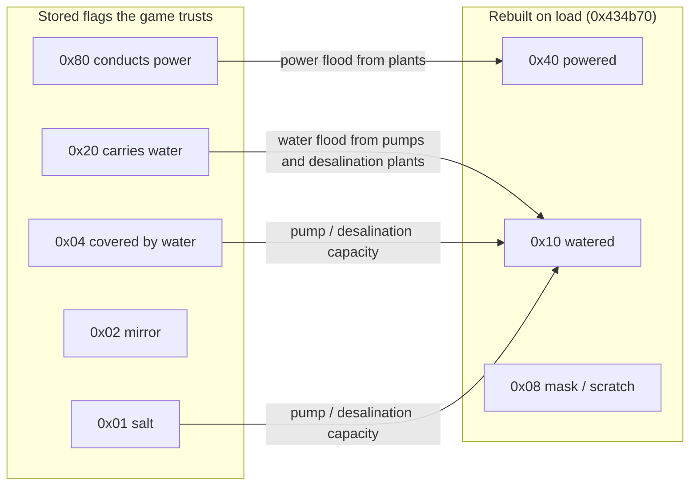
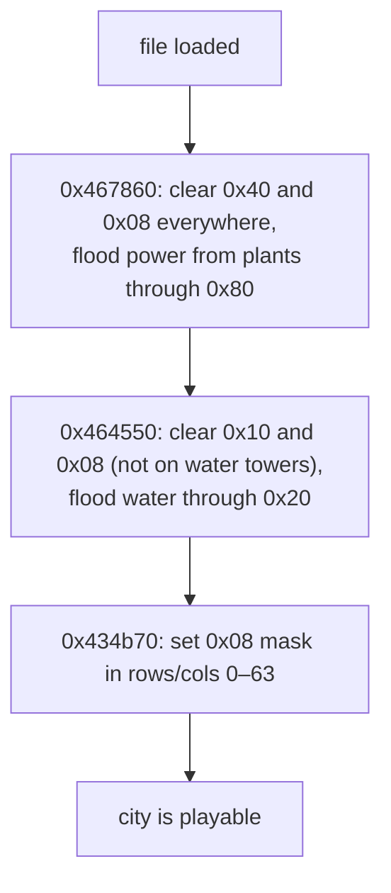

# XBIT: Per-tile flags

One byte of eight independent flags per tile. The flags record whether a tile conducts power, is powered, carries water, is watered, is covered by water, is salt, and whether its sprite is mirrored. Bit 0x08 is a working bit with two jobs.

Three of the eight bits are recomputed by the game when it loads a city, so a reader can treat their stored values as a snapshot ([§ What to trust](#what-to-trust)).

## At a glance

| | |
|---|---|
| Size | 16384 bytes decoded |
| Storage | RLE ([compression.md](../compression.md)) |
| Shape | 128 × 128 tiles, one byte each, row by row ([conventions.md](../conventions.md#the-city-map-128--128-tiles)) |
| Byte order | single bytes, nothing to swap |
| Game buffer | `0x4cab10` (128 row pointers) |
| Present | 114/114 files |

## Layout

```
offset(row, col) = row * 128 + col
```

Each byte is a set of flags, tested and changed with masks. The bit names in the older documents use different numbering conventions, so these pages always give the **mask**.

## Bit layout

| Mask | Our name | Meaning | Set by | Stored value used after load? | Confidence |
|---|---|---|---|---|---|
| `0x80` | conducts power | Power can flow through this tile (buildings, zones, power lines) | placing a building (`0x436e80`), the power-line tool (`0x441400`) | **yes**, trusted | **Confirmed (code)** |
| `0x40` | powered | The tile currently receives power | the power flood (`0x4679b0`) | **no**: recomputed on load | **Confirmed (code)** |
| `0x20` | carries water | Water can flow through this tile (buildings, pipes) | placing a building (`0x436e80`), a pipe (`0x44b790`) | **yes**, trusted | **Confirmed (code)** |
| `0x10` | watered | The tile currently receives water | the water flood (`0x4649e0`) | **no**: recomputed on load | **Confirmed (code)** |
| `0x08` | developed mask / scratch | Rows 0–63, cols 0–63: a 64 × 64 mask of developed land. Elsewhere and in between: a temporary mark used by flood fills | see [0x08](#0x08-developed-land-mask-and-scratch-mark) | **no**: cleared and rebuilt on load | **Confirmed (code)** |
| `0x04` | covered by water | The tile is under water (sea, lake, river) | terrain generation, the water tool (`0x484320`) | **yes**, trusted | **Confirmed (code)** |
| `0x02` | mirror ("rotate") | Draw this tile's sprite mirrored, which turns it by 90° in the isometric view | placing runways and piers (`0x4382b0`), view rotation (bridges, on-ramps) | **yes**, trusted | **Confirmed (code)** |
| `0x01` | salt | Water on this tile is (or would be) salt | terrain generation (`0x447b20`, `0x447e20`) | **yes**, trusted | **Confirmed (code)** |



### 0x80: conducts power

Power spreads from each power plant (XBLD `0xC6`–`0xCF`) to neighbouring tiles (up, down, left, right) **only through tiles with 0x80 set** (**Confirmed (code)**, power flood `0x4679b0`). The game sets 0x80, together with 0x40 and 0x20, on every tile of a building it places (`0x436e80`). It also sets 0x80 alone in a tool action that then recomputes power (`0x441400`, the power-line tool **Inferred**), and clears 0x80, 0x40 and 0x20 when a tile is cleared (`0x440c50`).

**Verified (data)**: every tile with 0x40 also has 0x80 (114/114 files). Every powered tile can be reached from a power plant through 0x80 tiles in 111/114 files. The remaining 55 tiles in 3 files are explained by saves taken partway through a simulation step (see [0x08](#0x08-developed-land-mask-and-scratch-mark)) **Inferred**. 41/114 files have 0x80 on some empty tiles (XBLD 0), which the game leaves behind and ignores.

### 0x40: powered

Set by the power flood on tiles it reaches while the plants still have capacity (`0x4679b0`). **The game recomputes it**: `0x467860` clears 0x40 (and 0x08) on every tile and floods again from every plant. That routine runs right after loading (from `0x434b70`) and as step 1 of every simulation cycle (`0x413520`) (**Confirmed (code)**).

Buildings (XBLD ≥ `0x70`) with 0x80 set and 0x40 clear get an extra sprite drawn on top (`0x43c730`), presumably the flashing "no power" symbol (**Inferred**). On the power map view (`0x4888f0`), tiles with 0x40 are drawn in the "powered" colour and tiles with only 0x80 in the "unpowered" colour.

### 0x20: carries water

Water spreads from water sources **only through tiles with 0x20 set** (**Confirmed (code)**, water flood `0x4649e0`). It is set on every tile of a placed building (`0x436e80`) and when a pipe is laid in XUND (`0x44b790`). It is cleared when the tile is cleared (`0x440c50`) and by a tool action that also rewrites XUND (`0x441b80`). 9676 tiles in the corpus have 0x20 with nothing built on them: these are pipes under empty land.

### 0x10: watered

Set by the water flood (`0x4649e0`). It starts from every powered pump (XBLD `0xDC`) and powered desalination plant (`0xFA`) that is not yet watered. A pump's capacity grows with every neighbouring tile that is **fresh** water (0x04 set, 0x01 clear). A desalination plant's capacity grows with every neighbouring tile that is **salt** water (0x04 and 0x01 set). Water towers (`0xEB`) on the network add stored water, and powered treatment plants (`0xF4`) are marked watered themselves. **The game recomputes it**: `0x464550` clears 0x10 on every tile except water towers, then floods. It runs right after loading and as step 0x14 of the simulation cycle (**Confirmed (code)**).

**Verified (data)**: every tile with 0x10 also has 0x20 in 113/114 files. Every watered tile can be reached from a pump or desalination plant through 0x20 tiles in 113/114 files. The exception is the same file, which has watered tiles without 0x20.

### 0x08: developed-land mask and scratch mark

This bit has two jobs.

1. **A 64 × 64 mask, kept in the top-left quadrant.** After loading, `0x434b70` sets 0x08 on tile `(row / 2, col / 2)` for every tile whose XBLD code is above `0x1C` or whose XZON zone (low four bits) is not 0. Rows 0–63 and cols 0–63 of XBIT therefore hold one bit per 2 × 2 block: "this block has something built or zoned on it". Step 2 of the simulation cycle (`0x46a840`, which also computes XPLT) reads and rewrites the mask (**Confirmed (code)**; what it is used for there is **Inferred**: pollution and land value work on the same 64 × 64 grid).
2. **A "visited" mark for searches.** The power and water floods set 0x08 on each tile they visit and clear it on a second pass. A recursive check over lower-lying tiles (`0x443cb0` / `0x4441c0`) does the same.

The power reset (`0x467860`) and water reset (`0x464550`) clear 0x08 on every tile, so between steps 1 and 2 of a cycle the mask is empty. The floods also yield to Windows every 5000 tiles (`0x4570f0`), so a city can be saved partway through one.

**Verified (data)**:

| What the quadrant (rows 0–63, cols 0–63) holds | Files |
|---|---|
| exactly the mask computed from XBLD and XZON | 67/114 |
| all clear | 43/114 |
| partly the mask | 4/114 |

0x08 is set outside the quadrant in only 3/114 files.

**For a reader: ignore the stored 0x08.** If you need the mask, compute it from XBLD and XZON as above.

### 0x04: covered by water

The tile is part of a sea, lake or river. Overlay views draw empty tiles with 0x04 as water (`0x4888f0`, `0x488ab0`), and pumps and desalination plants count neighbouring 0x04 tiles. It is set by terrain generation and the water tool (`0x484320`, which also sets the XTER code to `0x10`), and cleared when land is raised (`0x443270`, `0x45b930`, `0x447020`, …).

**Verified (data)**: 0x04 is set only on tiles whose XTER code is a water code (`0x10` or above; see [xter.md](xter.md#values)): 428 372 tiles, no exceptions, 114/114 files. The converse does not hold. 1975 tiles have a water XTER code but no 0x04, all of them XTER `0x1D`, `0x30`–`0x3E` or `0x40`–`0x45`.

### 0x02: mirror ("rotate")

The renderer passes this bit to the sprite blitter as "draw mirrored left-to-right" (`0x43c730` → `0x485230`). In the isometric view, a mirrored straight piece runs along the other map axis. How the bit is applied depends on the XBLD code (**Confirmed (code)**):

| XBLD code | Sprite is mirrored when |
|---|---|
| below `0x1D` (empty land, rubble, trees, power lines) | never: the bit is not used |
| `0x1D`–`0x6F` (roads, rails, highways, bridges, on-ramps, tunnels) | `flag` |
| `0x70` and above (buildings, including runways `0xDD` and piers `0xDF`) | `flag XOR (compass & 1)` |

The difference comes from view rotation. When the view turns, the game flips the flag on bridges (`0x51`–`0x5C`, `0x6A`, `0x6B`) and re-codes highway on-ramps (`0x5D`–`0x60`), but it **never touches the flag of runways and piers** ([§ Rotation](#rotation)). Their stored flag therefore means "along row" only at an even compass.

Placing a runway or pier (`0x4382b0`) sets the flag to *runs along the row axis* XOR *compass is odd*. For a pier, the axis comes from where the crane meets the water. Bulldozing a runway or pier clears 0x02 along with 0x80 and 0x40 (`& 0x3D`).

What the flag says about direction, in map terms ("along row" = the piece's long axis follows the row index, i.e. neighbouring pieces are at `row ± 1`):

| Tiles | Rule | Verified (data) |
|---|---|---|
| Bridges `0x51`–`0x5C` | along row ⇔ flag set, at any compass | 3672 of 3677 unambiguous tiles in 69 files. The 5 exceptions (2 files) are one-tile bridges lying side by side, where the neighbour test cannot tell the axis |
| Runway `0xDD` | along row ⇔ flag XOR (compass is odd) | 1612/1612 tiles, 67 files |
| Pier `0xDF` | along row ⇔ flag XOR (compass is odd) | 1078/1078 tiles, 63 files |

"Unambiguous" means the tile has a neighbour of the same kind along exactly one axis. In the corpus the flag occurs on XBLD `0x51`–`0x60`, `0x6A`, `0x6B`, `0xDD` and `0xDF`. Stray flags also occur on one 4 × 4 prison (`0xD8`, 16 tiles, 1 file), one water treatment plant tile (1 file) and one empty tile (1 file); their origin is **Unknown**.

### 0x01: salt

Water on this tile is salt. When a new map is generated, the ocean strip is created with 0x01 (`0x447b20`). `0x447e20` then spreads 0x01 to neighbouring water tiles and removes it from tiles that are not water. After that, the bit is not cleared when land is raised, so it marks where water *would* be salt. **Verified (data)**: 159 608 of the 267 781 salt tiles in the corpus are not covered by water (66/114 files).

## How the game uses it

| Use | Bits | Function |
|---|---|---|
| Power simulation | 0x80 → 0x40, 0x08 as mark | `0x467860`, `0x4679b0` (cycle step 1) |
| Water simulation | 0x20, 0x04, 0x01 → 0x10, 0x08 as mark | `0x464550`, `0x4649e0` (cycle step 0x14) |
| Developed-land mask | 0x08 | `0x434b70` (after load), `0x46a840` (cycle step 2) |
| Drawing tiles | 0x02, 0x80 + 0x40 | `0x43c730` |
| Power and water map views | 0x80, 0x40 / 0x20, 0x10; 0x04 | `0x4888f0`, `0x488ab0` |
| Placing and clearing tiles | all except 0x08 | `0x436e80`, `0x440c50`, `0x4382b0`, `0x44b790`, … |

### What to trust



0x80, 0x20, 0x04, 0x02 and 0x01 come straight from the file. 0x40, 0x10 and 0x08 are rebuilt before the city is shown (**Confirmed (code)**, [container.md § After the walk](../container.md#after-the-walk)).

## Rotation

When the view turns, the game moves each XBIT byte with its tile and leaves all bits unchanged, with two exceptions (**Confirmed (code)**, `0x465490` / `0x466660`):

- **Bridges** (`0x51`–`0x5C`, `0x6A`, `0x6B`): the 0x02 flag is toggled. Suspension-bridge pieces whose flag was set are also re-coded (`0x51` ↔ `0x55`, `0x52` ↔ `0x54`).
- **Highway on-ramps** (`0x5D`–`0x60`): the code and the 0x02 flag are replaced together from a fixed table.

The exact rules, and how to normalise a city to compass 0, are in [conventions.md § Orientation](../conventions.md#orientation).

## Evidence

| Claim | Code | Data (`sc2check.py --only xbit`) |
|---|---|---|
| Meanings of 0x80/0x40 and 0x20/0x10 | floods `0x4679b0`, `0x4649e0`; map views `0x4888f0`, `0x488ab0` | powered ⇒ conducts 114/114; reachability 111/114 and 113/114 |
| 0x40, 0x10, 0x08 rebuilt on load | `0x434b70` → `0x467860`, `0x464550` | — |
| 0x08 as 64 × 64 mask | `0x434b70` | 67/114 exact, 43/114 clear |
| 0x04 = covered by water | map views, pump capacity in `0x4649e0`, water tool `0x484320` | only on water XTER codes, 114/114 |
| 0x01 = salt | `0x447b20`, `0x447e20`, desalination in `0x4649e0` | — |
| 0x02 = mirror | renderer `0x43c730`, rotation `0x465490`/`0x466660`, placement `0x4382b0` | bridge, runway and pier rules above |
| Bits per file | — | 0x80 106, 0x40 106, 0x20 105, 0x10 97, 0x08 67, 0x04 112, 0x02 90, 0x01 68 (of 114) |

## Pitfalls for readers

- **Use masks, not bit numbers.** djm numbers bits from the least significant end (bit 7 = 0x80); OpenCity2k numbers them from the most significant end (its "bit 6, rotation" is 0x02).
- **Do not read 0x40 and 0x10 as truth for a hand-edited file.** They are whatever the last simulation step left. If your tool changes the map, they will be recomputed by the game anyway.
- **Do not read 0x08 at all** unless you want the scratch state. It is neither a land value field nor stable.
- **Runway and pier direction depends on the compass**, bridge direction does not. Read the compass from MISC word 2 ([conventions.md § The compass](../conventions.md#the-compass-the-map-is-saved-as-currently-viewed)).
- **0x01 without 0x04 is normal**: salt marks a location, not current water.
