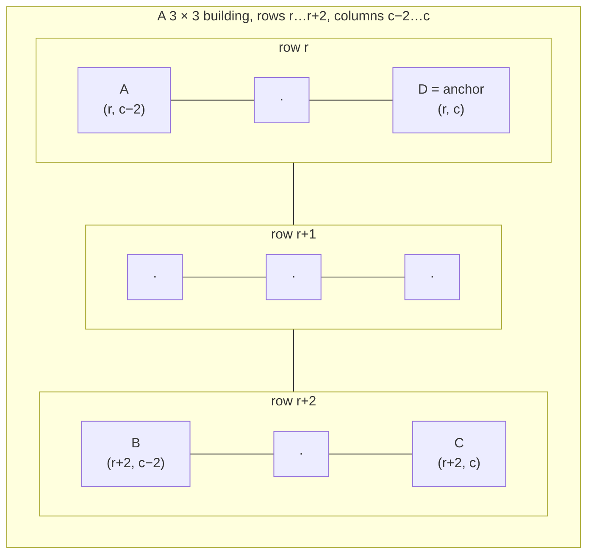

# XBLD: What is built on each tile

XBLD says what occupies each tile of the map: nothing, trees, a road, a power line, a bridge, or one tile of a building. It is the main map layer. Most other per-tile layers describe the tile *in addition to* what XBLD says.

## At a glance

| | |
|---|---|
| Size | 16384 bytes decoded |
| Storage | RLE-compressed ([compression.md](../compression.md)) |
| Shape | 128 × 128 bytes, row by row ([conventions.md](../conventions.md#the-city-map-128--128-tiles)) |
| Element | 1 byte: a tile code, `0x00`–`0xFF` |
| Byte order fix-up | none |
| Game buffer | `0x4cc4f0` (128 row pointers) |
| Code table | [reference/tile-codes-xbld.md](../reference/tile-codes-xbld.md) |

## Layout

| Offset | Size | Type | Name | Meaning | Confidence |
|---|---|---|---|---|---|
| `row * 128 + col` | 1 | uint8 | code | What occupies tile (row, col) | **Confirmed (code)**: the loader decodes 16384 bytes into the XBLD map; every map loop reads it as `map[row][col]` |

Every one of the 16384 bytes is a tile code. There is no header and no padding.

## Values

The full list with names and sizes is in [reference/tile-codes-xbld.md](../reference/tile-codes-xbld.md). In outline:

| Codes | What | Footprint |
|---|---|---|
| `0x00` | Nothing built (clear terrain; what the ground looks like is in [XTER](xter.md#values)) | 1×1 |
| `0x01`–`0x0D` | Rubble, radioactive waste, trees, small park | 1×1 |
| `0x0E`–`0x48` | Power lines, roads, rails, tunnel entrances, crossings | 1×1 |
| `0x49`–`0x50` | Straight highways and highway crossings | 1×1 tiles forming 2×2 cells ([Highways](#highways)) |
| `0x51`–`0x60` | Bridges, elevated power lines, highway on-ramps | 1×1 |
| `0x61`–`0x6B` | Sloped, curved and cloverleaf highways, highway bridges | 2×2 |
| `0x6C`–`0x6F` | Subway/rail connections | 1×1 |
| `0x70`–`0xFF` | Buildings: zone buildings, power plants, civic, ports, military, arcologies | 1×1 to 4×4 (size table) |

- All 256 values are meaningful (**Confirmed (code)**: the size table and the string table cover all of `0x70`–`0xFF`, and every code below `0x70` belongs to a range the game handles).
- 255 of them occur in the corpus. Only `0x59` (raising bridge, raised) never does (**Verified (data)**, 114 files).
- Codes below `0x70` are terrain features and networks. Codes from `0x70` are buildings. The game draws and rotates the two groups differently ([Rotation](#rotation)).

## Footprints and anchors

### Every tile holds the code

A building larger than 1×1 writes **its code into every tile it covers**. A 4×4 power plant is sixteen equal bytes in a 4 × 4 block (**Verified (data)**: 67 063 multi-tile buildings in the corpus, all stored this way; the exceptions are described under [Fragments](#fragments)).

The footprint size comes from the code alone. For codes `0x70`–`0xFF` the game has a 16-bit size table at `0x4e85d8` + 2 × code (**Confirmed (code)**). The sizes are listed in the [code table](../reference/tile-codes-xbld.md).

### Corner bits mark the outline

XBLD alone cannot tell two neighbouring 2×2 office buildings with the same code apart. The game marks each building's corners in the upper four bits of [XZON](xzon.md#corner-bits):

| Tile | XZON corner bits |
|---|---|
| 1×1 building | all four (`0xF0`) |
| corner tile of a larger building | exactly one: the bit for that corner |
| any other tile of a larger building | none |

**Verified (data)**: 1×1 buildings carry `0xF0` in 112/114 files (the exceptions are 7 tiles on row 127 of two cities). Larger buildings carry the pattern in the table in 108/114 files.

Which bit marks which corner depends on the **compass**, because the game turns the map arrays when the view turns but leaves XZON's bits as they are ([Rotation](#rotation)). Name the corners by their position in the stored grid:

| Corner | Position | Compass 0 | Compass 1 | Compass 2 | Compass 3 |
|---|---|---|---|---|---|
| A | min row, min col | `0x10` | `0x20` | `0x40` | `0x80` |
| B | max row, min col | `0x20` | `0x40` | `0x80` | `0x10` |
| C | max row, max col | `0x40` | `0x80` | `0x10` | `0x20` |
| D | min row, max col | `0x80` | `0x10` | `0x20` | `0x40` |

In general, corner *k* (A = 0, B = 1, C = 2, D = 3) is marked by bit `0x10 << ((k + compass) mod 4)`. **Confirmed (code)**: table at `0x4dc4d0`, four 16-bit values per compass, used by `0x45b1c0`.



### The anchor

When the game needs "the building at this tile" (to query it, bulldoze it or draw it) it calls `0x45b1c0`. That routine moves from any tile of a building to its **anchor**: corner **D**, the tile with the smallest row and the largest column. **Confirmed (code)**:

1. Codes `0x49`–`0x50` and `0x61`–`0x6B` (highways): round the row down to even and the column up to odd. The size is 2 ([Highways](#highways)).
2. Any other code below `0x70`: the tile is its own anchor, size 1.
3. Codes `0x70`–`0xFF`: look up the size *n*.
   - 3×3 and 4×4: step to an adjacent tile (including diagonals) that carries a corner bit, trying corners A, B, C and D in turn. Every tile of a 3×3 or 4×4 building touches at least one of its corners.
   - Then, from whichever corner the tile is now on, jump to corner D: from A add *n* − 1 to the column; from B subtract *n* − 1 from the row and add *n* − 1 to the column; from C subtract *n* − 1 from the row.

So a building of size *n* anchored at (r, c) covers rows r … r + *n* − 1 and columns c − *n* + 1 … c.

**For a reader** the simplest correct way to list buildings follows from this:

```
for each tile (r, c):
    code = XBLD[r][c];  n = size(code)
    if code >= 0x70 and XZON[r][c] & 0xF0 == cornerBit(D, compass):   # (for n = 1: 0xF0)
        building at rows r..r+n-1, cols c-n+1..c
```

Check that the block holds `code` throughout. Tiles of multi-tile codes that no anchor covers are [fragments](#fragments).

### Highways

Highways are two tiles wide, so the game handles them in 2×2 **cells** aligned to even rows and even columns: rows 2k and 2k + 1, columns 2m and 2m + 1.

- `0x61`–`0x6B` (slopes, curves, cloverleaf, highway bridges) are true 2×2 pieces. All four tiles hold the code, and each corner tile carries its corner bit like a 2×2 building. **Verified (data)**: in all 46 files that use these codes, every such tile lies in a uniform, even-aligned 2×2 block.
- `0x49`–`0x50` (straights and crossings) are 1×1 tiles with all four corner bits (`0xF0`), but always come in even-aligned 2×2 cells made only of highway codes. A straight highway is two parallel tiles of `0x49`; where a road crosses it, the cell holds two tiles of `0x49` and two of `0x4B`. **Verified (data)**: 47 of the 49 files that use these codes; 5 tiles in two cities break the rule.
- The game's anchor for both is the cell's (min row, max col) tile (step 1 above).

The even grid survives view turns: a turn maps row *r* to 127 − *r* or column *c* to 127 − *c*, which turns an even-aligned pair into an even-aligned pair.

### Fragments

In 37/114 files some tiles hold a multi-tile code but are not part of any well-formed block. Usually there are only a few (1–5 tiles in 27 of those files). Most have no corner bits; some carry a single, unmatched one. They are what is left when part of a building was overwritten without the rest being cleared, for example a 3×3 factory partly replaced by smaller buildings during redevelopment. They occur in cities shipped with the game, so they are not just the result of editing. Two cities (`FLOATING.SC2`, `PETER3.SC2`) have dozens, alongside overlapping buildings that are clearly damaged.

How the game treats a fragment when drawing or simulating is **Unknown** ([open questions](../open-questions.md)). A reader should not assume that every run of equal codes is a building. Take buildings from anchors and handle fragments separately (ignore them, or treat each as a 1×1 tile of that code).

## How the game uses it

| What | Where | Notes |
|---|---|---|
| Changing a tile | `0x441f00` (SetTile) | Writes the code and keeps the per-code tile counts in step: the 256-entry table loaded from MISC words 124–379 for ordinary tiles, and a 16-entry military table at `0x4ca934` for tiles in a military zone (XZON zone 7) |
| Recounting after load | `0x434f80` | Rebuilds the 256-entry per-code tile count from XBLD, **skipping tiles whose XZON zone is 7** (military) ([container.md](../container.md#after-the-walk)) |
| Finding a building's anchor | `0x45b1c0` | See [The anchor](#the-anchor) |
| Drawing | `0x43c730` | Picks the sprite from the code. The XBIT rotate flag mirrors the sprite: for codes `0x1D`–`0x6F` the flag alone decides; for codes from `0x70` it is XORed with the compass parity ([xbit.md](xbit.md#bit-layout)) |
| Placing runways and piers | `0x4382b0` | Sets `0xDD` / `0xDF` and the XBIT rotate flag for their direction |
| Turning the view | `0x465490`, `0x466660` | Remaps the codes; see [Rotation](#rotation) |

The military count table indexes the codes as follows (**Confirmed (code)**, `0x441f00`): 0 other, 1 `0xDD`, 2 `0xDE`, 3 `0xEF`, 4 `0xF2`, 5 `0xEA`, 6 `0xE3`, 7 `0xE4`, 8 `0xE5`, 9 `0xF1`, 10 `0xE0`, 11 `0xE2`, 12 `0xE7`, 13 `0xE8`, 14 `0xF6`, 15 `0xF9`. It is stored in MISC words 1002–1017 and is not recomputed on load ([tile-counts.md](misc/tile-counts.md#military-counts-words-10021017)).

## Rotation

The map is stored as currently viewed ([conventions.md](../conventions.md#orientation)). When the view turns, the game moves every XBLD byte to its new position and passes it through a remap table, so that a road running "left-right" on screen still does after the turn. **Confirmed (code)**:

| Routine | Compass | Moves | Remap table |
|---|---|---|---|
| `0x465490` | − 1 | `new[r][c] = T[old[c][127 − r]]` | `0x4e8fa0` |
| `0x466660` | + 1 | `new[r][c] = T[old[127 − c][r]]` | `0x4e9110` (the inverse of `0x4e8fa0`) |

What the tables change:

| Codes | Effect of one turn |
|---|---|
| straights (`0x0E`/`0x0F`, `0x1D`/`0x1E`, `0x2C`/`0x2D`, `0x49`/`0x4A`) and crossings (`0x43`–`0x48`, `0x4B`–`0x50`) | swap with their partner |
| slopes, curves and T-junctions of power lines, roads and rails; rail slope approaches `0x3B`–`0x3E`; tunnel entrances `0x3F`–`0x42`; sloped and curved highways `0x61`–`0x68`; subway/rail connections `0x6C`–`0x6F` | step through their group of four |
| suspension bridge ends `0x51` ↔ `0x55` and `0x52` ↔ `0x54` | swap |
| everything else, including all codes from `0x70`, `0x00`–`0x0D`, the four-way crossings `0x1C`/`0x2B`/`0x3A`, the cloverleaf `0x69`, other bridge pieces and on-ramps | unchanged by the table |

The per-code partner is listed in the "turns into" notes of the [code table](../reference/tile-codes-xbld.md).

After moving everything, the same routines make a second pass over the map for the pieces whose direction lives in the XBIT rotate flag (**Confirmed (code)**):

- **Bridges** (`0x51`–`0x5C`) and **highway bridges** (`0x6A`, `0x6B`): if the rotate flag is set, it is cleared and the code is remapped once more; if it is clear, it is set.
- **On-ramps** (`0x5D`–`0x60`): a new code and flag are chosen from a small table, using the old code and flag as the index.

Runways (`0xDD`) and piers (`0xDF`) are not touched by either pass. Their flag is read relative to the compass instead. Details of the flag are on [xbit.md](xbit.md#bit-layout).

## Evidence

| Claim | Code | Data |
|---|---|---|
| Layout | loader `0x4302e0` | 114/114 decode to 16384 bytes |
| All 256 codes valid; `0x59` unseen | size table, string table | 255 codes seen in 114 files |
| Size table | `0x4e85d8`, read by `0x45b1c0` | — |
| Every tile of a footprint holds the code | `0x45b1c0` (assumes it) | 67 063 well-formed buildings; 108/114 files without a malformed one |
| Corner bits per compass | table `0x4dc4d0`, `0x45b1c0` | 1×1: 112/114; multi-tile: 108/114 |
| Anchor = corner D | `0x45b1c0` | — |
| Highway 2×2 cells | `0x45b1c0` | `0x61`–`0x6B`: 46/46 files that use them; `0x49`–`0x50`: 47/49 |
| Fragments | — | 37/114 files; 27 of them with at most 5 tiles |
| Military tiles excluded from the code count | `0x434f80`, `0x441f00` | — |
| Rotation tables | `0x465490`, `0x466660`, `0x4e8fa0`, `0x4e9110` | — |

Tallies: `sc2check.py --only xbld`.

## Pitfalls for readers

- **Don't find buildings by scanning for the first non-zero tile.** Fragments and adjacent buildings with the same code break that approach. Use the anchor (corner D, from XZON) as shown above.
- **The corner bits depend on the compass.** A reader that assumes compass 0 gets every building's outline wrong in three quarters of saved views.
- **`0x49`–`0x50` are 1×1 in XZON but 2×2 to the game.** Treat a straight highway as two tiles wide.
- **Directions in tile codes are relative to the saved view.** To compare cities saved at different compass values, undo the rotation and apply the remap tables ([conventions.md](../conventions.md#orientation)).
- **Military tiles are not in the per-code count** stored in MISC. Recount from XBLD if you need totals.
- **Game names repeat.** "Warehouse", "Office building" and "Construction" cover several codes. Use the code, not the name, as the key.
