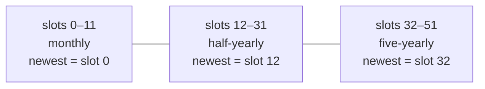
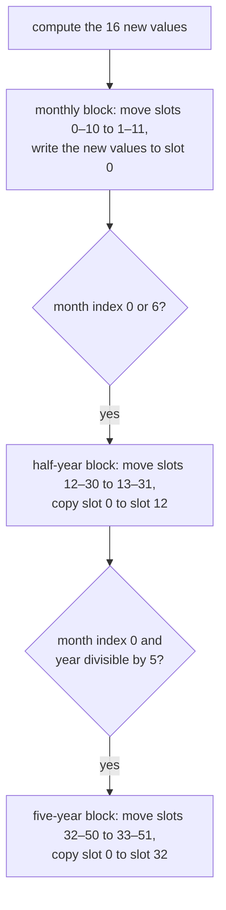

# XGRP: graph history

XGRP holds the history behind the game's **Graph window**: 16 statistics (city size, traffic, pollution, health, GNP and so on), each with 52 past values. The values are snapshots taken once a month, so a reader can show the same 1-year, 10-year and 100-year graphs the player sees. The game recomputes nothing in XGRP on load. Only the scale of each graph (its maximum) is derived from it, and that scale is not stored.

## At a glance

| | |
|---|---|
| Size | 3328 bytes decoded |
| Compressed | yes, RLE ([compression.md](../compression.md)) |
| Shape | 16 series × 52 values |
| Element | signed 32-bit integer, big-endian |
| Byte order fix-up | the loader swaps every 4-byte word (`0x42a7e0`) |
| Rotation | not affected |

## Layout

Series *i* (0–15) starts at byte offset *i* × 208 (`0xD0`). Within a series, value *k* (0–51) is at offset *i* × 208 + *k* × 4 (**Confirmed (code)**: the game allocates one 3328-byte buffer and points series *i* at *i* × `0xD0` (`0x42d820`); the loader decodes XGRP straight into it).

Each series is split into three blocks of samples. **The newest sample is first** in every block:

| Slots | Samples | Spacing | Covers | Graph button |
|---|---|---|---|---|
| 0–11 | 12 | one month | the last year | "1 Year" |
| 12–31 | 20 | half a year | the last 10 years | "10 Years" |
| 32–51 | 20 | five years | the last 100 years | "100 Yrs" |

(**Confirmed (code)**: the update routine `0x413e50` and the graph renderer `0x46f4a2`, see below. **Verified (data)**, see [Evidence](#evidence).)

### When samples are taken

The game's calendar is the day counter in MISC word 4: a month is 25 days and a year 300, so the month index is (day ÷ 25) mod 12 and the year is day ÷ 300 (**Confirmed (code)**: `0x413520`). The simulation runs one step per day; on **day 21 of every month** (step `0x15`) it calls `0x413e50`, which:

So slot 12 and slot 32 are copies of a monthly value, taken in January and July (month index 0 and 6; index 0 is January: the game's month-name table starts with "January", **Confirmed (code)** `0x405650`, `0x477c12`) and in January of every fifth year. The oldest sample of each block is dropped. A new city starts with all 832 values at 0 (`0x40e250`), so the blocks fill up over the first 1, 10 and 100 years.

### How the graph window reads it

The renderer `0x46f4a2` draws, for each selected series, slots 11 → 0 in the 1-year view, slots 31 → 12 in the 10-year view and slots 51 → 32 in the 100-year view, from left to right. The newest value is therefore at the right, as the game's help text says ("The current month is farthest to the right"). Each point is plotted as value × height ÷ *scale*, where *scale* is the series maximum described under [Graph scale](#graph-scale-not-stored) (**Confirmed (code)**).

## Graph series

The order is the order of the 16 buttons in the game's Graph window dialog (**Confirmed (code)**: dialog resource of `SIMCITY.EXE`; it matches the 16 values computed by `0x413e50`, in order). Meanings and units are the game's own help text (`DATA\TEXT_USA.DAT`). "Newest value" is what `0x413e50` writes to slot 0 every month (**Confirmed (code)**). The MISC words are the stored copies of the inputs (**Verified (data)** where a tally is given; out of the 109 files with graph history).

| # | Offset | Button | Meaning (game help) | Newest value | Range in corpus |
|---|---|---|---|---|---|
| 0 | `0x000` | City Size | Total population | microsim population (MISC word 1032) + 10 × population (MISC word 380) + arcology bonus (below) | 0 – 9 342 726 |
| 1 | `0x0D0` | Residents | Children, parents and home-spouses of the work force; scaled against City Size | (MISC 1032 + bonus) ÷ 2 + 10 × (MISC 381 + MISC 382) | 0 – 4 677 449 |
| 2 | `0x1A0` | Commerce | Laborers working for local services; scaled against City Size | (MISC 1032 + bonus) ÷ 4 + 10 × (MISC 383 + MISC 384) | 0 – 2 357 224 |
| 3 | `0x270` | Industry | Laborers working for local industry; scaled against City Size | (MISC 1032 + bonus) ÷ 4 + 10 × (MISC 385 + MISC 386) | 0 – 2 328 266 |
| 4 | `0x340` | Traffic | Average cars per minute of all roads, highways and bridges | MISC word 12 ÷ (road + highway + bridge counts of the budget + 1) | 0 – 183 640 |
| 5 | `0x410` | Pollution | Air pollution in PPM | MISC word 13 ÷ (developed tiles ÷ 4 + 1) | 0 – 9 459 |
| 6 | `0x4E0` | Value | Average block value, in thousands of dollars per lot | MISC word 10 ÷ (developed tiles ÷ 4 + 1) | 0 – 30 346 |
| 7 | `0x5B0` | Crime | Annual incidents per thousand citizens | MISC word 11 ÷ (developed tiles ÷ 4 + 1) | 0 – 9 657 |
| 8 | `0x680` | Power % | Power surplus: the percentage of capacity left | 100 − percentage of power capacity in use (`0x4caa50`) | −8 – 100 |
| 9 | `0x750` | Water % | Water surplus: the percentage of pumped water left unused | 100 − percentage of water capacity in use (`0x4cc4b8`) | 0 – 100 |
| 10 | `0x820` | Health | Life expectancy (LE) of a laborer, in years | MISC word 18 (109/109) | 0 – 96 |
| 11 | `0x8F0` | Education | Educational quotient (EQ); the national average is 100 | MISC word 19 (109/109) | 0 – 143 |
| 12 | `0x9C0` | Unemployment | Percentage of people who want work but cannot find it | 100 × MISC 387 ÷ (MISC 380 + MISC 387 + 1); the result is also kept in MISC word 1001 (109/109) | 0 – 99 |
| 13 | `0xA90` | GNP | Gross National Product of the SimNation | MISC word 21 (101/109) | 0 – 3 508 040 |
| 14 | `0xB60` | Nat'n Pop. | National population, in thousands (the graph labels a value below 1000 with "k", below a million with "m", else "b": **Confirmed (code)**, `0x46f4a2`) | MISC word 20 (105/109) | 0 – 5 008 332 |
| 15 | `0xC30` | Fed Rate | Percentage the national government pays on bonds | MISC word 22 (102/109) | 0 – 9 |

Notes on the formulas (all **Confirmed (code)**, `0x413e50` and `0x468150`):

- **Population words.** Just before the graphs are updated, `0x468150` sets MISC word 380 to the sum of words 381–386, and the Residents, Commerce and Industry inputs to the sums of the pairs 381 + 382, 383 + 384 and 385 + 386. Word 387 counts the population units of abandoned buildings ([population.md § Zone population](misc/population.md#zone-population)). These words keep changing during the month, so in a saved file they often no longer add up (word 380 equals the sum of 381–386 in only 40 of 109 files). Recomputing Residents, Commerce or Industry from a saved file therefore rarely gives the stored value. **Read the series; do not recompute them.**
- **Arcology residents.** MISC word 1032 is the sum of the residents (word 4) of every arcology record (`0xFB`–`0xFE`), recomputed each January by `0x44e390` (**Confirmed (code)**; [xmic.md](xmic.md#misc-words-set-from-xmic)). The City Size formula holds for the newest value in 84 of 109 files (**Verified (data)**); the others were saved after the inputs had changed again.
- **Arcology bonus.** With *n* = the number of arcologies (tiles of XBLD `0xFB`–`0xFE` ÷ 16, from the per-code tile counts), the game adds (5*n* − 700) × 4000 to MISC 1032 in the formulas once *n* exceeds 140, so City Size gets all of it and Residents, Commerce and Industry a half and two quarters. One city in the corpus is affected.
- **Developed tiles** are tiles with XBLD above `0x1C` or a zone, counted by the post-load routine `0x434b70` and in simulation step 2 (`0x46a840`). Pollution, Value and Crime are therefore averages per developed 2 × 2 block, the cell size of the [overlays](../conventions.md#overlay-grids).
- **Traffic** divides by the Roads, Highways and Bridges counts of the budget (MISC words 749, 776 and 803; the Roads count includes 250 per bus station), as of the start of the month (**Confirmed (code)**: `0x413e50`, `0x4734a0`; [budget.md](misc/budget.md#transport-counts)).
- **Power % and Water %** are 100 minus the percentages computed by the power and water floods `0x467860` and `0x464550` ([xbit.md](xbit.md#how-the-game-uses-it)): power or water delivered as a percentage of the plants' total capacity. The power percentage is capped at 100, so this version never writes a negative Power %. Three files nevertheless have small negative values (−5 to −8), all in old samples (half-year or five-year slots): `CAPE.SC2`, `PETER2.SC2` and the scenario `CHICAGO.SCN`. They were presumably written by an earlier version without the cap (**Inferred**).

## How the game uses it

| When | What happens | Code |
|---|---|---|
| Load | XGRP is decoded and swapped; then the [graph scales](#graph-scale-not-stored) are computed from all 52 values of each series | `0x4302e0`, `0x431fd0` |
| Day 21 of every month | 16 new values are computed and shifted in, as described under [When samples are taken](#when-samples-are-taken) | `0x413520` → `0x413e50` |
| Graph window | Draws the selected series from the chosen block | `0x46f4a2` |
| New city | All 832 values set to 0 | `0x40e250` |
| Save | The buffer is written back as it is | `0x432350` |

### Graph scale (not stored)

The y-axis of each series is scaled to a maximum that the game keeps in memory only (`0x4cc6f0`, 16 values):

- On load, `0x431fd0` sets each maximum to the largest of the series' 52 values, but at least a floor from a table at `0x4e72b0`: 100 for Power % and Water %, 150 for Health, 90 for Education, 15 for Unemployment and Fed Rate, 1 for all others. Residents, Commerce and Industry then take City Size's maximum, so the four share one scale.
- Each monthly update raises the maxima with the new values. City Size, Residents, Commerce and Industry keep sharing one scale; so do Traffic, Pollution, Value and Crime; and GNP's scale is raised to at least Nat'n Pop's.
- A new city starts with the same floors except that Health and Education are swapped (90 and 150, `0x40e250`).

A reader that draws graphs can reproduce this; nothing in the file needs to change.

## Evidence

| Claim | Code | Data (`sc2check.py --only xgrp`) |
|---|---|---|
| 16 series × 52 int32, series at *i* × `0xD0` | `0x42d820`, `0x431fd0`, `0x413e50` | 3328 bytes in 114/114 |
| Series order and names | Graph window dialog resource; `0x413e50` | — |
| Meanings and units | `DATA\TEXT_USA.DAT` help text | ranges in the table above |
| Monthly update on day 21 | `0x413520` step `0x15` | — |
| Slot 12 = copy made at the last January/July update | `0x413e50` | 105/109 files with history: slot 12 equals the monthly slot that has aged since that update |
| Slot 32 = copy made at the last five-year update | `0x413e50` | 92/109; see [Pitfalls](#pitfalls-for-readers) |
| Newest values equal MISC words | `0x413e50`, `0x431330` | Health 109/109, Education 109/109, Unemployment 109/109, Nat'n Pop 105/109, Fed Rate 102/109, GNP 101/109, City Size 84/109 |
| Values are signed | `0x42a7e0` swaps them as 32-bit words; `0x413e50` writes 100 − percentage | negative only in Power %, 3/114, old samples only |
| No history in new cities | `0x40e250` | 5/114 files are all zero (`BABAR.SC2` and the four `TOMG_B*.SC2`) |

## Pitfalls for readers

- **Newest first.** Slot 0, 12 and 32 are the newest samples of their block. Reverse each block to draw it left to right in time.
- **Blocks overlap in time.** Slot 12 is a copy of what was slot 0 in the last January or July, and slot 32 a copy from the last five-year January. Do not concatenate the blocks into one time line.
- **Unfilled history is 0.** A city younger than 1, 10 or 100 years has zeros at the old end of the blocks, which look like real values.
- **Five-year phase.** In 17 of 109 files the five-year block was not last updated in a year divisible by 5 (mostly scenarios, 11 of them, and a few cities, probably saved by another version or edited). Don't derive dates for the five-year samples from the year; count back from the newest.
- **Some files break the half-year rule** (4/109: `MAXISLND.SC2` and the scenarios `CHARLEST.SCN`, `OAKLAND.SCN`, `PORTLAND.SCN`). Treat the stored values as they are.
- **Units differ per series.** City Size and its parts count people, Nat'n Pop. counts thousands of people, and GNP has no unit in the game's help text (**Unknown**).
- **The scales are not in the file.** Recompute them as described under [Graph scale](#graph-scale-not-stored) if graphs should look like the game's.
- The Industry window's graphs and the population, health and education graphs by age group are **not** in XGRP; they are in MISC ([population.md](misc/population.md)).
