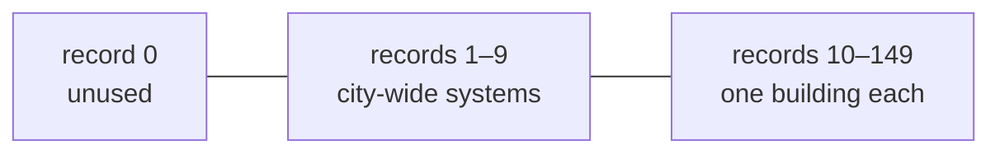

# XMIC: microsim statistics

150 small records with the statistics the game shows when the player clicks a **microsim**: a building with its own figures, such as a power plant, a hospital, a stadium or an arcology, or one of the nine city-wide systems (buses, parks, libraries, …). Each record holds the building code and four numbers whose meaning depends on the building. A tile's [XTXT](xtxt.md) value points to its record, and the record's name is in [XLAB](xlab.md).

## At a glance

| | |
|---|---|
| Size | 1200 bytes: 150 records of 8 bytes |
| Storage | RLE-compressed ([compression.md](../compression.md)) |
| Element | 8-byte record: 2 bytes, then three big-endian 16-bit words |
| Game buffer | `0x4cb3ec` |
| Linked to | XTXT value *r* + `0x33` and XLAB slot *r* + `0x33` for record *r* |
| Changes with the compass? | No |
| Recomputed on load? | No. Most figures are recomputed once a year ([§ When the figures change](#when-the-figures-change)) |

## Layout

Record *r* (0–149) is bytes `8r` to `8r + 7`.

| Byte | Size | Field | Confidence |
|---|---|---|---|
| 0 | 1 | Building code (XBLD) the record belongs to; 0 = record free | **Confirmed (code)** `0x44cf60`, `0x44ced0` |
| 1 | 1 | Figure **#0**, unsigned byte | **Confirmed (code)** `0x44d360` |
| 2 | 2 | Figure **#1**, big-endian unsigned 16-bit | **Confirmed (code)**: the loader swaps bytes 2–3, 4–5 and 6–7 of every record (`0x42a820`); **Verified (data)**: every coal plant's word 2 reads 200 (MW) in big-endian |
| 4 | 2 | Figure **#2**, big-endian unsigned 16-bit | as above |
| 6 | 2 | Figure **#3**, big-endian unsigned 16-bit | as above |

"#0" to "#3" are the names the microsim window's text templates use for these four figures ([§ The microsim window](#the-microsim-window)). What each figure means depends on the building code in byte 0; the full list is in [microsim-kinds-xmic.md](../reference/microsim-kinds-xmic.md).

## Records

| Records | XTXT / XLAB | Contents | Confidence |
|---|---|---|---|
| 0 | `0x33` | Unused. Byte 0 is `0xEC`; the other bytes are never written, so they hold whatever was in memory | **Confirmed (code)**: a new city writes only byte 0 (`0x44cb60`), the yearly update starts at record 1 (`0x44e390`); **Verified (data)**: byte 0 = `0xEC` in 114/114, bytes 1–7 zero in 38/114 |
| 1–9 | `0x34`–`0x3C` | The nine city-wide systems, one record each, always present | **Confirmed (code)**; **Verified (data)** 113/114 |
| 10–149 | `0x3D`–`0xC8` | One record per microsim building, allocated when it is built | **Confirmed (code)** `0x44cf60` |

### Records 1–9: city-wide systems

A new city writes these building codes into byte 0 and zeroes the figures (`0x44cb60`). Every building of the system counts towards the same record ([xtxt.md](xtxt.md#built-in-microsims-0x340x3c)).

| Record | Byte 0 | System | XLAB slot |
|---|---|---|---|
| 1 | `0xEC` | Bus system | 52 |
| 2 | `0xED` | Rail system | 53 |
| 3 | `0xE9` | Subway system | 54 |
| 4 | `0xC8` | Wind power | 55 |
| 5 | `0xC6` or `0xC7` | Hydroelectric power | 56 |
| 6 | `0xD5` | Parks | 57 |
| 7 | `0xD4` | Museums | 58 |
| 8 | `0xF5` | Libraries | 59 |
| 9 | `0xF8` | Marinas | 60 |

Placing a system building writes its code into byte 0 again, so record 5 holds the code of the last hydroelectric plant built: `0xC6` in 99/114 files, `0xC7` in 15 (**Confirmed (code)** `0x44cf60`; **Verified (data)**). One file (`PARADE.SC2`) has `0xD2` in record 4.

### Records 10–149: buildings

When a microsim building is placed, `0x44cf60` looks up its code in the table at `0x4e7c9a`. Codes with an entry of 1–`0x10` get a record of their own (**Confirmed (code)**): the power plants `0xC9`–`0xCF`, City Hall `0xD0`, hospital `0xD1`, police `0xD2`, fire `0xD3`, school `0xD6`, stadium `0xD7`, prison `0xD8`, college `0xD9`, zoo `0xDA`, statue `0xDB`, the mayor's house `0xF3`, water treatment `0xF4`, desalination `0xFA`, the arcologies `0xFB`–`0xFE` and the Llama Dome `0xFF`.

1. It takes the **first free record from 10 up** (byte 0 = 0).
2. If all 140 are taken, only an arcology still gets one: it takes the first record whose building code is below `0xFB` and clears that building's XTXT values from the map. Other buildings get no record and no XTXT value.
3. It writes the building code into byte 0 and sets the starting figures (`0x44ddc0`, [microsim-kinds-xmic.md](../reference/microsim-kinds-xmic.md)).
4. It writes the building's name into XLAB slot *r* + `0x33`: a name the player gave this kind of building before (`0x4cde68`), or the default name, string 831 + (code − `0xC6`) of `SIMCITY.EXE` ("Gas Power", "Hospital", "Plymouth Arco", …).
5. It returns *r* + `0x33`, which the caller writes into the XTXT byte of every tile of the footprint.

**Verified (data)**: records 10–149 hold only these codes (114/114). 6 670 of the 6 694 records in use have their XTXT value on the map; the 24 others (4 files) are buildings destroyed without their record being freed.

A record is **freed** by clearing byte 0: when the building is demolished (`0x44ced0`, which also clears the XLAB slot), or when a power plant wears out ([microsim-kinds-xmic.md](../reference/microsim-kinds-xmic.md#power-plants-0xc90xcf)). The other bytes keep their old values. Records 1–9 are never freed.

## When the figures change

| When | Function | What changes |
|---|---|---|
| A microsim building is placed | `0x44ddc0` (from `0x44cf60`) | Its own record (10–149): cleared, then starting values. A system building (records 1–9): adds to the count (one more bus station, 20 MW more hydro power, …) |
| Once a year, at the start of January | `0x44e390`, called by the monthly budget `0x4734a0` when the year's budget is booked (MISC word 911 set, month 0) | Records 1–149 are recomputed from the city's statistics, the budget and the tile counts; MISC words 1032, 1038 and 1039 are set from them |
| Clicking a microsim whose XTXT value is `0x6F` | `0x414b40` | Runs the opinion poll and updates every mayor's house record as the yearly update does (**Inferred**: meant for the mayor's house) |
| Zone growth, simulation steps 3–18 | `0x4358b0` | Byte 1 of each arcology (`0xFB`–`0xFE`): its conditions grade, from XVAL, XCRM, XPLT, power and water at the arcology's tile with XZON corner bit `0x80` |
| Demolishing a stadium | `0x458d40` | Its sport is removed from MISC word 1034 |

So most figures in a saved file are **as of the last January**, not the moment of saving. The yearly update draws random numbers for many of them, so they cannot be recomputed exactly ([§ Pitfalls](#pitfalls-for-readers)).

The yearly update often limits a figure by the city's size: `0x44f7d0`(*x*, *d*) returns the smaller of *x* and (population + MISC word 1032 + arcology bonus) ÷ *d*, where population is MISC word 1035 and the arcology bonus is (*n* − 140) × 20 000 for *n* > 140 arcologies (*n* = arcology tiles ÷ 16) (**Confirmed (code)**).

## The microsim window

Clicking a microsim opens a window (dialog `0x9a`, `0x44d1b0`) with the building's picture, its name from XLAB (which the player can edit) and up to five lines of statistics, drawn by `0x427720` through `0x44d360` (**Confirmed (code)**).

- Byte 0's code is looked up in `0x4e7c9a` to get a **kind** (1–25). The table at `0x4e7da0` gives five text templates per kind, as string ids − 900 (−1 = no line). The templates are loaded at start-up (`0x4501af`).
- In a template, `#0` to `#3` are replaced by byte 1 and the three words, as decimal numbers. Five more codes exist:

| Code | Shows |
|---|---|
| `#G` | A grade: byte 1 as F, D−, D, D+, C−, C, C+, B−, B, B+, A−, A, A+ (0–12) |
| `#W` | Wins − losses: byte 1 and 40 − byte 1 (nothing when byte 1 is 0) |
| `#S` | The name of a sport: string 786 + word 4 (Football, Baseball, Soccer, Cricket, Rugby) |
| `#T` | The XLAB slot given by word 6 (a team name) |
| other text | As written, for example `Beds : 1000` |

The lines of every kind are in [microsim-kinds-xmic.md](../reference/microsim-kinds-xmic.md). Some language versions of the game replace a few templates at start-up (`0x4501af`, for the "aus", "fre" and "ger" builds).

## MISC words set from XMIC

| MISC word | Value | Confidence |
|---|---|---|
| 1032 | Sum of word 4 (residents) of the arcology records (`0xFB`–`0xFE`) | **Confirmed (code)** `0x44e390`; **Verified (data)** 109/114 |
| 1038 | Sum of word 6 (arrests) of the police station records, at most 65 535 | **Confirmed (code)**; **Verified (data)** 111/114 |
| 1039 | 1 if the city has prisons and they are on average at most 79 % full (word 6 of the prison records ÷ number of prisons), else 0 | **Confirmed (code)**; **Verified (data)** 112/114 |
| 1034 | Bit *s* set for each sport *s* with a stadium; a stadium's word 4 is its sport | **Confirmed (code)** `0x458d40`; **Verified (data)**: 150 of 156 stadium records have their bit |

Word 1039 feeds back: the next year, police arrests are crimes ÷ (5 − word 1039), and in simulation step 2 a police station's strength is (5 + word 1039) × funding ÷ 2 ([minimaps.md](minimaps.md#xplc-police-coverage)).

## How the game uses it

| Use | Function | What it does with XMIC |
|---|---|---|
| Load | `0x4302e0`, `0x42a820` | RLE-decodes 1200 bytes, swaps the three words of every record |
| Save | `0x432350` | Writes the 1200 bytes, words big-endian |
| New city | `0x44cb60` | Frees all records; writes the system codes into records 0–9; zeroes records 1–9; writes the systems' default names into XLAB slots 52–60 |
| Place a building | `0x44cf60`, `0x44ddc0` | Allocates and initialises a record, or adds to a system record |
| Yearly update | `0x44e390` | Recomputes the figures; may wear out power plants; may launch the Launch arcologies |
| Arcology conditions | `0x4358b0` | Byte 1 of arcology records |
| Demolish | `0x44ced0` | Frees the record (codes `0x3D`–`0xC8` only) and its XLAB slot |
| Microsim window | `0x44d1b0`, `0x427720`, `0x44d360` | Shows the figures with the kind's templates |
| Simulation | step 2 (`0x46a840`), power (`0x467860`) and the rest | Never read the records; they use MISC words 1032, 1038, 1039. So a power plant's output in word 2 is for the window only (**Confirmed (code)**: no other function reads `0x4cb3ec`) |

## Evidence

| Claim | Code | Data (`sc2check.py --only xmic`) |
|---|---|---|
| 150 records of 8 bytes, words big-endian | `0x4302e0`, `0x42a820` | 1200 bytes in 114/114; plant output words read correctly (281 records) |
| Record 0 unused, byte 0 `0xEC` | `0x44cb60`, `0x44e390` | 114/114 |
| Records 1–9 = the systems | `0x44cb60`, `0x44cf60` | 113/114 |
| Records 10–149 = buildings with their own record | `0x44cf60`, table `0x4e7c9a` | 114/114 |
| Field meanings | templates `0x4e7da0`, `0x44d360`, `0x44e390`, `0x44ddc0` | constants per kind hold: power plant output 281/281 records, arcology capacity 1 253/1 253 |
| MISC 1032, 1038, 1039 | `0x44e390` | 109, 111, 112 of 114 |
| Stadium team slot = 251 + sport | `0x483250` (import), `0x44d360` (`#S`, `#T`) | 142 of 156 records; the other 14 (4 files) have sport 0 and slot 0 |

## Pitfalls for readers

- **The words are big-endian**, like the rest of the file; byte 1 is a single byte, not part of a word.
- **Interpret the figures by byte 0's building code**, not by the record number. The same offset means "patients" for a hospital and "officers" for a police station.
- **Figures are a yearly snapshot** with random parts. Show them; do not try to recompute them. The counts of the city-wide systems (records 1–9) can be recomputed from the tile counts (MISC words 124–379) exactly as the game does.
- **A record can be in use with no building on the map** (24 records in 4 files) and record 0 holds garbage in 76/114 files. To list the microsims a player sees, start from the XTXT values on the map.
- **"Passengers/day"** in the bus, rail and subway windows is really the number of trips counted since the last yearly update (`0x457620`), reset after each update and on load (`0x434b70`).
- **Some values exceed the game's own limits** in files from other versions (an arcology with 65 491 residents, attendance above 25 000). Treat them as stored, not as errors.

## Links

- [microsim-kinds-xmic.md](../reference/microsim-kinds-xmic.md): every building code's figures, starting values and yearly formulas
- [xtxt.md](xtxt.md#microsims-0x3d0xc8): how tiles point to records
- [xlab.md](xlab.md#slots-61200-microsims): the names
- [misc/general.md](misc/general.md#counters): MISC words 1032, 1034, 1038, 1039
- [game-internals.md](../game-internals.md): addresses
