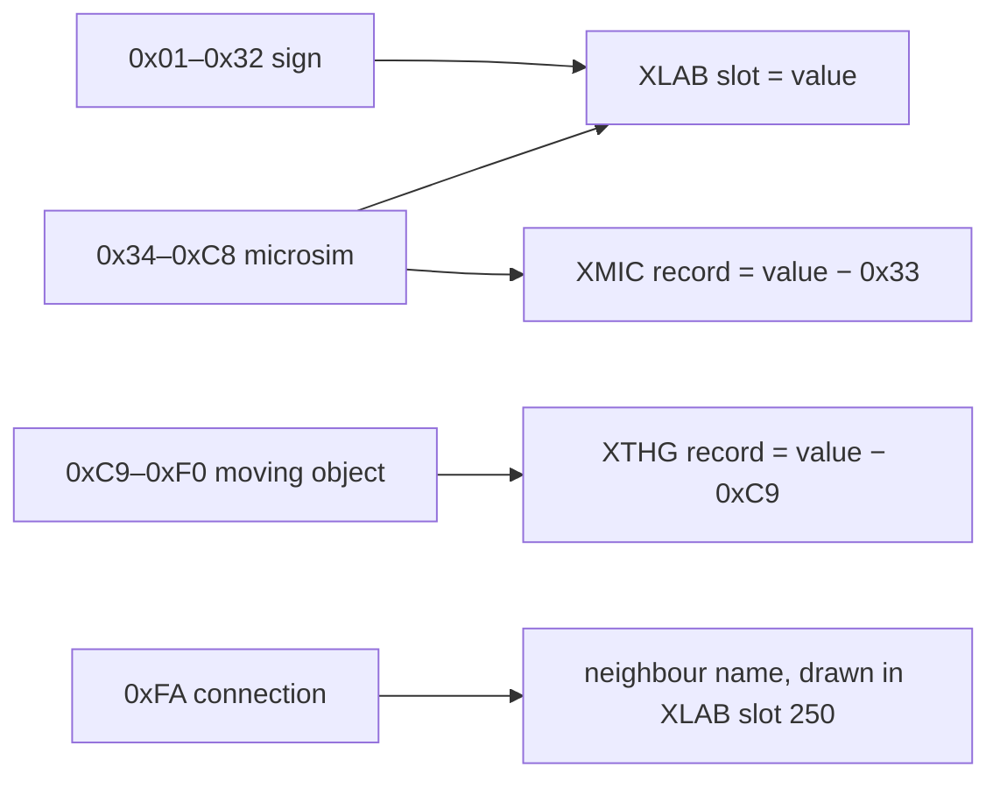

# XTXT: text and object index per tile

One byte per tile. A non-zero value links the tile to **something drawn or named on top of it**: a sign the player placed, the name of a building with its own statistics (a *microsim*), a moving object such as a train, or a connection to a neighbouring city. The value is an **index**. The text itself is in [XLAB](xlab.md), and the details of microsims and moving objects are in [XMIC](xmic.md) and [XTHG](xthg.md).

## At a glance

| | |
|---|---|
| Size | 16384 bytes, 128 × 128 tiles, row by row ([conventions.md](../conventions.md#the-city-map-128--128-tiles)) |
| Storage | RLE-compressed ([compression.md](../compression.md)) |
| Element | 1 byte: an index whose meaning depends on its range ([Values](#values)) |
| Game buffer | `0x4ca600` (128 row pointers) |
| Changes with the compass? | The bytes move with the map, unchanged ([Rotation](#rotation)) |
| Every value | [XTXT text codes](../reference/text-codes-xtxt.md) |

In the corpus, 1 762 462 of the 1 867 776 tiles (94.4%) hold 0.

## Layout

| Bytes | Field | Confidence |
|---|---|---|
| `row * 128 + col` | Index for tile (row, col) | **Confirmed (code)**: renderer `0x43c730` reads it through the row pointers; rotation `0x465490` / `0x466660` moves it like the other maps |

There is no header and no other field. Everything is in the value.

## Values

The ranges below are exact. Each one is backed by the code that writes it ([How the game uses it](#how-the-game-uses-it)) and by the corpus (114 files).

| Value | Meaning | Points to | Tiles / files | Confidence |
|---|---|---|---|---|
| `0x00` | nothing | — | 1 762 462 / 114 | **Confirmed (code)** |
| `0x01`–`0x32` | **sign** placed by the player | XLAB slot = value | 793 / 66 | **Confirmed (code)** sign tool `0x44d7c0`; **Verified (data)** |
| `0x33` | never used | (would be XMIC record 0) | 0 / 0 | **Unused** |
| `0x34`–`0x3C` | **built-in microsim**: a city-wide system such as the bus network or the parks | XMIC record = value − `0x33` (1–9); XLAB slot = value | 30 925 / 100 | **Confirmed (code)** allocator `0x44cf60`; **Verified (data)** |
| `0x3D`–`0xC8` | **microsim** of one building | XMIC record = value − `0x33` (10–149); XLAB slot = value | 71 643 / 104 | **Confirmed (code)** `0x44cf60`; **Verified (data)** |
| `0xC9`–`0xF0` | **moving object** on this tile | XTHG record = value − `0xC9` (0–39) | 1 075 / 92 | **Confirmed (code)** renderer `0x44d9a0`; **Verified (data)** |
| `0xF1`–`0xF9` | never used | — | 0 / 0 | **Unused**: no writer found |
| `0xFA` | **neighbour connection** (road, rail or highway leaving the map) | a neighbour city's name | 878 / 76 | **Confirmed (code)** `0x449bb0`, `0x449f50`, `0x4621f0`; **Verified (data)** |
| `0xFB`–`0xFF` | **disaster markers**, only while a disaster runs | — | 0 / 0 | **Confirmed (code)** `0x45cf10`; **Verified (data)**: never saved |

So for every value from 1 to `0xC8`, **the XLAB slot is the value itself**. The XMIC record is the value − `0x33`, which leaves record 0 and value `0x33` unused.

### Signs: `0x01`–`0x32`

- The player places a sign with the sign tool (`0x44d7c0`). It takes the **first free value from 1 to 50** (`0x44d970`) and stores the text in the XLAB slot with that number (**Confirmed (code)**).
- At most 50 signs: with all 50 in use the tool shows string 263, *"You have 50 signs in your city. This is the upper limit."* (**Confirmed (code)**).
- On a tile whose value is already `0x33` or higher the tool refuses with string 264, *"You can't place a label here at this time"* (**Confirmed (code)**). A sign never covers a microsim, a moving object or a connection.
- Saving an empty text removes the sign (**Confirmed (code)**).
- **Verified (data)**: each sign value is on one tile only, and all 793 sign tiles have a non-empty label. The most signs in one file is 45.

### Built-in microsims: `0x34`–`0x3C`

These nine values belong to **city-wide systems**, not to one building. Every building of that type carries the same value. XMIC records 1–9 hold their statistics and XLAB slots 52–60 their names.

| Value | XMIC record | System | XBLD codes | Tiles / files |
|---|---|---|---|---|
| `0x34` | 1 | bus stations | `0xEC` | 4 416 / 55 |
| `0x35` | 2 | rail stations | `0xED` | 1 428 / 49 |
| `0x36` | 3 | subway stations | `0xE9` | 1 787 / 48 |
| `0x37` | 4 | wind power | `0xC8` | 645 / 33 |
| `0x38` | 5 | hydroelectric power | `0xC6`, `0xC7` | 3 709 / 34 |
| `0x39` | 6 | parks | `0xD5` | 9 441 / 87 |
| `0x3A` | 7 | museums | `0xD4` | 2 818 / 70 |
| `0x3B` | 8 | libraries | `0xF5` | 2 505 / 78 |
| `0x3C` | 9 | marinas | `0xF8` | 4 176 / 73 |

(**Confirmed (code)**: the allocator `0x44cf60` looks the building code up in the table at `0x4e7c9a`. An entry of `0x11` or more means *use the fixed record entry − `0x10`*, which gives records 1–9 for exactly these codes. **Verified (data)**: 98 of the 100 files with these values have them only on the listed codes. The other 2 files also have `0x37` on 9 tiles and `0x39` on 36 tiles of police stations (`0xD2`), which looks like a leftover after rebuilding. Building names: [XBLD tile codes](../reference/tile-codes-xbld.md).)

The delete action (`0x44ced0`) does nothing for these values (**Confirmed (code)**): the system and its name stay even when its last building is gone.

### Microsims: `0x3D`–`0xC8`

A microsim is a building that keeps its own statistics and name: power plants, city hall, hospitals, police and fire stations, schools, stadiums, prisons, colleges, zoos, the statue, the mayor's house, water treatment and desalination plants, the arcologies and the Llama dome (**Confirmed (code)**: the codes whose entry in `0x4e7c9a` is between 1 and `0x10`: `0xC9`–`0xD3`, `0xD6`–`0xDB`, `0xF3`, `0xF4`, `0xFA`–`0xFF`).

- When such a building is placed, `0x44cf60` takes the **first free XMIC record from 10 up**, writes the building code into its byte 0, writes the building's default name into XLAB slot record + `0x33`, and returns record + `0x33`. The caller writes that value into **every tile of the footprint** (**Confirmed (code)**; callers include `0x440c50` and `0x441400`). Default names come from the table at `0x4c6a8a` (25 bytes per building code); names the player chose earlier come from `0x4cde68`. The record's figures are described in [xmic.md](xmic.md).
- **Verified (data)**: each value covers 1, 4, 9 or 16 tiles in a file, the footprint sizes of [xbld.md](xbld.md#footprints-and-anchors).
- **Verified (data)**: 69 296 of the 71 643 tiles (96.7%) sit on the building code stored in byte 0 of their XMIC record. Nearly all the others are on empty land (XBLD `0x00`): stale values left when a building was demolished (1 973 tiles below a former arcology `0xFE`, 297 below a police station `0xD2`, 43 below an arcology `0xFB`). By file: 97/114 match everywhere, 3 have only these leftovers on empty land, 4 have a value on another building.
- **When all 140 records are taken**, placing an arcology takes over the first record whose building is not an arcology (code below `0xFB`) and clears that building's XTXT tiles (**Confirmed (code)**, `0x44cf60`).
- The highest value in the corpus is `0xC8`, record 149, the last one.

### Moving objects: `0xC9`–`0xF0`

The tile holds a vehicle or other moving object from the 40 XTHG records: value − `0xC9` is the record number. The objects are described in [XTHG](xthg.md); the corpus tiles are mostly rails because trains are the most common objects (**Verified (data)**: 588 of 1 119 records). The record keeps the value the marker replaced in its byte 10 and puts it back when the object moves ([xthg.md](xthg.md#the-xtxt-marker)).

- The routines that move these objects write the record number + `0xC9` (in the code: index − `0x37` as a signed byte) on the tile they enter: `0x450690`, `0x452d00`, `0x452fa0`, `0x453280`, `0x453460`, `0x453600`, `0x455500`, `0x45f090`; `0x442a30` writes `0xC9` (**Confirmed (code)**).
- The renderer `0x44d9a0` calls `0x450bb0` with the record number to draw the object (**Confirmed (code)**).
- **Verified (data)**: bytes 3 and 4 of the XTHG record hold the tile's (row, col) for 1 048 of 1 075 tiles; 80 of the 92 files with these values match everywhere. Most of these tiles are rails (`0x2C`, `0x2D`) and empty land. `0xC9` (record 0, the tools' bulldozer cursor) occurs in 1 file.

### Neighbour connections: `0xFA`

When a road, rail or highway is built onto the map edge, the game asks whether to connect it to the neighbouring city and marks the tile with `0xFA` (**Confirmed (code)**):

| Tool | Function | Prompt | Cost | Counter |
|---|---|---|---|---|
| Road | `0x449bb0` | string 109, *"Do you want to build a connection to your neighbor for $1000?"* | $1000 | `0x4cc4d8` |
| Rail | `0x449f50` | string 110 | $1500 | `0x4ca3f0` |
| Highway | `0x4621f0` | string 246 | $1500 | `0x4ca3f0` |

- After loading, `0x434b70` **recounts** the road connections from the `0xFA` tiles that carry a road code (XBLD `0x1D`–`0x2B`, `0x3F`–`0x46`, `0x4B`, `0x4C`, `0x5D`–`0x60`). The stored count is not trusted (**Confirmed (code)**).
- The renderer `0x44d9a0` draws a sign with the neighbour's name ([How the game uses it](#how-the-game-uses-it)).
- **Verified (data)**: 818 of the 878 tiles are on the outermost row or column and the other 60 one tile in (highways, which are 2 × 2). 680 are on roads, 123 on highways, 75 on rails.

### Disaster markers: `0xFB`–`0xFF`

These values exist only while a disaster runs. The dispatcher `0x45cf10` starts the disaster held in `0x4ca420` (MISC word 28 in the file), and `0x45f760` updates the markers every tick (**Confirmed (code)**). None occurs in the corpus (0/114), and none should be written to a file.

| Value | Disaster | Confidence |
|---|---|---|
| `0xFF` | **fire**: spreads to random neighbours, goes out on water; `0x4611e0` turns a burnt tile into rubble | **Confirmed (code)** `0x460e10`, `0x461330`, `0x45e2a0`, `0x483250` |
| `0xFE`, `0xFD` | **riots** (disasters 3 and 13, `0x452fa0`): a front that moves along roads: `0x461140` sets `0xFE` on the next tile and leaves `0xFD` behind; `0x4612d0` clears both | **Confirmed (code)** for the mechanism. OpenCity2k names `0xFD` rioters and `0xFE` rioters of mass riots, which fits |
| `0xFC` | **flood water**: `0x461000` marks dry tiles up to a water level, removes signs and microsims there, and clears XTRF; it recedes on the timer at `0x4c93a8` | **Confirmed (code)** `0x45db00`, `0x45d4e0`, `0x461000`, `0x483250` |
| `0xFB` | **toxic spill** (disasters 4 and 15, `0x452fa0`): an effect on zoned buildings (XBLD `0x70`–`0xC5`) that ends on water | **Confirmed (code)** for the writers `0x45e590`, `0x45d8b0`, `0x45f5c0`, `0x45e2a0`, `0x461190`. The flying rescuer targets `0xFB` for disasters 4 and 15 ([thing-ids-xthg.md](../reference/thing-ids-xthg.md#16-flying-rescuer)) |

`0x461140` and `0x461190` only mark a tile whose value is below `0x33`, so a disaster can **overwrite a sign**. The sign's text stays in XLAB, which explains orphaned sign labels ([xlab.md](xlab.md#pitfalls-for-readers)).

## How the game uses it

| Use | Function | What it does with XTXT |
|---|---|---|
| Drawing | `0x43c730` → `0x44d9a0` | For any non-zero value: draws the sign text (values below `0x33`) or the connection sign (`0xFA`) when labels are switched on (`0x4e9e54`); draws the moving object for `0xC9`–`0xF0` |
| Sign tool | `0x44d7c0`, `0x44d970` | Finds a free value 1–50, refuses on values ≥ `0x33` |
| Delete text | `0x44ced0` | Clears a sign and its label; clears byte 10 of an XTHG record; does nothing for `0x34`–`0x3C` |
| Placing a microsim | `0x44cf60`, callers `0x440c50`, `0x441400` | Returns the value to write over the footprint |
| Connections | `0x449bb0`, `0x449f50`, `0x4621f0`; readers `0x44aed0`, `0x44b3a0`, `0x457620`, `0x462910` | Writes and reads `0xFA` on edge tiles |
| Recount after load | `0x434b70` | Counts road connections from `0xFA` |
| Disasters | `0x45cf10`, `0x45f760` and the writers above | Temporary markers `0xFB`–`0xFF` |
| New city | `0x44cb60` | Clears XTXT, XLAB slots 1–255 and XTHG |

### The connection sign

For an `0xFA` tile the renderer builds a text in **XLAB slot 250**, used as a scratch buffer (**Confirmed (code)**, `0x44d9a0`):

1. The side of the map: col < 2 → 3, row > `0x7D` → 0, col > `0x7D` → 1, row < 2 → 2.
2. The neighbour's name is entry (compass + side) & 3 of the four 32-byte names at `0x4cad58`, cut to 20 characters.
3. A space and the digit `'5'` + (*n* mod 5) are appended, where *n* is taken from the tile's position (giving signs such as "Cats Corner 5" or "Oak Creek 6").

Because the neighbour is chosen with the compass, the same edge shows the same neighbour whichever way the view is turned, as in the Neighbors window ([neighbours.md § Which edge each neighbour is on](misc/neighbours.md#which-edge-each-neighbour-is-on)). The four neighbour names are saved as name ids in MISC ([neighbours.md](misc/neighbours.md#names)).

## Rotation

The rotation routines `0x465490` and `0x466660` move every XTXT byte to its new position **without changing it** (**Confirmed (code)**). The values are indexes, not directions, so normalising a file to compass 0 only needs the array move from [conventions.md](../conventions.md#orientation).

## Evidence

| Claim | Code | Data (`sc2check.py --only xtxt`) |
|---|---|---|
| Ranges as in [Values](#values); `0x33`, `0xF1`–`0xF9`, `0xFB`–`0xFF` never saved | `0x44d7c0`, `0x44cf60`, `0x44d9a0`, `0x45cf10` | 114/114 |
| Sign = XLAB slot, first free 1–50 | `0x44d7c0`, `0x44d970` | 793/793 sign tiles labelled; 66/66 files |
| Built-in microsims on their system's buildings | table `0x4e7c9a` | 98/100 files |
| Microsim value − `0x33` = XMIC record of the building | `0x44cf60` | 69 296 / 71 643 tiles; 97/104 files exact, 3 more with only stale tiles on empty land |
| Moving object at its XTHG record's (row, col) | `0x44d9a0`, movers listed above | 1 048 / 1 075 tiles; 80/92 files |
| `0xFA` within one tile of the edge, on transport | `0x449bb0`, `0x449f50`, `0x4621f0` | 878/878 tiles; 76/76 files |
| Bytes unchanged by rotation | `0x465490`, `0x466660` | — |

## Pitfalls for readers

- **XTXT is not "the label index".** Only values 1–`0xC8` name an XLAB slot. `0xC9`–`0xF0` point into XTHG and `0xFA` to a neighbour name. A reader that looks up every non-zero value in XLAB shows nonsense for trains and connections.
- **A microsim value spans the whole footprint.** Count microsims by distinct value, not by tile.
- **Stale values on empty land.** A demolished microsim can leave its value on bare tiles (3/114 files). Check the XBLD code before trusting it.
- **Moving-object values are a snapshot.** They can disagree with XTHG (27 tiles in 12 files): ships on the map edge, stale fire units, trains ([xthg.md](xthg.md#the-xtxt-marker)). On a marked tile the sign or microsim value is in the record's byte 10.
- **Slot 250 is not a real label.** It holds whichever connection sign was drawn last ([xlab.md](xlab.md#label-slots)).
- **Do not write `0xFB`–`0xFF`.** They only make sense together with a running disaster.
- **`0xFB`–`0xFF` are not the team names.** The teams are XLAB slots 251–255, the same numbers, but no XTXT value points to them ([xlab.md](xlab.md#slots-251255-sports-teams)).
